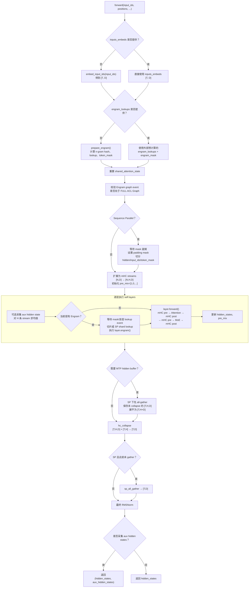
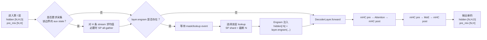
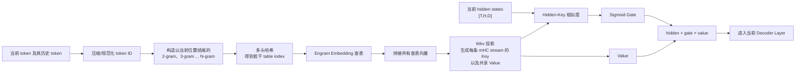
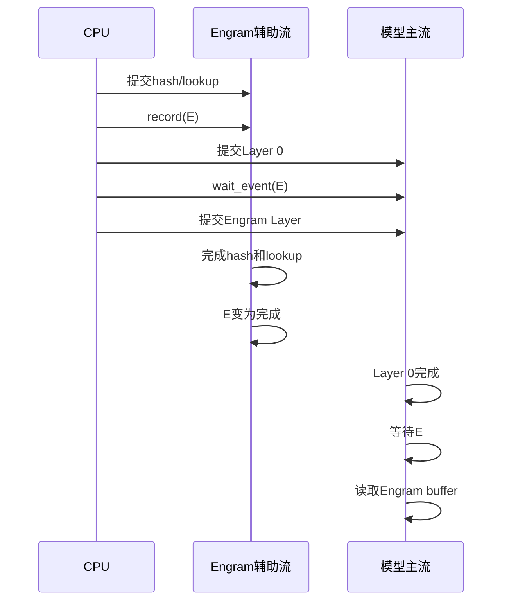
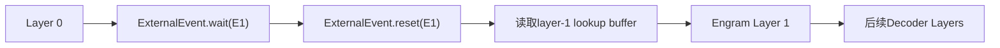
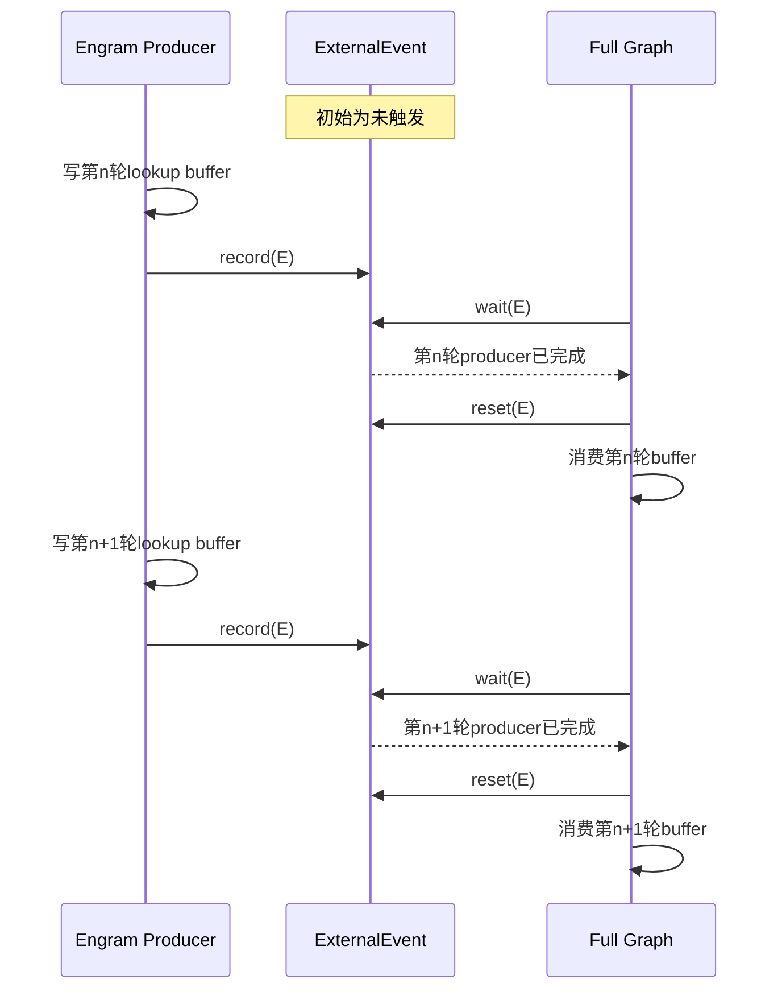
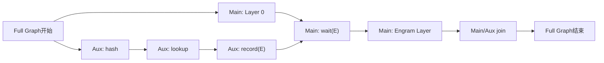

# DeepSeek V4.1-Flash 推理执行过程笔记

> 本文档整理自当前分析任务最近四组已完成问答。问题与回答正文保持原内容，仅增加文档标题、目录和分节标题。

## 目录

1. [DeepSeek V4.1-Flash 第 0–1 层执行逻辑及论文对比](#qa-1)
2. [DeepseekV41Model.forward 执行过程](#qa-2)
3. [Engram 的执行原理](#qa-3)
4. [Eager、Piecewise Graph 与 Full Graph 的 Event 生命周期](#qa-4)

---

<a id="qa-1"></a>

## 问题 1：DeepSeek V4.1-Flash 第 0–1 层执行逻辑及论文对比

### 原问题

请你结合 D:\Code\vllm-ascend\vllm-ascend 和 D:\Code\vllm-github的代码内容，以及论文D:\Code\vllm\_notes\DeepSeekV41-Flash\DeepSeek-V4.1-Flash Pushing the Limits of KV Cache Compression.pdf的内容，回答以下问题。你在回答问题的时候可以辅助进行一些网络知识的搜索，请尽量详细回答，并配合适当举例和图表。我的问题如下：现在 D:\Code\vllm-ascend\vllm-ascend代码中已经完成了 DeepSeek V4.1-Flash的适配，请帮我分析 D:\Code\vllm-ascend\vllm-ascend代码执行DeepSeek V4.1-Flash的 第0-1层的逻辑，解释并且分析其实现过程，并给出和论文实现上的共同点和差异，以及这些差异的分析和差异原因。

### 回答

## 结论先行

这里的“第 0–1 层”应按模型配置的零基编号理解为 `layers.0` 和 `layers.1`。它们是 40 层语言骨干中 causal encoder 的前两层，不是 decoder 的前两层。

这两层的核心特点是：

| 层 | Attention | CSA² 全局 KV | Engram | FFN |
|---|---|---|---|---|
| `layers.0` | 128-token SWA | 无，`compress_ratio=0` | 无 | DeepSeekMoE |
| `layers.1` | 128-token SWA | 无，`compress_ratio=0` | 有，进入该层 mHC/Attention 前注入 | DeepSeekMoE |
| `layers.2` | SWA + CSA² | ratio=2，首个 KV/Indexer source | 无 | DeepSeekMoE |

官方配置明确给出 `num_hidden_layers=40`、`compress_ratios[0:2]=[0,0]`、`kv_source_layer_ids=[2,8,14,20]`、`engram_layer_ids=[1,14]`、`hc_mult=4`、384 个路由专家且每 token 选 6 个专家。[DeepSeek-V4.1-Flash 官方配置](https://huggingface.co/deepseek-ai/DeepSeek-V4.1-Flash/blob/main/config.json)

因此，第 0–1 层的主要任务不是 KV 压缩，而是：

1. 用纯 SWA 构造局部表征；
2. 通过 Single-Pass mHC 在 4 条 residual stream 之间混合；
3. 经过 DeepSeekMoE；
4. 在第 1 层入口注入第一次 Engram 条件记忆；
5. 把处理后的状态交给第 2 层——第 2 层才第一次进入 CSA² ratio=2 的全局压缩路径。

以下是基于：

- vLLM-Ascend：`00627a11a9b7f0f44fce98a6effc7218e65cf1d5`
- 上游 vLLM：`df6c7ad03194a3051a197d57ca4a94e4a063014e`
- 本地论文 :codex-file-citation{path="D:\Code\vllm_notes\DeepSeekV41-Flash\DeepSeek-V4.1-Flash Pushing the Limits of KV Cache Compression.pdf" purpose="source"}

所做的静态源码分析。没有进行 NPU/GPU 数值或性能实测。

---

## 一、论文中的层次定位

论文第 7 页图 3 将语言骨干分为：

```text
40 层语言骨干
├── Causal Encoder：layers.0 ~ layers.19
│   ├── layers.0 ~ 1：纯 SWA
│   ├── layers.2：CSA²(2, Full)
│   ├── layers.3 ~ 7：CSA²(2, Reuse)
│   ├── layers.8：CSA²(2, Full)
│   └── ...
└── Decoder：layers.20 ~ layers.39
    ├── layers.20：CSA²(1, Full)，构造候选池
    ├── layers.24/28/32/36：Reindex
    └── 其余：Reuse
```

论文也明确说明，前两个 encoder layer 仅使用 SWA，而其他层才同时拥有 global attention 和 SWA；这与本地 PDF 第 7 页和论文在线版的架构描述一致。[论文在线版](https://arxiv.org/abs/2609.19969)

所以，分析第 0–1 层时不应把 compressor、Indexer、Top-512、候选池当作实际执行内容。那些结构从第 2 层才出现。

---

## 二、模型进入第 0 层前做了什么

Ascend 在模型级 `forward()` 中先取得 token embedding，然后准备 Engram 查表结果：

- embedding 与 Engram 准备入口：[model.py:1514](D:/Code/vllm-ascend/vllm-ascend/vllm_ascend/models/deepseek_v41/model.py:1514)
- Engram hash 和 lookup：[model.py:1107](D:/Code/vllm-ascend/vllm-ascend/vllm_ascend/models/deepseek_v41/model.py:1107)

设：

- token 数量为 \(T\)；
- hidden size \(D=5120\)；
- mHC stream 数量 \(n=4\)。

embedding 的初始形状是：

\[
E\in\mathbb{R}^{T\times5120}.
\]

Ascend 在模型循环前显式复制为 4 条 residual stream：

```python
hidden_states = hidden_states.unsqueeze(1).repeat(1, self.hc_mult, 1)
pre_mix = zeros([T, 4])
pre_mix[:, 0] = 1
```

对应 [model.py:1560](D:/Code/vllm-ascend/vllm-ascend/vllm_ascend/models/deepseek_v41/model.py:1560)。

于是：

\[
X_0=[E,E,E,E]\in\mathbb{R}^{T\times4\times5120},
\qquad
A_{-1}=[1,0,0,0].
\]

虽然 4 条 stream 初值相同，但 identity `pre_mix` 只选择第 0 条，这是 Single-Pass mHC 的初始边界条件。

---

## 三、Single-Pass mHC 在代码中的含义

论文第 12–13 页将 Single-Pass mHC 写为：

\[
X_{l+1}
=
B_lX_l+C_l\mathcal{F}_l(A_{l-1}X_l),
\]

\[
(A_l,B_l,C_l)=\mathcal{H}(X_l).
\]

重点是当前 block 使用上一 block 生成的 \(A_{l-1}\) 做 input mixing，同时从当前 \(X_l\) 预测新的 \(A_l,B_l,C_l\)。

Ascend 中对应：

- `hc_pre()`：调用 `npu_hc_pre_v3`，完成上一组 `pre_mix` 的 collapse，并预测新的 pre/post/comb；
- `hc_post()`：调用 `npu_hc_post`，把 Attention 或 MoE 输出重新写回 4 条 residual stream；
- 入口与算子：[model.py:852](D:/Code/vllm-ascend/vllm-ascend/vllm_ascend/models/deepseek_v41/model.py:852)
- C++ 绑定：[torch_binding.cpp:1437](D:/Code/vllm-ascend/vllm-ascend/csrc/torch_binding.cpp:1437)、[torch_binding.cpp:1566](D:/Code/vllm-ascend/vllm-ascend/csrc/torch_binding.cpp:1566)

源码测试给出的系数构造近似为：

\[
\begin{aligned}
(\hat A,\hat C,\hat B)&=W_{\mathrm{HC}}\operatorname{RMS}(X),\\
A&=\sigma(s_A\hat A+b_A)+\epsilon,\\
C&=2\sigma(s_C\hat C+b_C),\\
B&=\operatorname{Sinkhorn}(s_B\hat B+b_B).
\end{aligned}
\]

参考实现位于 [deepseek_v41_utils.py:247](D:/Code/vllm-ascend/vllm-ascend/tests/deepseek_v41_utils.py:247)。

`hc_post` 的明确张量方程是：

\[
X'_{t,j,:}
=
C_{t,j}Y_{t,:}
+
\sum_{i=1}^{4}B_{t,i,j}X_{t,i,:},
\]

其中 \(Y\) 是 Attention 或 MoE 输出。测试在 [test_deepseek_v41_hyper_connection.py:199](D:/Code/vllm-ascend/vllm-ascend/tests/ut/models/test_deepseek_v41_hyper_connection.py:199) 验证了这个方程。

---

## 四、第 0 层的完整执行过程

第 0 层进入 `DeepseekV41DecoderLayer.forward()`。虽然类名中有 `DecoderLayer`，它实际上被统一用于 40 个 causal Transformer block，因此 `layers.0` 仍属于 causal encoder。

主逻辑位于 [model.py:887](D:/Code/vllm-ascend/vllm-ascend/vllm_ascend/models/deepseek_v41/model.py:887)。

### 1. Attention 前的 mHC

输入：

```text
hidden_states = X0: [T, 4, 5120]
pre_mix      = [1, 0, 0, 0]: [T, 4]
```

执行：

```python
residual = hidden_states
x, attn_post, attn_comb, attn_pre = hc_pre(
    hidden_states, hc_attn_fn, ..., pre_mix
)
x = input_layernorm(x)
```

输出形状：

| 张量 | 形状 | 含义 |
|---|---:|---|
| `x` | `[T,5120]` | \(A_{-1}X_0\)，Attention 的单流输入 |
| `attn_pre` | `[T,4]` | Attention 子层为下一 FFN 子层生成的 \(A\) |
| `attn_post` | `[T,4]` | Attention 输出写回 4 条 stream 的系数 |
| `attn_comb` | `[T,4,4]` | 4 条 residual stream 之间的传递矩阵 |

### 2. 第 0 层只运行 SWA

层拓扑由 `build_layer_plan()` 从配置构造：[model.py:512](D:/Code/vllm-ascend/vllm-ascend/vllm_ascend/models/deepseek_v41/model.py:512)。

对第 0 层：

```text
compress_ratio     = 0
has_long_context   = False
is_kv_source       = False
is_index_source    = False
```

所以初始化时：

- 不创建 `long_kv_cache`；
- 不创建 compressor；
- 不创建 indexer；
- 只保留本层 SWA cache。

相关分支在 [model.py:682](D:/Code/vllm-ascend/vllm-ascend/vllm_ascend/models/deepseek_v41/model.py:682)。

Attention 投影为：

\[
\begin{aligned}
q_r &= \operatorname{RMSNorm}(W_{q,a}x),\\
Q &= W_{q,b}q_r
    \in\mathbb{R}^{T\times H_{\mathrm{local}}\times512},\\
KV_{\mathrm{SWA}} &= \operatorname{RMSNorm}(W_{kv}x)
    \in\mathbb{R}^{T\times512}.
\end{aligned}
\]

投影参数构造见 [model.py:379](D:/Code/vllm-ascend/vllm-ascend/vllm_ascend/models/deepseek_v41/model.py:379)。

在 Ascend Attention 实现中：

1. `_preprocess()` 计算 Q、KV；
2. KV 写入本层 SWA paged cache；
3. 因为 `has_long_context=False`，`_select_sparse_indices()` 直接返回 `None`；
4. `npu_sparse_flash_mla` 只收到 `ori_kv=SWA cache`；
5. `cmp_kv=None`、`cmp_ratio=0`，因此没有 CSA² global branch。

见：

- Q/KV 和 cache 写入：[dsa_v41.py:391](D:/Code/vllm-ascend/vllm-ascend/vllm_ascend/attention/dsa_v41.py:391)
- 跳过 Indexer：[dsa_v41.py:611](D:/Code/vllm-ascend/vllm-ascend/vllm_ascend/attention/dsa_v41.py:611)
- NPU Attention 调用：[dsa_v41.py:657](D:/Code/vllm-ascend/vllm-ascend/vllm_ascend/attention/dsa_v41.py:657)
- 整体自定义算子边界：[dsa_v41.py:734](D:/Code/vllm-ascend/vllm-ascend/vllm_ascend/attention/dsa_v41.py:734)

Attention 输出经 O projection 恢复到：

\[
Y_0^{\mathrm{attn}}\in\mathbb{R}^{T\times5120}.
\]

随后 `hc_post` 把它扩展并写回 4 条 stream：

\[
X_0^{\mathrm{attn-out}}
=
B_0^{\mathrm{attn}}X_0+
C_0^{\mathrm{attn}}Y_0^{\mathrm{attn}}
\in\mathbb{R}^{T\times4\times5120}.
\]

### 3. 第 0 层 MoE

接着 FFN 子层再次做 Single-Pass mHC：

```python
x, ffn_post, ffn_comb, ffn_pre = hc_pre(
    hidden_states, hc_ffn_fn, ..., attn_pre
)
x, x_fp32 = rms_norm_cast(x)
x = mlp(x, hidden_states_fp32=x_fp32)
hidden_states = hc_post(x, residual, ffn_post, ffn_comb)
```

见 [model.py:912](D:/Code/vllm-ascend/vllm-ascend/vllm_ascend/models/deepseek_v41/model.py:912)。

这里 `attn_pre` 正是 Attention 子层刚生成的系数，即论文中的“使用前一个 block 的 input-mixing coefficient”。

MoE 结构包含：

- 384 个 routed experts；
- 每 token Top-6；
- 1 个 shared expert；
- FP32 router 输入；
- expert 输出乘 `routed_scaling_factor=1.5`。

实现见 [model.py:153](D:/Code/vllm-ascend/vllm-ascend/vllm_ascend/models/deepseek_v41/model.py:153)。

第 0 层最终返回：

```text
X1       = hidden_states: [T,4,5120]
A0_ffn   = ffn_pre:       [T,4]
```

这个 `ffn_pre` 将作为第 1 层 Attention 的 input mix。

---

## 五、第 0 层到第 1 层的真实传递关系

```text
Embedding E [T,5120]
        │
        ▼ broadcast ×4，A-1=[1,0,0,0]
X0 [T,4,5120]
        │
        ├─ Layer 0 Attention hc_pre(A-1)
        │      → RMSNorm → 纯 SWA → hc_post
        │
        ├─ Layer 0 FFN hc_pre(A0_attn)
        │      → RMSNorm/FP32 Router → MoE → hc_post
        │
        ▼
X1 [T,4,5120] + A0_ffn [T,4]
        │
        ├─ Layer 1 Engram 注入
        │      X1' = X1 + gate(X1,Kngram)·Vngram
        │
        ├─ Layer 1 Attention hc_pre(A0_ffn)
        │      → RMSNorm → 纯 SWA → hc_post
        │
        ├─ Layer 1 FFN hc_pre(A1_attn)
        │      → RMSNorm/FP32 Router → MoE → hc_post
        ▼
X2 [T,4,5120] + A1_ffn [T,4]
        │
        ▼
Layer 2：首次进入 CSA²(2, Full)
```

---

## 六、第 1 层相对第 0 层新增的 Engram

官方配置指定：

```json
"engram_layer_ids": [1, 14]
```

因此第 1 层构造 `AscendEngram`，第 0 层不构造。判断见 [model.py:845](D:/Code/vllm-ascend/vllm-ascend/vllm_ascend/models/deepseek_v41/model.py:845)。

### 1. Engram lookup 提前准备

Ascend 在进入层循环以前，为整个 flattened batch：

1. 组合当前 chunk、lookback token 和可选 slot history；
2. 计算 2/3/4-gram hash；
3. 按 8 个 hash head 查 embedding table；
4. 为第 1 层和第 14 层分别准备 lookup rows。

相关逻辑见 [model.py:1125](D:/Code/vllm-ascend/vllm-ascend/vllm_ascend/models/deepseek_v41/model.py:1125) 和 [hash_state.py:65](D:/Code/vllm-ascend/vllm-ascend/vllm_ascend/models/deepseek_v41/engram/hash_state.py:65)。

对图像 sentinel/padding token，mask 会关闭 Engram gate，避免图像 token 参与文本 n-gram；见 [model.py:1172](D:/Code/vllm-ascend/vllm-ascend/vllm_ascend/models/deepseek_v41/model.py:1172)。

### 2. 注入位置

模型循环先检查 `layer.engram`，完成注入后才调用 `layer.forward()`：

```python
hidden_states[:n] = layer.engram(...)
hidden_states, pre_mix = layer(...)
```

见 [model.py:1574](D:/Code/vllm-ascend/vllm-ascend/vllm_ascend/models/deepseek_v41/model.py:1574)。

所以真实顺序是：

```text
第0层 FFN hc_post 完成
→ 第1层 Engram
→ 第1层 Attention hc_pre
```

而不是把 Engram 放在第 1 层 Attention 后面。

### 3. Engram 的张量计算

配置为：

- N-gram order：2、3、4，共 3 个 order；
- 每 order 8 个 head；
- 每 head 256 维；
- lookup 拼接宽度：

\[
3\times 8\times256=6144.
\]

`wkv` 将 6144 维 lookup 投影为：

\[
(4+1)\times5120=25600,
\]

拆成：

- 4 个 key：`[T,4,5120]`；
- 一个共享 value：`[T,5120]`。

实现见 [engram/layer.py:18](D:/Code/vllm-ascend/vllm-ascend/vllm_ascend/models/deepseek_v41/engram/layer.py:18)。

每条 mHC stream 的 gate 是 hidden 与 key 的归一化点积，经 signed-square-root 和 sigmoid：

\[
g_{t,j}
=
\sigma\left(
\operatorname{sign}(s_{t,j})\sqrt{|s_{t,j}|}
\right),
\]

\[
X'_{t,j,:}=X_{t,j,:}+g_{t,j}V_{t,:}.
\]

参考实现见 [engram/common.py:46](D:/Code/vllm-ascend/vllm-ascend/vllm_ascend/models/deepseek_v41/engram/common.py:46)。

因为 Engram 在第 1 层 `hc_pre` 之前注入，所以：

- 第 1 层 Attention 的实际输入包含 Engram value；
- 第 1 层新预测的 mHC 系数也能感知 Engram；
- 但本次 input collapse 使用的仍是第 0 层 FFN 生成的 `ffn_pre`，正好符合 Single-Pass mHC 的 one-block shift。

---

## 七、与论文实现的一致点

| 论文设计 | Ascend 第 0–1 层实现 | 结论 |
|---|---|---|
| 前两个 encoder layer 仅使用 SWA | `compress_ratios[0:2]=0`，无 compressor/indexer/global KV | 完全一致 |
| 每层都有 SWA | 两层都独立写入并读取本层 SWA cache | 一致 |
| 所有 FFN 使用标准 DeepSeekMoE | 两层均实例化 `DeepseekV41MoE` | 一致 |
| mHC 有 4 条 residual stream | `hc_mult=4`，状态为 `[T,4,5120]` | 一致 |
| Single-Pass mHC 使用上一 block 的 input mix | 第 0 层 FFN 接收 `attn_pre`；第 1 层 Attention 接收第 0 层 `ffn_pre` | 一致 |
| Engram 位于第 1、14 层 | `engram_layer_ids=[1,14]` | 一致 |
| Engram 使用 2/3/4-gram、8 heads | hash/embedding layout 直接从配置建立 | 一致 |
| Engram 写入 residual stream 后再进入 Transformer block | 第 1 层调用 `layer.forward()` 前注入 | 一致 |
| CSA² 从第三个 encoder layer 开始 | 第 2 层才是首个 KV/Indexer source | 一致 |

---

## 八、与论文和 CUDA 实现的主要差异

### 1. Ascend 是“层内闭合”，CUDA 是“跨层延迟闭合”

这是第 0→1 层最重要的实现差异。

Ascend：

```text
Layer 0 FFN
→ MoE
→ 立即执行 hc_post
→ 得到完整 X1
→ Engram
→ Layer 1 hc_pre
```

对应 [Ascend model.py:887–928](D:/Code/vllm-ascend/vllm-ascend/vllm_ascend/models/deepseek_v41/model.py:887)。

CUDA：

```text
Layer 0 FFN
→ 返回 MoE 输出 + residual/post_mix/res_mix
→ Layer 1 入口才完成 Layer 0 的 pending hc_post
→ Engram
→ Layer 1 hc_pre
```

CUDA 的延迟状态传递见 [NVIDIA model.py:455](D:/Code/vllm-github/vllm/models/deepseek_v41/nvidia/model.py:455)，第 1 层遇到 Engram 时先物化上一层 post，再注入 Engram，见 [NVIDIA model.py:531](D:/Code/vllm-github/vllm/models/deepseek_v41/nvidia/model.py:531)。

两者语义顺序相同：

\[
\text{Layer0 FFN post}\rightarrow\text{Engram}\rightarrow\text{Layer1 pre}.
\]

差异只是 post 在哪个 Python layer boundary 内完成。

原因是 CUDA 实现希望把：

- 上一子层 `hc_post`；
- 当前子层 `hc_pre`；
- RMSNorm；
- TP all-reduce；
- 必要时 MoE finalize

融合进 `mhc_shifted_post_pre()`，见 [mhc.py:191](D:/Code/vllm-github/vllm/models/deepseek_v41/nvidia/ops/mhc.py:191)。

Ascend 当前则使用：

```text
npu_hc_pre_v3
→ 单独 RMSNorm
→ Attention/MoE
→ npu_hc_post
```

这种“层内闭合”状态更简单，也更适合当前 NPU ACLNN、ACL Graph 和显式 Sequence Parallel 边界，但跨层融合程度低于 CUDA 路径。

### 2. 论文中的 Mega-mHC 与 Ascend 算子边界不完全相同

论文第 13 页说明，部署时的 Mega-mHC 会把 residual update、input mixing、coefficient prediction、pre-norm 和 FP8 conversion 尽量合并成单 kernel。

Ascend 在数学上实现了 Single-Pass mHC，但当前源码仍是：

- `npu_hc_pre_v3`；
- 独立 `input_layernorm` 或 `rms_norm_cast`；
- Attention/MoE；
- `npu_hc_post`。

因此应区分：

- **算法语义：一致**；
- **论文所述 Mega-mHC kernel 数量和访存下界：不能直接认为已经等价实现**。

这主要是硬件算子生态与通信调度不同造成的。是否因此有性能差距，需要 NPU profiler，而不能从 Python 调用数直接得出。

### 3. Attention kernel 不同，但第 0–1 层语义一致

CUDA 的公共 Attention 类同样把 `compress_ratio=0` 定义为纯 SWA，并只让 KV source layer 拥有 compressed cache，见 [attention.py:303](D:/Code/vllm-github/vllm/models/deepseek_v41/attention.py:303)。

平台侧差异：

| CUDA | Ascend |
|---|---|
| FlashMLA/FlashInfer/MegaAttention backend | `npu_sparse_flash_mla` |
| CUDA fused QNorm/RoPE/KV insert | NPU projection、RoPE、paged-cache write |
| 可融合 GEMM-RS | 显式 `sp_reduce_scatter` |
| ratio=0 走 SWA-only backend | `cmp_kv=None, cmp_ratio=0` |

原因是底层 kernel、KV cache layout、量化格式和通信原语不同，不是模型结构不同。

### 4. Engram 调度归属不同

CUDA 把 Engram 放在 `DeepseekV4DecoderLayer.forward()` 内；Ascend 把它放在模型循环中。

Ascend 这样做便于：

- 在进入层循环前批量完成 hash 和 embedding lookup；
- 对 CPU-offload/DP/TP lookup 做通信；
- 用 NPU event 与第 0 层计算重叠；
- 为 ACL Graph 提供固定 lookup buffer 地址。

因此这是调度与图捕获设计差异，不是论文语义差异。

### 5. Engram 存储精度存在硬件适配分支

论文描述 Engram embedding table 和 key/value projection 使用 FP8。

Ascend 会根据 checkpoint 和硬件能力选择：

- 原生 MXFP8；
- `int8` fallback；
- 无量化时 BF16。

见 [model.py:1028](D:/Code/vllm-ascend/vllm-ascend/vllm_ascend/models/deepseek_v41/model.py:1028)。

这是为了适配不同 Ascend 硬件能力和 checkpoint 布局。逻辑上的 hash、lookup、key/value projection 和 gate 保持一致，但物理存储格式不一定与论文部署栈完全相同。

### 6. 论文的 FP4 global KV 不适用于第 0–1 层

论文强调 CSA² global KV 使用 FP4，但第 0–1 层根本没有 global KV。它们只拥有 SWA KV，具体 cache dtype 由 vLLM runtime cache 配置决定，见 [model.py:629](D:/Code/vllm-ascend/vllm-ascend/vllm_ascend/models/deepseek_v41/model.py:629)。

所以不能说“第 0–1 层也执行 FP4 CSA² KV cache”。这是架构层次上常见的误读。

---

## 九、Prefill 与 Decode 时第 0–1 层是否不同

模型计算公式相同，差异主要来自 Attention metadata 和 cache 状态：

### Prefill

- prompt token 全部经过 causal encoder 的第 0–1 层；
- SWA 对每个 token 仅保留因果可见且位于最近 128 token 内的位置；
- Engram hash 会组合当前 chunk 与 lookback history；
- 第 1 层为有效文本 token 注入 Engram。

### Decode

- 每个新 token 仍会经过第 0、1 层；
- Q 长度通常为 1 或 speculative batch 长度；
- SWA cache 读取最近最多 128 个 token；
- Engram 根据最新的 2/3/4-gram history 查表；
- 之后该 token 继续经过第 2–39 层。

CED 使大部分 prompt token 能绕过完整 decoder 计算，但这不是第 0–1 层内部的条件分支。第 0–1 层属于 causal encoder，本身始终承担 prompt 的初始局部编码。论文对此描述为 decoder global KV 从 encoder 输出构造，使多数 prompt token 不必完整经过 decoder。[论文在线版](https://arxiv.org/abs/2609.19969)

---

## 十、最终判断

从当前 Ascend 源码看，第 0–1 层对论文结构的落地是完整而清晰的：

1. 两层正确识别为纯 SWA，而不是 CSA²；
2. 四路 mHC stream 和 shifted `pre_mix` 正确跨 Attention、FFN 和层边界传递；
3. 第 0 层 FFN 输出先闭合；
4. 第 1 层入口准确注入 Engram；
5. Engram 注入后的状态参与第 1 层 mHC 系数预测和 Attention；
6. 两层均使用标准 DeepSeekMoE；
7. 第 1 层输出才交给首个 CSA² Full layer——`layers.2`。

最主要的“差异”不是模型数学，而是平台实现策略：

- Ascend：层内闭合、显式 HC pre/post、NPU 稀疏 MLA、自定义 cache/graph/event 调度；
- CUDA：跨层 pending post、shifted post/pre 融合、MoE 延迟 finalize、可融合 GEMM-RS；
- 论文：描述 Single-Pass mHC、Mega-mHC、Engram 和 CSA² 的目标算法与官方部署设计，不规定 vLLM-Ascend 必须复制 CUDA 的 kernel boundary。

另外，`D:\Code\vllm-github` 当前工作树有一处用户未提交修改：`common/engram.py:1513` 将 `Engram` 临时重命名成 `EngramEngram`，可能破坏 `model.py` 的导入。上面的 CUDA 对照使用该仓库当前 `HEAD` 中原本的 `Engram` 语义，没有把这处本地修改当作架构差异。

- :codex-followup[继续分析第 2–8 层 CSA²]{prompt="继续结合论文与两份代码，详细分析 DeepSeek-V4.1-Flash 第2到第8层的 CSA2 Full/Reuse、KV压缩和跨层复用流程。"}
- :codex-followup[绘制完整 40 层拓扑]{prompt="根据官方配置和当前源码，绘制 DeepSeek-V4.1-Flash 40层的逐层拓扑表，标出 Encoder/Decoder、SWA、Full、Reindex、Reuse、KV source、Indexer source 和 Engram。"}
- :codex-followup[设计 NPU 运行时验证]{prompt="为第0到第1层设计一套 Ascend NPU 运行时验证方案，包括张量hook、shape、mHC系数、Engram gate、SWA cache、数值误差和Profiler采集点。"}

<oai-mem-citation>
<citation_entries>
rollout_summaries/2026-10-12T06-41-40-jhtx-deepseek_v41_decoder_layer_forward_cuda_ascend_comparison.md:21-35|note=[used prior source boundary comparison and reverified against current commits]
MEMORY.md:33-58|note=[used comparison structure and static evidence cautions]
</citation_entries>
<rollout_ids>
01a12ed8-77d3-7fb0-a807-27d0d64b1603
</rollout_ids>
</oai-mem-citation>

---

<a id="qa-2"></a>

## 问题 2：DeepseekV41Model.forward 执行过程

### 原问题

请给出vllm\_ascend.models.deepseek\_v41.model.DeepseekV41Model.forward方法的执行过程。最好可以画图。

### 回答

下面按当前代码快照分析：

- vLLM-Ascend：`D:\Code\vllm-ascend\vllm-ascend`
- 当前提交：`00627a11a9b7f0f44fce98a6effc7218e65cf1d5`
- 目标方法：[DeepseekV41Model.forward](D:/Code/vllm-ascend/vllm-ascend/vllm_ascend/models/deepseek_v41/model.py:1514)

先给出结论：`DeepseekV41Model.forward` 不是普通的“Embedding → N 个 Transformer Layer → Norm”。它还负责：

1. 准备或接收 Engram 查表结果；
2. 处理 Engram 异步流水和图执行事件；
3. Sequence Parallel 切分与恢复；
4. 把每个 token 从一条 hidden state 扩展为 `hc_mult` 条 mHC stream；
5. 在每层之前选择性注入 Engram；
6. 在所有层结束后执行 mHC collapse；
7. 可选保存未 collapse 的 hidden states，供 MTP/推测解码使用；
8. 可选返回中间层 hidden states。

---

# 1. 整体执行流程图



其中：

- `T`：本次 forward 的总 token 数；
- `N`：Sequence Parallel 切分后的本地 token 数；未开启 SP 时 `N=T`；
- `D`：`hidden_size`；
- `H`：`hc_mult`，即每个 token 的 mHC stream 数。

---

# 2. 方法输入和输出

方法签名位于 [model.py:1514-1525](D:/Code/vllm-ascend/vllm-ascend/vllm_ascend/models/deepseek_v41/model.py:1514)：

```python
def forward(
    self,
    input_ids,
    positions,
    intermediate_tensors,
    inputs_embeds=None,
    engram_lookups=None,
    engram_mask=None,
    engram_pending=None,
    engram_graph_events=False,
    lookback_token_ids=None,
    engram_mask_ready_event=None,
):
```

主要参数含义如下。

| 参数 | 作用 |
|---|---|
| `input_ids` | 当前批次 token ID；除 Embedding 外，Engram、MoE 等路径也可能需要 |
| `positions` | token 位置，Attention/RoPE 等模块使用 |
| `intermediate_tensors` | 保留给流水并行接口；这个方法当前实现中没有直接读取 |
| `inputs_embeds` | 可选的预计算 Embedding，提供后跳过 `embed_input_ids()` |
| `engram_lookups` | 可选的外部 Engram 查表结果，通常用于提前/异步准备 |
| `engram_mask` | 表示哪些 token 的 Engram 特征有效 |
| `engram_pending` | 各 Engram 层异步查表完成事件 |
| `engram_graph_events` | 事件是否属于完整 ACL Graph 捕获路径 |
| `lookback_token_ids` | 当前 chunk 之前的历史 token，用于构造跨 chunk n-gram |
| `engram_mask_ready_event` | Engram mask 的异步就绪事件 |

输出有两种形式：

```python
hidden_states
```

或者：

```python
(hidden_states, aux_hidden_states)
```

最终 `hidden_states` 的逻辑形状为：

```text
[T, hidden_size]
```

这里并不计算 LM Head 或最终 logits。Logits 由外层 `AscendDeepseekV41LLMForCausalLM` 后续处理。外层转发入口可见 [model.py:1705-1743](D:/Code/vllm-ascend/vllm-ascend/vllm_ascend/models/deepseek_v41/model.py:1705)。

---

# 3. 第一阶段：准备输入 Embedding

代码位于 [model.py:1527-1528](D:/Code/vllm-ascend/vllm-ascend/vllm_ascend/models/deepseek_v41/model.py:1527)：

```python
use_sequence_parallel = getattr(
    self, "use_sequence_parallel", False
)

hidden_states = (
    inputs_embeds
    if inputs_embeds is not None
    else self.embed_input_ids(input_ids)
)
```

逻辑是：

```text
inputs_embeds 已提供
    → 直接采用
否则
    → self.embed_input_ids(input_ids)
```

`embed_input_ids()` 位于 [model.py:1104-1105](D:/Code/vllm-ascend/vllm-ascend/vllm_ascend/models/deepseek_v41/model.py:1104)，本质上调用模型的 token embedding。

初始张量形状为：

```text
input_ids:     [T]
hidden_states: [T, D]
positions:     [T]
```

即使传入了 `inputs_embeds`，`input_ids` 仍不能简单视为无用，因为后续 Engram 或 MoE 路径仍可能使用原始 token ID。

---

# 4. 第二阶段：准备 Engram 输入

代码位于 [model.py:1529-1532](D:/Code/vllm-ascend/vllm-ascend/vllm_ascend/models/deepseek_v41/model.py:1529)：

```python
if engram_lookups is None:
    lookups, token_mask = self.prepare_engram(
        input_ids,
        positions,
        lookback_token_ids=lookback_token_ids,
    )
else:
    lookups, token_mask = engram_lookups, engram_mask
```

这里有两条路径。

## 4.1 forward 内同步准备

如果调用方没有提供 `engram_lookups`，则执行：

```python
self.prepare_engram(...)
```

`prepare_engram()` 的入口位于 [model.py:1107](D:/Code/vllm-ascend/vllm-ascend/vllm_ascend/models/deepseek_v41/model.py:1107)。

其核心任务可以概括为：

```text
input_ids + lookback_token_ids
        ↓
构造跨 chunk 的 token 历史
        ↓
计算不同 n-gram 的 hash
        ↓
按照 hash 查 Engram embedding table
        ↓
为每个配置了 Engram 的层生成 lookup tensor
        ↓
生成 token_mask，标识哪些 token 的 n-gram 有效
```

输出大致为：

```text
lookups = {
    layer_idx_1: [T, E],
    layer_idx_2: [T, E],
    ...
}

token_mask: [T]，bool
```

其中 `E` 是该 Engram 层对应的特征维度。

## 4.2 使用外部异步准备结果

如果调用方已经提前计算了 Engram lookup，forward 直接使用：

```python
lookups, token_mask = engram_lookups, engram_mask
```

这样做的目的，是让 Engram 的 hash/查表与模型早期层计算重叠：

```text
Engram stream:  hash → layer-1 lookup → layer-14 lookup
                        │                  │
Main stream:    layer-0 ├→ layer-1 ...────├→ layer-14
```

调用契约上，`engram_lookups` 和 `engram_mask` 应当成对提供。否则后面执行 `token_mask[:full_num_tokens]` 时会出错。

---

# 5. 第三阶段：重置共享 Attention 状态

代码位于 [model.py:1533](D:/Code/vllm-ascend/vllm-ascend/vllm_ascend/models/deepseek_v41/model.py:1533)：

```python
self.shared_attention_state.reset()
```

`shared_attention_state` 在模型初始化阶段建立，参见 [model.py:1000-1025](D:/Code/vllm-ascend/vllm-ascend/vllm_ascend/models/deepseek_v41/model.py:1000)。

它用于在相关层之间共享或复用一些 Attention 路由状态，例如候选索引、top-k 信息或中间缓冲区。

这里的“reset”主要表达一个新的 model forward 开始了。当前实现为了保持 ACL Graph 中缓冲区地址固定，并不一定对所有底层存储执行实际清零；有效行一般会由对应生产层覆盖。

---

# 6. 第四阶段：处理 Engram 图事件

总 token 数由 [model.py:1534](D:/Code/vllm-ascend/vllm-ascend/vllm_ascend/models/deepseek_v41/model.py:1534) 得到：

```python
full_num_tokens = positions.shape[0]
```

随后在 [model.py:1538-1543](D:/Code/vllm-ascend/vllm-ascend/vllm_ascend/models/deepseek_v41/model.py:1538) 检查：

```python
if engram_graph_events and not (
    is_forward_context_available()
    and get_forward_context().cudagraph_runtime_mode
    == CUDAGraphMode.FULL
):
    engram_pending = None
    engram_graph_events = False
    engram_mask_ready_event = None
```

含义是：只有完整 ACL Graph 运行模式，才能把这些事件视为已捕获、可安全复用的图内同步关系。

若不是 `CUDAGraphMode.FULL`：

- 清除 `engram_pending`；
- 关闭 `engram_graph_events`；
- 清除 `engram_mask_ready_event`。

这是因为 eager、piecewise graph 和 full graph 的事件生命周期不同。不能把完整图捕获中生成的 event 语义直接套到其他执行模式。

接着裁剪图缓冲区的容量维度，见 [model.py:1548-1549](D:/Code/vllm-ascend/vllm-ascend/vllm_ascend/models/deepseek_v41/model.py:1548)：

```python
token_mask = token_mask[:full_num_tokens]
lookups = {
    layer_idx: lookup[:full_num_tokens]
    for layer_idx, lookup in lookups.items()
}
```

ACL Graph 通常使用固定容量 buffer，例如容量是 4096，但本轮只有 37 个 token：

```text
图缓冲区容量： [4096, E]
本轮有效区域： [37, E]
实际使用：     lookup[:37]
```

---

# 7. 第五阶段：Sequence Parallel 切分

代码位于 [model.py:1544-1559](D:/Code/vllm-ascend/vllm-ascend/vllm_ascend/models/deepseek_v41/model.py:1544)。

## 7.1 为什么要先等待 Engram mask

开启 Sequence Parallel 且 `engram_mask_ready_event` 存在时：

```python
AscendParallelEngramEmbedding.wait_lookup(...)
engram_mask_ready_event = None
```

原因是马上要对 `token_mask` 做 `sp_shard()`。如果 mask 仍由异步 Engram stream 写入，主 stream 此时切分它会产生数据依赖问题。

未开启 SP 时，可以把 mask 的等待推迟到第一个真正使用 Engram 的层，从而让 Engram 准备继续与前面几层计算重叠。

## 7.2 MoE padding mask

当开启 `VLLM_MOE_SKIP_PADDING` 时，代码为 forward context 设置：

```python
forward_context.is_padding = sp_padding_mask(...)
```

这样 MoE 在 Sequence Parallel 补齐 token 数时，可以跳过 padding token，避免把填充位置送入专家计算。

## 7.3 对输入进行 token 维切分

```python
hidden_states = sp_shard(hidden_states)
input_ids = sp_shard(input_ids)
token_mask = sp_shard(token_mask)
```

假设：

```text
T = 8
SP size = 2
```

则可能变为：

```text
rank 0:
    hidden_states [4,D]
    input_ids     [4]
    token_mask    [4]

rank 1:
    hidden_states [4,D]
    input_ids     [4]
    token_mask    [4]
```

因此后续用：

```text
N = hidden_states.shape[0]
```

表示当前 rank 的本地 token 数。

注意 `lookups` 此处没有统一提前 shard，而是在对应 Engram 层即将消费时才切分，减少不必要的提前通信或数据处理。

---

# 8. 第六阶段：建立 mHC 多流表示

这是整个方法最关键的步骤之一，代码位于 [model.py:1560-1562](D:/Code/vllm-ascend/vllm-ascend/vllm_ascend/models/deepseek_v41/model.py:1560)：

```python
hidden_states = hidden_states.unsqueeze(1).repeat(
    1, self.hc_mult, 1
)

pre_mix = torch.zeros(
    hidden_states.shape[:2],
    dtype=torch.float32,
    device=hidden_states.device,
)
pre_mix[:, 0] = 1
```

假设：

```text
hidden_states 原形状 = [N,D]
hc_mult = H = 4
```

扩展后：

```text
[N,D]
  ↓ unsqueeze(1)
[N,1,D]
  ↓ repeat(1,4,1)
[N,4,D]
```

此时每个 token 的同一初始 hidden state 被复制为 4 条 mHC stream：

```text
token i:
    stream 0: xᵢ
    stream 1: xᵢ
    stream 2: xᵢ
    stream 3: xᵢ
```

同时建立：

```text
pre_mix[i] = [1,0,0,0]
```

`pre_mix` 使用 FP32，形状为：

```text
[N,H]
```

它不是 hidden state，而是后续 mHC collapse 使用的混合权重。初始只有第一条 stream 有效；经过每层的 hyper-connection 计算后，权重和各 stream 内容会被持续更新。

---

# 9. 第七阶段：逐层执行

主循环位于 [model.py:1563-1601](D:/Code/vllm-ascend/vllm-ascend/vllm_ascend/models/deepseek_v41/model.py:1563)：

```python
last_layer = None
aux_hidden_states = []

for layer in self.layers:
    last_layer = layer
    ...
    hidden_states, pre_mix = layer(
        positions,
        hidden_states,
        pre_mix,
        None,
        input_ids=input_ids,
    )
```

循环内部可分成三个部分：



## 9.1 可选采集辅助 hidden states

代码位于 [model.py:1569-1573](D:/Code/vllm-ascend/vllm-ascend/vllm_ascend/models/deepseek_v41/model.py:1569)：

```python
if layer.layer_idx + 1 in self.aux_hidden_state_layers:
    aux_hidden_state = hidden_states.mean(dim=1)

    if use_sequence_parallel:
        aux_hidden_state = sp_all_gather(
            aux_hidden_state, dim=0
        )[:full_num_tokens]

    aux_hidden_states.append(aux_hidden_state)
```

有三个细节。

第一，采集发生在当前层执行之前。因此它表示的是某个 layer boundary 的输入状态，而不是当前层执行完成后的输出。

第二，内部 mHC 状态是：

```text
[N,H,D]
```

辅助状态使用简单平均：

\[
h_i^{aux}
=
\frac{1}{H}\sum_{k=1}^{H}h_{i,k}
\]

得到：

```text
[N,D]
```

第三，配置判断使用：

```python
layer.layer_idx + 1
```

说明外部的辅助层编号按一基计数，而内部 `layer_idx` 按零基计数。

如果开启 SP，则立即 all-gather，使保存的辅助状态恢复为完整 token 序列：

```text
[T,D]
```

## 9.2 在指定层前注入 Engram

代码位于 [model.py:1574-1599](D:/Code/vllm-ascend/vllm-ascend/vllm_ascend/models/deepseek_v41/model.py:1574)。

只有当前层具有 Engram 模块，并且 mask 非空时才执行：

```python
if layer.engram is not None and token_mask.numel():
```

### 等待全局 mask

如果 `engram_mask_ready_event` 还没被等待：

```python
AscendParallelEngramEmbedding.wait_lookup(...)
engram_mask_ready_event = None
```

这通常发生在未开启 SP 的路径，因为 SP 路径在切分 mask 前已经等待过。

### 等待当前层 lookup

如果 lookup 是异步准备的：

```python
if (
    engram_pending is not None
    and layer.layer_idx in engram_pending
):
    AscendParallelEngramEmbedding.wait_lookup(
        engram_pending[layer.layer_idx],
        external=engram_graph_events,
    )
```

它只等待当前即将消费的那一层，而不是在 forward 开头等待所有 Engram 查表完成。

例如 Engram 位于第 1 层和第 14 层：

```text
主计算 stream: layer 0 ──wait lookup1── layer 1 ... layer 13 ──wait lookup14── layer 14
Engram stream: hash ───── lookup1 ─────────────── lookup14
```

这使第 14 层的 lookup 可以与第 1～13 层计算重叠。

### 对 lookup 做本地化

代码为：

```python
n = hidden_states.shape[0]
lookup = lookups[layer.layer_idx]

if use_sequence_parallel:
    lookup = sp_shard(lookup)

lookup = lookup[:n]
active_mask = token_mask[:n]
```

得到：

```text
lookup:      [N,E]
active_mask: [N]
```

然后执行：

```python
hidden_states[:n] = layer.engram(
    hidden_states[:n],
    lookup,
    active_mask,
    self.engram_rotation if self.engram_rotated else None,
)
```

可以抽象为：

\[
X_l'
=
\operatorname{Engram}
\left(
X_l,\,
E_l,\,
M,\,
R
\right)
\]

其中：

- \(X_l\)：当前 mHC hidden states；
- \(E_l\)：当前层查到的 Engram embedding；
- \(M\)：有效 token mask；
- \(R\)：可选 Engram rotation。

Engram 是在该层 Attention/MoE 之前注入的。

## 9.3 调用 DecoderLayer.forward

代码位于 [model.py:1601](D:/Code/vllm-ascend/vllm-ascend/vllm_ascend/models/deepseek_v41/model.py:1601)：

```python
hidden_states, pre_mix = layer(
    positions,
    hidden_states,
    pre_mix,
    None,
    input_ids=input_ids,
)
```

这里传入：

```text
hidden_states: [N,H,D]
pre_mix:       [N,H]
positions:     [T]
input_ids:     [N]（SP 开启时）或 [T]
```

对应 `DeepseekV41DecoderLayer.forward` 的主体位于 [model.py:887-928](D:/Code/vllm-ascend/vllm-ascend/vllm_ascend/models/deepseek_v41/model.py:887)，一层内部大致是：

```text
输入 [N,H,D]
   │
   ├─ mHC pre mixing
   │
   ├─ input RMSNorm
   │
   ├─ Sequence Parallel all-gather（如需要）
   │
   ├─ Self Attention
   │
   ├─ Sequence Parallel reduce-scatter（如需要）
   │
   ├─ mHC post
   │
   ├─ mHC pre mixing
   │
   ├─ RMSNorm / dtype cast
   │
   ├─ MoE
   │
   └─ mHC post
        ↓
输出 hidden_states [N,H,D]
输出 pre_mix      [N,H]
```

因此 `DeepseekV41Model.forward` 的循环并不会在每层结束后把多条 mHC stream collapse 成一条。多流状态一直保留到最后一层结束。

---

# 10. 第八阶段：保存 MTP 未折叠状态

代码位于 [model.py:1604-1610](D:/Code/vllm-ascend/vllm-ascend/vllm_ascend/models/deepseek_v41/model.py:1604)：

```python
if self._mtp_hidden_buffer is not None:
    if use_sequence_parallel:
        hidden_states = sp_all_gather(
            hidden_states, dim=0
        )[:full_num_tokens]

        pre_mix = sp_all_gather(
            pre_mix, dim=0
        )[:full_num_tokens]

    num_tokens = hidden_states.shape[0]

    self._mtp_hidden_buffer[:num_tokens].copy_(
        hidden_states.flatten(1)
    )
```

`_mtp_hidden_buffer` 在模型初始化时根据推测解码配置创建，参见 [model.py:984-996](D:/Code/vllm-ascend/vllm-ascend/vllm_ascend/models/deepseek_v41/model.py:984)。

这里保存的不是最终 collapse 后的 `[T,D]`，而是完整 mHC 状态：

```text
hidden_states: [T,H,D]
flatten(1):    [T,H×D]
```

例如：

```text
T = 32
H = 4
D = 7168
```

则保存为：

```text
[32, 4×7168] = [32,28672]
```

这样 MTP、Eagle 或 DSpark 等推测模块能够访问所有 mHC stream，而不是只能看到 collapse 后的信息。

如果开启 SP，此时必须先恢复完整 token 维：

```text
各 rank 的 [N,H,D]
    ↓ sp_all_gather
完整 [T,H,D]
    ↓ flatten
[T,H×D]
```

同时也 gather `pre_mix`，供后面的 collapse 使用。

---

# 11. 第九阶段：mHC collapse

代码位于 [model.py:1611](D:/Code/vllm-ascend/vllm-ascend/vllm_ascend/models/deepseek_v41/model.py:1611)：

```python
hidden_states = last_layer.hc_collapse(
    hidden_states,
    pre_mix,
)
```

`hc_collapse` 位于 [model.py:862-864](D:/Code/vllm-ascend/vllm-ascend/vllm_ascend/models/deepseek_v41/model.py:862)：

```python
return (
    pre_mix.unsqueeze(-1) * x.float()
).sum(-2).to(x.dtype)
```

其数学形式是：

\[
h_i
=
\sum_{k=1}^{H}
\alpha_{i,k}
x_{i,k}
\]

其中：

- \(x_{i,k}\in\mathbb{R}^{D}\)：token \(i\) 的第 \(k\) 条 mHC stream；
- \(\alpha_{i,k}\)：`pre_mix[i,k]`；
- \(h_i\in\mathbb{R}^{D}\)：collapse 后的单条 hidden state。

形状变化：

```text
hidden_states: [T,H,D]
pre_mix:       [T,H]
                     │
                     ▼
pre_mix.unsqueeze: [T,H,1]
逐元素乘法:       [T,H,D]
沿 H 维求和:      [T,D]
```

例如某个 token 有 4 条 stream：

```text
pre_mix = [0.1, 0.2, 0.3, 0.4]
```

则：

\[
h
=
0.1x_0+0.2x_1+0.3x_2+0.4x_3
\]

乘加过程先转 FP32：

```python
x.float()
```

累加完成后再转换回 `x.dtype`，这样可以降低 BF16/FP16 多路累加的精度损失。

这里通过 `last_layer.hc_collapse` 调用，但 collapse 操作本身不依赖最后一层动态状态；主要是复用该层中已经构造的 mHC collapse 模块。

代码随后断言模型至少有一个本地 layer：

```python
assert last_layer is not None
```

见 [model.py:1602](D:/Code/vllm-ascend/vllm-ascend/vllm_ascend/models/deepseek_v41/model.py:1602)。

---

# 12. 第十阶段：恢复完整 token 序列

代码位于 [model.py:1612-1613](D:/Code/vllm-ascend/vllm-ascend/vllm_ascend/models/deepseek_v41/model.py:1612)：

```python
if (
    use_sequence_parallel
    and self._mtp_hidden_buffer is None
):
    hidden_states = sp_all_gather(
        hidden_states, dim=0
    )[:full_num_tokens]
```

为什么仅在 `_mtp_hidden_buffer is None` 时 gather？

因为存在 MTP buffer 时，前面为了保存 `[T,H,D]` 已经执行过一次 gather：

```text
SP + MTP:
    gather [N,H,D] → [T,H,D]
    保存 MTP
    collapse → [T,D]
```

没有 MTP buffer 时，则先 collapse 再 gather：

```text
SP + 无 MTP:
    本地 collapse [N,H,D] → [N,D]
    gather → [T,D]
```

后一种方式通信量更小。假设 `H=4`：

```text
collapse 前 gather：[T,4,D]
collapse 后 gather：[T,D]
```

因此，当 MTP 不需要完整多流状态时，代码尽量把 all-gather 推迟到 collapse 之后，将通信量大致降低为原来的 `1/H`。

---

# 13. 第十一阶段：最终 RMSNorm 与返回

代码位于 [model.py:1614-1617](D:/Code/vllm-ascend/vllm-ascend/vllm_ascend/models/deepseek_v41/model.py:1614)：

```python
hidden_states = self.norm(hidden_states)

if aux_hidden_states:
    return hidden_states, aux_hidden_states

return hidden_states
```

最终流程为：

```text
[T,H,D]
    ↓ hc_collapse
[T,D]
    ↓ SP all-gather（如需要）
[T,D]
    ↓ final RMSNorm
[T,D]
```

如果采集过中间层状态：

```python
return hidden_states, aux_hidden_states
```

否则：

```python
return hidden_states
```

注意最终返回的仍然是模型 hidden states，不是 vocabulary logits。

---

# 14. 用一个具体例子串起来

假设：

```text
当前总 token 数 T = 8
hidden_size D = 7168
hc_mult H = 4
SP size = 2
Engram 层 = {1,14}
需要保存 MTP hidden buffer
```

那么一个 rank 上的主要形状变化如下。

| 阶段 | 张量形状 |
|---|---|
| Embedding 后 | `[8,7168]` |
| SP shard 后 | `[4,7168]` |
| mHC 扩展后 | `[4,4,7168]` |
| `pre_mix` | `[4,4]` |
| 每个 DecoderLayer 后 | `[4,4,7168]` |
| MTP 前 SP gather | `[8,4,7168]` |
| MTP flatten buffer | `[8,28672]` |
| mHC collapse 后 | `[8,7168]` |
| final RMSNorm 后 | `[8,7168]` |

执行顺序近似为：

```text
8 个 token
   │
   ├─ Embedding → [8,7168]
   │
   ├─ SP shard → 每个 rank [4,7168]
   │
   ├─ 复制为 4 条 mHC stream → [4,4,7168]
   │
   ├─ Layer 0
   │
   ├─ 等待 layer-1 Engram lookup
   │
   ├─ 注入 Engram
   │
   ├─ Layer 1
   │
   ├─ ...
   │
   ├─ Layer 13
   │
   ├─ 等待 layer-14 Engram lookup
   │
   ├─ 注入 Engram
   │
   ├─ Layer 14
   │
   ├─ ...
   │
   ├─ 最后一层
   │
   ├─ SP gather → [8,4,7168]
   │
   ├─ 保存 MTP buffer → [8,28672]
   │
   ├─ 根据 pre_mix collapse → [8,7168]
   │
   └─ final RMSNorm → [8,7168]
```

---

# 15. 这个 forward 的关键设计点

可以把它概括为四条主要数据流：

| 数据流 | 生命周期 | 用途 |
|---|---|---|
| `hidden_states` | 从 Embedding 到 final norm | 模型主隐藏状态；中间保持 mHC 多流形态 |
| `pre_mix` | mHC 初始化到最终 collapse | 控制多条 stream 的动态组合 |
| `lookups/token_mask` | Engram 准备到指定层消费 | 注入 n-gram 外部记忆 |
| `shared_attention_state` | 一个完整 forward 内跨层共享 | 保存 Attention 路由或候选状态 |

核心计算关系可以压缩为：

\[
\begin{aligned}
X_0 &=
\operatorname{Repeat}_H(\operatorname{Embed}(tokens)) \\
(X_l', P_l') &=
\operatorname{EngramInject}_l(X_l,P_l) \\
(X_{l+1},P_{l+1}) &=
\operatorname{DecoderLayer}_l(X_l',P_l') \\
h &=
\sum_{k=1}^{H}P_{L,k}\,X_{L,k} \\
y &= \operatorname{RMSNorm}(h)
\end{aligned}
\]

最值得注意的是：DeepSeek V4.1 在这里把 mHC 看作模型主干状态，而不是某一层内部短暂存在的辅助张量。`[N,H,D]` 从进入第 0 层前一直保留到最后一层结束，最后才通过学习得到的 `pre_mix` 折叠回 `[T,D]`。Engram、Attention、MoE、Sequence Parallel 和 MTP 都围绕这条多流主干进行协调。

另外，`intermediate_tensors` 虽然出现在签名里，但当前这个方法体没有直接读取它；不能仅凭这一点判断流水并行是否支持或不支持，因为 PP 的 tensor 传递还涉及外层 runner、模型包装和 `make_layers()` 创建的本地层范围。

<oai-mem-citation>
<citation_entries>
MEMORY.md:50-58|note=[used prior execution boundary structure and reverified current source]
</citation_entries>
<rollout_ids>
01a12ed8-77d3-7fb0-a807-27d0d64b1603
</rollout_ids>
</oai-mem-citation>

---

<a id="qa-3"></a>

## 问题 3：Engram 的执行原理

### 原问题

请你大概讲述一下engram的执行原理。

### 回答

Engram 可以理解为：给 Transformer 增加一套“基于连续 token 片段的静态查表记忆”。

普通 Transformer 主要依靠 Attention，从 KV Cache 中动态寻找上下文信息；Engram 则把当前 token 结尾的若干个 n-gram，例如 2-gram、3-gram、4-gram，哈希到若干张很大的 embedding 表中，取出记忆向量，然后根据当前 hidden state 判断“这条记忆是否值得注入”。

它不是替代 Attention，而是补充一条低成本的局部模式记忆通路。

---

## 1. 整体流程



因此，Engram 的核心可以压缩成：

\[
\text{tokens}
\rightarrow
\text{n-gram hash}
\rightarrow
\text{embedding lookup}
\rightarrow
(K,V)
\rightarrow
g(H,K)
\rightarrow
H+gV
\]

---

# 2. 第一步：构造以当前位置结尾的 n-gram

Engram 为每个 token 构造“以当前 token 结束”的多个 n-gram。

假设 token 序列是：

```text
DeepSeek is a powerful model
```

处理 `powerful` 这个位置时，如果最大 n-gram 长度为 4，那么可能构造：

```text
2-gram: a powerful
3-gram: is a powerful
4-gram: DeepSeek is a powerful
```

处理 `model` 时则构造：

```text
2-gram: powerful model
3-gram: a powerful model
4-gram: is a powerful model
```

vLLM 对这个布局的定义位于：

[engram.py:208-240](D:/Code/vllm-github/vllm/models/deepseek_v41/common/engram.py:208)

代码明确说明每个位置会产生：

```text
2-gram、3-gram、...、max_ngram_size-gram
```

总的 hash 列数为：

\[
C=(N_{\max}-1)\times N_{\text{head}}
\]

其中：

- \(N_{\max}\)：最大 n-gram 长度；
- \(N_{\text{head}}\)：每种 n-gram 的 hash head 数；
- \(C\)：一个 token 最终得到的 hash ID 数量。

例如：

```text
max_ngram_size = 4
engram_n_heads = 8
```

则一个 token 会产生：

```text
(4 - 1) × 8 = 24
```

个 hash ID。

---

# 3. 为什么需要历史 token

如果一次 forward 的 chunk 是：

```text
当前 chunk：[powerful, model]
```

为了给 `powerful` 构造 2/3/4-gram，还需要 chunk 之前的 token：

```text
lookback：[DeepSeek, is, a]
```

组合以后才能得到：

```text
a powerful
is a powerful
DeepSeek is a powerful
```

Ascend 实现的历史来源有三层，注释位于：

[model.py:1125-1129](D:/Code/vllm-ascend/vllm-ascend/vllm_ascend/models/deepseek_v41/model.py:1125)

优先顺序是：

```text
1. 当前 chunk 中更早的 token
2. runner 显式传入的 lookback_token_ids
3. V1 模式下按 KV slot 保存的历史 cache
```

Hash State 的说明位于：

[hash_state.py:90-99](D:/Code/vllm-ascend/vllm-ascend/vllm_ascend/models/deepseek_v41/engram/hash_state.py:90)

输出 hash tensor 的形状是：

```text
[num_tokens, num_engram_layers, num_hash_columns]
```

即：

\[
[T,L_e,C]
\]

其中 \(L_e\) 是配置了 Engram 的层数，不一定等于 Transformer 总层数。

---

# 4. 第二步：token ID 压缩和 rolling hash

Engram 并不是直接拿原始 token ID 做简单拼接，而是先通过 `token_map` 映射到压缩后的 token 空间。

对应 hash kernel 可见：

[engram.py:352-420](D:/Code/vllm-github/vllm/models/deepseek_v41/common/engram.py:352)

其逻辑近似为：

\[
r_1=t_i m_0
\]

\[
r_2=r_1\oplus t_{i-1}m_1
\]

\[
r_3=r_2\oplus t_{i-2}m_2
\]

依此类推。

其中：

- \(t_i\)：压缩后的 token ID；
- \(m_j\)：对应位置的 hash multiplier；
- \(\oplus\)：按位异或；
- \(r_n\)：长度为 \(n\) 的 n-gram rolling hash。

然后对每个 hash head 使用不同的质数桶：

\[
id_{n,h}
=
r_n\bmod p_{n,h}+offset_{n,h}
\]

其中：

- \(p_{n,h}\)：第 \(n\) 种 n-gram、第 \(h\) 个 head 的质数表大小；
- `offset`：该表在整个 Engram embedding 中的起始偏移。

不同的：

```text
n-gram 长度 × hash head
```

拥有互不重叠的 bucket 范围，参见：

[engram.py:211-214](D:/Code/vllm-github/vllm/models/deepseek_v41/common/engram.py:211)

例如：

```text
2-gram, head 0 → bucket [0, 10008]
2-gram, head 1 → bucket [10009, 20030]
3-gram, head 0 → bucket [20031, 30050]
...
```

这样可以避免 2-gram 和 3-gram 因为数值碰巧相同而访问同一区域。

但同一个 bucket 区间内仍然允许哈希冲突，这是用较小查找表表示巨大 n-gram 空间时必须接受的压缩。

---

# 5. 第三步：处理不可参与 Engram 的 token

Ascend 代码先生成 `dead_mask`：

[model.py:1172-1186](D:/Code/vllm-ascend/vllm-ascend/vllm_ascend/models/deepseek_v41/model.py:1172)

```python
dead = engram_dead_mask(
    input_ids,
    image_token_id,
    image_pad_token_id,
)

mask = ~dead
```

当前实现主要把以下位置标为 dead：

- 图像 token；
- 图像 padding token；
- Full Graph 静态 bucket 中超出真实 token 数的 padding 位置。

具体判断位于：

[hash_state.py:50-62](D:/Code/vllm-ascend/vllm-ascend/vllm_ascend/models/deepseek_v41/engram/hash_state.py:50)

这些位置不应该接受文本 n-gram 记忆。

Hash kernel 内部还会维护 `blocked` 状态：

[engram.py:404-410](D:/Code/vllm-github/vllm/models/deepseek_v41/common/engram.py:404)

如果构造 n-gram 时：

- 超出了序列起点；
- 遇到 image/dead token；
- 历史 token 无法取得；

则对应缺失部分使用 Engram 的 pad ID，避免错误地读取普通文本的哈希位置。

---

# 6. 第四步：Engram Embedding 查表

Hash 完成后，Ascend 会为每个配置了 Engram 的 Decoder Layer 选择对应 hash：

[model.py:1209-1232](D:/Code/vllm-ascend/vllm-ascend/vllm_ascend/models/deepseek_v41/model.py:1209)

核心逻辑近似为：

```python
for layer_id, table in engram_tables:
    layer_hashes = hashes[:, layer_slot]
    values = table.embed_gathered(layer_hashes, num_tokens)
```

一次查表之前：

```text
hash IDs：
[T,C]
```

查表之后：

```text
Engram rows：
[T,C,E]
```

其中：

- `T`：token 数；
- `C`：hash 列数；
- `E`：`engram_head_dim`。

随后展平：

```text
[T,C,E] → [T,C×E]
```

对应代码：

```python
values = table.embed_gathered(
    gathered[:, slot],
    hashes.shape[0],
).flatten(1)
```

同一个 n-gram 会通过多个 head 查询多个不同的 bucket。可以把它理解成类似多头哈希：

```text
"powerful model"
       │
       ├─ hash head 0 → row 1837
       ├─ hash head 1 → row 9214
       ├─ hash head 2 → row 127
       └─ ...
```

多个查询结果拼接起来，比只使用一个 hash 值更能缓解单表冲突。

---

# 7. 第五步：把查表结果投影为 Key 和 Value

真正的 Engram 层实现在：

[engram/layer.py:15-57](D:/Code/vllm-ascend/vllm-ascend/vllm_ascend/models/deepseek_v41/engram/layer.py:15)

首先执行：

```python
kv = self.wkv(rows)
```

`wkv` 的输入维度为：

```python
(max_ngram_size - 1)
× engram_n_heads
× engram_head_dim
```

输出维度为：

```python
(hc_mult + 1) × hidden_size
```

参见：

[engram/layer.py:23-30](D:/Code/vllm-ascend/vllm-ascend/vllm_ascend/models/deepseek_v41/engram/layer.py:23)

随后拆分：

```python
key, value = kv.split(
    [hc_mult * hidden_size, hidden_size],
    dim=-1,
)
```

得到：

```text
key:   [T,H,D]
value: [T,D]
```

这意味着：

- 每条 mHC stream 拥有自己的 Engram Key；
- 所有 mHC stream 共享同一个 Engram Value。

如果 `hc_mult=4`：

```text
Engram lookup
     │
     └─ Wkv
         ├─ key₀ [D]，与 stream 0 比较
         ├─ key₁ [D]，与 stream 1 比较
         ├─ key₂ [D]，与 stream 2 比较
         ├─ key₃ [D]，与 stream 3 比较
         └─ value [D]，作为共享注入内容
```

这里的 Key 不是 KV Cache 中 Attention Key，Value 也不是 Attention Value。它们只用于 Engram 自己的门控注入。

---

# 8. 第六步：根据 hidden state 计算注入门

Engram 并不会无条件把查表结果加到 hidden state 中。

门控实现位于：

[engram/common.py:46-72](D:/Code/vllm-ascend/vllm-ascend/vllm_ascend/models/deepseek_v41/engram/common.py:46)

对于 token \(i\) 的第 \(s\) 条 mHC stream，首先计算带通道权重的归一化点积：

\[
d_{i,s}
=
\frac{
\sum_j
h_{i,s,j}\,
w_{s,j}\,
k_{i,s,j}
}{
\operatorname{RMS}(h_{i,s})
\operatorname{RMS}(k_{i,s})
\sqrt{D}
}
\]

代码对应：

```python
rstd = torch.rsqrt(
    original.square().mean(-1) + eps
)

rstd *= torch.rsqrt(
    key.square().mean(-1) + eps
)

dot = (
    original
    * channel_weight
    * key
).sum(-1) * rstd * dim**-0.5
```

其中通道权重为：

```python
q_weight * k_weight
```

然后对点积做“保留符号的平方根压缩”：

\[
z_{i,s}
=
\operatorname{sign}(d_{i,s})
\sqrt{|d_{i,s}|}
\]

最后通过 sigmoid：

\[
g_{i,s}=\sigma(z_{i,s})
\]

对应代码：

```python
magnitude = dot.abs().clamp_min(1e-6).sqrt()

gate = torch.sigmoid(
    torch.where(
        torch.signbit(dot),
        -magnitude,
        magnitude,
    )
)
```

因此：

- hidden 与 Engram Key 越匹配，gate 越大；
- 匹配较差或方向相反，gate 越小；
- 不同 mHC stream 会产生不同 gate；
- Value 内容相同，但注入强度不同。

---

# 9. 第七步：把 Engram Value 注入 residual stream

最终更新公式是：

\[
h'_{i,s}
=
h_{i,s}+g_{i,s}v_i
\]

代码位于：

[engram/common.py:71-72](D:/Code/vllm-ascend/vllm-ascend/vllm_ascend/models/deepseek_v41/engram/common.py:71)

```python
gate = gate.masked_fill(
    ~token_mask.unsqueeze(-1),
    0,
)

return (
    hidden.float()
    + gate.unsqueeze(-1)
    * value.float().unsqueeze(-2)
).to(hidden.dtype)
```

形状关系为：

```text
hidden: [T,H,D]
gate:   [T,H]
value:  [T,D]

gate.unsqueeze(-1):   [T,H,1]
value.unsqueeze(-2):  [T,1,D]

gate × value:         [T,H,D]
hidden + gate×value:  [T,H,D]
```

对 mask 无效的位置：

```text
gate = 0
```

所以：

\[
h'=h+0\times v=h
\]

即完全透传，不受 Engram 影响。

---

# 10. Engram 在模型层中的位置

在 `DeepseekV41Model.forward` 中，Engram 位于对应 Decoder Layer 之前：

[model.py:1574-1601](D:/Code/vllm-ascend/vllm-ascend/vllm_ascend/models/deepseek_v41/model.py:1574)

逻辑是：

```python
if layer.engram is not None:
    hidden_states = layer.engram(
        hidden_states,
        lookup,
        active_mask,
        rotation,
    )

hidden_states, pre_mix = layer(...)
```

即：

```text
上一层输出
   │
   ├─ Engram 注入
   │
   ▼
当前 Decoder Layer
   ├─ mHC pre
   ├─ Attention
   ├─ mHC post
   ├─ mHC pre
   ├─ MoE
   └─ mHC post
```

并不是每一层都有 Engram。只有 `config.engram_layer_ids` 指定的层才构造 `layer.engram`。

因此 Engram 更像是在少数关键深度插入的大容量局部模式记忆，而不是每层都执行的标准子层。

---

# 11. 一个简化数值例子

假设当前序列为：

```text
[机器, 学习, 很, 有趣]
```

当前位置是“有趣”，最大 n-gram 长度为 3，hash head 数为 2。

首先构造：

```text
2-gram：[很, 有趣]
3-gram：[学习, 很, 有趣]
```

每种 n-gram 计算两个 hash：

```text
2-gram:
    head 0 → 107
    head 1 → 824

3-gram:
    head 0 → 1521
    head 1 → 2337
```

然后查表：

```text
table[107]  → e₀
table[824]  → e₁
table[1521] → e₂
table[2337] → e₃
```

拼接：

\[
e=[e_0;e_1;e_2;e_3]
\]

经过 `wkv`：

```text
e → key₀, key₁, key₂, key₃, value
```

假设 4 条 mHC stream 算出的 gate 是：

```text
[0.82, 0.61, 0.20, 0.05]
```

则更新为：

```text
stream 0: h₀ + 0.82 × value
stream 1: h₁ + 0.61 × value
stream 2: h₂ + 0.20 × value
stream 3: h₃ + 0.05 × value
```

模型认为 stream 0、1 与该 n-gram 记忆更匹配，因此注入较强；stream 3 不匹配，几乎不使用这条记忆。

---

# 12. Ascend 实现中的异步优化

上述内容是 Engram 的算法原理。vLLM-Ascend 还额外实现了执行优化：

```text
独立 Engram producer stream:
    hash → 查 layer-1 表 → 查 layer-14 表

主模型 stream:
    layer-0 → 等 layer-1 lookup → layer-1
            → layer-2 ... layer-13
            → 等 layer-14 lookup → layer-14
```

在 `prepare_engram()` 中，每层 lookup 完成后会记录事件：

[model.py:1233-1235](D:/Code/vllm-ascend/vllm-ascend/vllm_ascend/models/deepseek_v41/model.py:1233)

主 forward 到达对应层时才等待：

[model.py:1574-1585](D:/Code/vllm-ascend/vllm-ascend/vllm_ascend/models/deepseek_v41/model.py:1574)

这样做可以把：

- n-gram hash；
- 大表查找；
- DP/TP 通信；

与前面 Decoder Layer 的计算重叠。

因此需要区分：

```text
Engram 算法：
    n-gram → hash → embedding → gate → residual add

Ascend 执行优化：
    异步 stream、event、DP/TP 分片、UVA/量化表、ACL Graph
```

后者改变的是执行方式和性能，原则上不改变 Engram 的数学语义。

---

# 13. 与 Attention 的直观区别

| 项目 | Attention | Engram |
|---|---|---|
| 检索依据 | 当前 Query 与历史 Key 的相似度 | 当前结尾 n-gram 的哈希值 |
| 记忆来源 | 当前请求运行时产生的 KV Cache | 训练得到的静态 Engram 表 |
| 检索范围 | 请求上下文 | 训练阶段沉淀的 n-gram 模式 |
| 主要代价 | QK 计算、KV Cache 访问 | hash、大表 lookup、一次投影 |
| 是否精确匹配 | 连续向量软匹配 | n-gram 哈希定位，允许冲突 |
| 注入方式 | Attention 加权求和 | `hidden + gate × value` |
| 主要作用 | 动态上下文理解 | 常见短语、局部模式和固定搭配记忆 |

一句话总结：

> Engram 先把“当前 token 结尾的局部短语”哈希到训练好的静态记忆表中，再让当前 hidden state 与查出的 Key 做匹配，仅在匹配度足够高时，才将查出的 Value 注入 mHC residual stream。

---

<a id="qa-4"></a>

## 问题 4：Eager、Piecewise Graph 与 Full Graph 的 Event 生命周期

### 原问题

eager、piecewise graph 和 full graph 的事件生命周期不同。不能把完整图捕获中生成的 event 语义直接套到其他执行模式  ， 请具体解释一下。

### 回答

这里的关键不是“event 在三种模式下 API 不同”，而是：

> event 所描述的生产者、消费者，以及 record/wait/reset 三个动作是否被捕获进 ACL Graph、是否每步重新提交、是否跨 replay 复用，都不一样。

DeepSeek V4.1 Engram 有两条 stream：

```text
Producer stream（辅助流）
    计算 n-gram hash
    → 查 Engram 表
    → 写入 lookup/mask buffer
    → record(event)

Consumer stream（模型主流）
    运行前面若干层
    → wait(event)
    → 读取 lookup/mask buffer
    → 执行 Engram 层
```

event 的作用就是保证：

\[
\text{Engram buffer 写完}
\quad\rightarrow\quad
\text{Decoder Layer 读取}
\]

但在 eager、piecewise graph 和 full graph 中，这个依赖关系被提交给设备的方式不同。

---

# 1. 先理解普通 Event 的语义

假设有两个 NPU stream：

```text
aux_stream：  hash → lookup → 写 buffer → record(E)
main_stream： layer 0 ────────────────→ wait(E) → Engram layer 1
```

普通 `torch.npu.Event` 的典型执行流程是：

```python
event = torch.npu.Event()

with torch.npu.stream(aux_stream):
    prepare_engram()
    event.record(aux_stream)

main_stream.wait_event(event)
run_engram_layer()
```

其依赖关系是：



这里 event 是“本次 forward 的一次性同步点”：

- 本轮创建；
- 本轮 producer record；
- 本轮 consumer wait；
- 下一轮通常重新创建新的普通 event；
- 不需要在多个已捕获的图之间长期绑定。

Ascend Engram 普通 event 的等待代码位于：

[embedding.py:357-365](D:/Code/vllm-ascend/vllm-ascend/vllm_ascend/models/deepseek_v41/engram/embedding.py:357)

```python
@staticmethod
def wait_lookup(done, external: bool = False) -> None:
    stream = torch.npu.current_stream()

    if external:
        done.wait(stream)
        done.reset(stream)
    else:
        stream.wait_event(done)
```

可以看到普通 event 使用：

```python
stream.wait_event(done)
```

ExternalEvent 则使用：

```python
done.wait(stream)
done.reset(stream)
```

为什么 ExternalEvent 多一个 `reset`，后面会具体解释。

---

# 2. Eager 模式：每一步都是独立提交

Eager 对应：

```python
CUDAGraphMode.NONE
```

虽然枚举名叫 `CUDAGraphMode`，在 Ascend 后端对应的实际执行机制是 ACL Graph。

在 eager 模式下，Python 每次 forward 都会重新执行这些动作：

```text
第 1 步：
    创建 Event E1
    aux record(E1)
    main wait(E1)

第 2 步：
    创建 Event E2
    aux record(E2)
    main wait(E2)

第 3 步：
    创建 Event E3
    aux record(E3)
    main wait(E3)
```

对应代码在：

[model.py:1446-1450](D:/Code/vllm-ascend/vllm-ascend/vllm_ascend/models/deepseek_v41/model.py:1446)

```python
if overlap and "engram_pending" not in graph_inputs:
    graph_inputs.update(
        engram_pending={
            layer: torch.npu.Event()
            for layer in self.config.engram_layer_ids
        },
        engram_mask_ready_event=torch.npu.Event(),
    )
```

因此 eager 使用的是“每步新建的普通 event”：

```text
Forward n:
    mask_event_n
    layer1_event_n
    layer14_event_n

Forward n+1:
    mask_event_n+1
    layer1_event_n+1
    layer14_event_n+1
```

这些 event 不会跨 step 或跨 graph bucket 共享。

## Eager 中的事件时序

假设第 1 层和第 14 层有 Engram：

```text
辅助流：
    hash
      ├─ mask ready → record(M)
      ├─ layer 1 lookup ready → record(E1)
      └─ layer 14 lookup ready → record(E14)

主流：
    wait(M)
    layer 0
    wait(E1)
    layer 1
    ...
    layer 13
    wait(E14)
    layer 14
```

如果没有 Sequence Parallel，mask 的等待还可以推迟到第一个 Engram 层：

[model.py:1574-1585](D:/Code/vllm-ascend/vllm-ascend/vllm_ascend/models/deepseek_v41/model.py:1574)

```python
if engram_mask_ready_event is not None:
    AscendParallelEngramEmbedding.wait_lookup(
        engram_mask_ready_event,
        external=engram_graph_events,
    )

if (
    engram_pending is not None
    and layer.layer_idx in engram_pending
):
    AscendParallelEngramEmbedding.wait_lookup(
        engram_pending[layer.layer_idx],
        external=engram_graph_events,
    )
```

此时：

```python
engram_graph_events == False
```

最终走的是：

```python
stream.wait_event(normal_event)
```

---

# 3. Full Graph：event 本身是图协议的一部分

Full Graph 对应：

```python
CUDAGraphMode.FULL
```

它的特点是整个模型 forward 的主要设备操作被捕获成一张完整图：

```text
Embedding
→ Layer 0
→ wait(Engram event)
→ Engram Layer 1
→ ...
→ Layer N
→ Norm
```

捕获完成后，运行时不再让 Python 把每个算子重新提交一次，而是：

```python
acl_graph.replay()
```

因此，如果在捕获阶段执行了：

```python
event.wait(stream)
event.reset(stream)
```

那么 wait/reset 本身也会成为图中的节点。

可以把图理解成：



每次 replay 都会再次执行图里的：

```text
wait(E1) → reset(E1) → 读取 buffer
```

但 Engram producer 可能运行在图外的辅助 stream 上：

```text
Python/aux stream:
    hash → lookup → 写固定buffer → ExternalEvent.record(E1)

ACL Graph replay:
    Layer 0 → ExternalEvent.wait(E1)
            → ExternalEvent.reset(E1)
            → 读取固定buffer
```

这就形成了一套跨图边界的握手协议。

---

# 4. 为什么 Full Graph 使用 ExternalEvent

普通 Event 比较适合：

```text
同一次 Python 提交过程中：
record → wait
```

Full Graph replay 需要解决的是：

```text
图外 producer
    与
已经捕获好的图内 consumer
之间的同步
```

因此代码为每张 Full Graph 创建持久化的 `ExternalEvent`：

[model.py:1363-1376](D:/Code/vllm-ascend/vllm-ascend/vllm_ascend/models/deepseek_v41/model.py:1363)

```python
events = self._engram_graph_events.get(key)

if events is None:
    events = (
        torch.npu.ExternalEvent(),
        {
            layer: torch.npu.ExternalEvent()
            for layer in self.config.engram_layer_ids
        },
    )

    self._engram_graph_events[key] = events
```

这里的 `key` 非常重要：

- V1 用 `batch_descriptor`；
- V2 使用 padded token count，即 Full Graph bucket。

例如：

```text
Full Graph bucket 32:
    mask_event_32
    layer1_event_32
    layer14_event_32

Full Graph bucket 64:
    mask_event_64
    layer1_event_64
    layer14_event_64
```

不同图不能随便共用同一组 event，因为每张图捕获的是特定 event 对象的 wait/reset 操作。

单元测试也验证了：

- 相同 descriptor 复用同一组事件；
- 不同 descriptor 使用不同事件。

参见：

[test_engram_multistream.py:74-95](D:/Code/vllm-ascend/vllm-ascend/tests/ut/models/test_engram_multistream.py:74)

---

# 5. 为什么 ExternalEvent 必须 reset

ExternalEvent 在这里类似一个可重复使用的二元信号。

一轮正确握手是：

```text
初始：E 未触发

Producer:
    写 buffer
    record(E)
    E = 已触发

Consumer graph:
    wait(E)
    读取 buffer
    reset(E)
    E = 未触发
```

下一轮再重复：

```text
Producer:
    写新 buffer
    record(E)

Consumer:
    wait(E)
    读取新 buffer
    reset(E)
```

时序如下：



如果没有 `reset`，上一轮留下的“已触发”状态可能导致下一轮：

```text
Full Graph wait(E)
    ↓
立即通过
    ↓
但第 n+1 轮 producer 尚未写完 buffer
    ↓
Consumer 读取旧数据或正在更新的数据
```

因此 ExternalEvent 的消费操作是成对的：

```python
event.wait(stream)
event.reset(stream)
```

对应：

[embedding.py:357-365](D:/Code/vllm-ascend/vllm-ascend/vllm_ascend/models/deepseek_v41/engram/embedding.py:357)

普通 per-step event 不承担这种“同一对象跨 replay 重用”的职责，所以走：

```python
stream.wait_event(event)
```

不需要在 Engram 代码里显式 reset。

---

# 6. 为什么 Full Graph 捕获前需要 prime

图捕获阶段通常只是 dummy/warmup 执行，此时可能没有真正的图外 Engram producer。

但捕获的 forward 内会执行：

```text
ExternalEvent.wait(E)
```

如果这个事件从未被 record，图捕获可能会一直等待。

因此创建 ExternalEvent 后，代码在捕获阶段先执行一次 `record()`：

[model.py:1377-1382](D:/Code/vllm-ascend/vllm-ascend/vllm_ascend/models/deepseek_v41/model.py:1377)

```python
if prime:
    # Capture/warmup has no producer. Seed every wait/reset pair
    for event in (
        events[0],
        *events[1].values(),
    ):
        event.record(torch.npu.current_stream())
```

这叫做 priming：

```text
捕获前：
    人工 record(E)

捕获时：
    图执行 wait(E)
    图执行 reset(E)

真实 replay：
    真正的 producer record(E)
    图执行 wait(E)
    图执行 reset(E)
```

prime 只用于让捕获阶段的 wait 有一个合法信号，并不代表真实 lookup 已经完成。

---

# 7. Full Graph 其实有两种 producer 布局

当前代码支持两种 Full Graph Engram 协议。

## 7.1 Producer 在图外

这是前面解释的 ExternalEvent 路径：

```text
图外辅助流：
    hash → lookup → record(ExternalEvent)

Full Graph：
    wait → reset → consume
```

这时：

```python
engram_graph_events = True
```

forward 会调用：

```python
event.wait(stream)
event.reset(stream)
```

## 7.2 Producer 和 Consumer 一起捕获进 Full Graph

代码还提供：

[captured_engram_inputs：model.py:1279-1326](D:/Code/vllm-ascend/vllm-ascend/vllm_ascend/models/deepseek_v41/model.py:1279)

它会在捕获期间：

```text
主图 main stream
    ├─ 启动辅助 capture stream
    │     └─ hash → lookup → record普通Event
    │
    ├─ wait普通Event
    ├─ 消费Engram lookup
    └─ main.wait_stream(aux)，合并辅助分支
```

生产者、record、wait、消费者以及最后的 stream join 全部被捕获进同一张图：



这条路径不需要每次 replay 前由 Python 提交图外 hash/lookup。代码注释明确说明：

> replay only stages fixed-address request coordinates; Python does not submit hashing/lookup before the main graph.

见 [model.py:1281-1286](D:/Code/vllm-ascend/vllm-ascend/vllm_ascend/models/deepseek_v41/model.py:1281)。

此时传给 forward 的是普通捕获内 event，并没有：

```python
engram_graph_events=True
```

因此不要把“Full Graph”简单理解成“必然使用 ExternalEvent”。更准确地说：

| Full Graph 布局 | Producer 位置 | 同步方式 |
|---|---|---|
| 图外 producer | 图外辅助 stream | 持久化 ExternalEvent |
| 图内 producer | 与 consumer 一起捕获 | 图内普通 Event + stream join |

用户引用的那段代码主要是在保护第一种 ExternalEvent 路径。

---

# 8. Piecewise Graph 为什么不能直接使用 Full Graph 的 event

Piecewise 模式对应：

```python
CUDAGraphMode.PIECEWISE
```

它不是把整个 `model.forward` 捕获成一张图，而是只捕获若干编译区域，区域之间仍由 eager/Python 调度。

大致结构是：

```text
Python/eager
    │
    ├─ 编译图区域 A：部分层/算子
    │
    ├─ Python 边界操作
    │
    ├─ 编译图区域 B：部分层/算子
    │
    └─ Python 后处理
```

而 Full Graph 是：

```text
一张完整图：
Embedding → 所有层 → Norm
```

因此在 Piecewise 中，Engram producer、wait、buffer 更新可能落在不同边界：

```text
prepare_engram() 可能在编译区域外
wait(event)       可能位于另一个区域
Engram layer      可能位于已捕获区域内
```

如果强行让编译器 trace：

```python
event.wait(...)
event.reset(...)
```

会产生几个问题。

## 8.1 record 与 wait 可能不在同一个可重复协议中

Full Graph 的协议是固定的：

```text
每次 replay 前 producer record
    ↓
图内 wait
    ↓
图内 reset
```

Piecewise 图只重放部分区域，可能出现：

```text
第一个区域 replay 了 wait/reset
但 producer pre-hook 没有重新执行
```

或者：

```text
producer 已经写入新 buffer
但包含 wait 的区域本轮没有按同样次序 replay
```

这会造成：

- 永久等待；
- 消费旧信号；
- 提前 reset；
- 读取旧 buffer；
- producer 写 buffer 和 consumer 读 buffer 发生竞争。

## 8.2 Python pre-hook 可能被 Piecewise replay 绕过

代码已经明确留下 TODO：

[model_state.py:224-227](D:/Code/vllm-ascend/vllm-ascend/vllm_ascend/models/deepseek_v41/engram/model_state.py:224)

```python
# TODO: Support breakable PIECEWISE by refreshing lookups under the
# forward context before replay, which bypasses the model pre-hook.
```

含义是 Piecewise replay 的某些执行路径可能绕过原本负责刷新 Engram lookup 的模型 pre-hook。

于是可能发生：

```text
图捕获时：
    dummy lookup buffer
    ↓
piecewise region 捕获了对该地址的读取

真实 replay：
    pre-hook 被绕过
    ↓
lookup buffer 没有刷新
    ↓
图继续读捕获时的 dummy/旧内容
```

这不仅是 event 问题，还涉及固定 buffer 的刷新时机。

## 8.3 stream-control 操作不适合被普通编译区域追踪

源码在 `prepare_engram_inputs()` 中直接说明：

[model.py:1415-1425](D:/Code/vllm-ascend/vllm-ascend/vllm_ascend/models/deepseek_v41/model.py:1415)

```python
# FULL steps reuse bucket-keyed ExternalEvents,
# NONE steps get per-step plain events,
# unknown/other modes stay synchronous because
# compiled regions must not trace stream control ops.
```

所以当前策略是：

```text
FULL：
    允许异步重叠
    使用每个graph bucket固定的ExternalEvent

NONE/eager：
    允许异步重叠
    每步使用新的普通Event

PIECEWISE：
    不做异步Engram重叠
    在主stream同步prepare
    不向forward传event
```

对应分支是：

[model.py:1437-1469](D:/Code/vllm-ascend/vllm-ascend/vllm_ascend/models/deepseek_v41/model.py:1437)

```python
overlap = cg_mode in (
    CUDAGraphMode.NONE,
    CUDAGraphMode.FULL,
) and self._engram_overlap_enabled

...

if not overlap:
    prepare()
    return graph_inputs
```

`PIECEWISE` 不在允许 overlap 的集合中，所以：

```text
prepare_engram()
    直接在当前主 stream 上同步提交
    ↓
后面的模型计算天然排在 prepare 之后
    ↓
不需要 event
```

单元测试也验证了 PIECEWISE：

- 使用 main stream；
- `ready_events is None`；
- `mask_ready_event is None`；
- 返回结果中不存在 `engram_pending`。

参见：

[test_engram_v2_model_state.py:119-140](D:/Code/vllm-ascend/vllm-ascend/tests/ut/models/test_engram_v2_model_state.py:119)。

---

# 9. 为什么 eager 也要过滤 Full Graph ExternalEvent

容易产生疑问的是：eager 本来支持普通 event，为什么 forward 中发现不是 FULL 后，把传入的 event 全部清掉？

代码位于：

[model.py:1533-1543](D:/Code/vllm-ascend/vllm-ascend/vllm_ascend/models/deepseek_v41/model.py:1533)

```python
if engram_graph_events and not (
    is_forward_context_available()
    and get_forward_context().cudagraph_runtime_mode
    == CUDAGraphMode.FULL
):
    engram_pending = None
    engram_graph_events = False
    engram_mask_ready_event = None
```

注意判断条件是：

```python
engram_graph_events == True
```

也就是说它清理的不是 eager 自己的普通 event，而是“被标记成 Full Graph ExternalEvent 的绑定”。

正常 eager 路径是：

```text
每步新建普通Event
engram_graph_events=False
```

不会被这个 guard 清除。

之所以可能把 Full Graph event 传进 eager forward，是因为 V2 runner 在进入 forward context 之前就要准备固定输入。当时可能还不知道最终到底选择：

- Full Graph；
- eager；
- Piecewise。

源码说明位于：

[model.py:1384-1390](D:/Code/vllm-ascend/vllm-ascend/vllm_ascend/models/deepseek_v41/model.py:1384)

```python
# runtime graph mode is unknown at dummy preparation
# FULL buckets get primed ExternalEvents
# non-FULL consumers rely on the forward's guard
# to skip captured waits
```

所以会出现：

```text
准备阶段：
    先把固定buffer和ExternalEvent绑定传下来

进入forward后：
    才从forward_context得知本轮实际是NONE/PIECEWISE

如果不是FULL：
    必须丢弃这些ExternalEvent
```

否则 eager 可能错误执行：

```python
external_event.wait(main_stream)
external_event.reset(main_stream)
```

但本轮根本没有对应的图外 producer 去 record 这个 ExternalEvent。

可能结果有两种：

### 情况一：event 仍保留 capture prime 的旧信号

```text
wait立即通过
→ 读取尚未刷新的lookup buffer
→ 使用上一轮或dummy数据
```

### 情况二：event 已被前一次 Full Graph reset

```text
wait一直等待
→ 本轮eager没有producer record它
→ forward挂住
```

所以这里不能“试试看 event 是否可用”，必须根据当前 runtime mode 明确过滤。

---

# 10. 三种模式的生命周期对比

| 属性 | Eager / NONE | PIECEWISE | FULL 图外 Producer |
|---|---|---|---|
| Engram prepare | 每步由 Python 提交 | 当前实现同步提交 | 每步在图外辅助流提交 |
| Consumer | 普通 eager forward | 部分编译区域 | 完整 ACL Graph replay |
| Event 类型 | `torch.npu.Event` | 无 event | `torch.npu.ExternalEvent` |
| Event 创建 | 每步重新创建 | 不创建 | 每个 graph bucket 创建一次 |
| Event record | 本轮辅助流 | 无 | 每轮图外辅助流 |
| Event wait | 本轮主流 `wait_event` | 无 | 已捕获在 Full Graph 中 |
| Event reset | 无显式 reset | 无 | 图中 wait 后 reset |
| 是否跨 replay 复用 | 否 | 不适用 | 是 |
| Capture 时是否 prime | 否 | 否 | 是 |
| Lookup buffer | 固定 buffer，但按步刷新 | 主流同步刷新 | 固定地址、每轮异步刷新 |
| 当前是否允许异步 overlap | 是 | 否 | 是 |

如果是“producer 也被捕获进 Full Graph”，则是另一种情况：

| 属性 | FULL 图内 Producer |
|---|---|
| Producer | 捕获在图中的辅助 stream |
| Event | 图内普通 Event |
| record/wait | 都在同一张图内 |
| Python replay 前提交 lookup | 不需要 |
| 图结束前 | main stream 与辅助 stream join |

---

# 11. 失败路径为什么还要 join 和 reset

假设 Producer 已经在辅助流运行：

```text
hash → lookup → record(E1) → lookup layer14 → record(E14)
```

但主 forward 在执行到 layer 1 前异常退出，那么：

- `E1/E14` 可能已经 record；
- lookup buffer 仍可能被辅助流写入；
- consumer 没有执行捕获好的 wait/reset；
- 下一轮准备可能复用同一 buffer 和 event。

因此异常处理不能直接开始下一轮，而要：

```text
1. main stream 等待辅助 producer stream 结束
2. reset 所有未消费的 ExternalEvent
3. 才允许下一轮复用 buffer/event
```

代码位于：

[model.py:1328-1339](D:/Code/vllm-ascend/vllm-ascend/vllm_ascend/models/deepseek_v41/model.py:1328)

```python
def retire_engram_lookups(self, *, reset_events=False):
    main = torch.npu.current_stream()

    if self._engram_prepare_stream is not None:
        main.wait_stream(self._engram_prepare_stream)

    if reset_events:
        for mask_ready, events in \
                self._engram_graph_events.values():
            for event in (
                mask_ready,
                *events.values(),
            ):
                event.reset(main)
```

调用位置：

[model.py:1492-1496](D:/Code/vllm-ascend/vllm-ascend/vllm_ascend/models/deepseek_v41/model.py:1492)

```python
try:
    with torch.npu.stream(stream):
        prepare()
except Exception:
    self.retire_engram_lookups(
        reset_events=True
    )
    raise
```

这相当于清理一次未完成的握手，防止下一轮继承“半消费”状态。

---

# 12. 最核心的理解

“不能把完整图捕获中生成的 event 语义直接套到其他模式”具体是指：

```text
Full Graph ExternalEvent 不是一个普通的“工作完成通知”；
它是某一张固定ACL Graph与图外Producer之间的持久握手对象。
```

它绑定了：

1. 特定 Full Graph bucket；
2. 固定 lookup/mask buffer 地址；
3. 图外 producer 的 `record`；
4. 图内已经捕获的 `wait`；
5. 图内已经捕获的 `reset`；
6. 下一次 replay 对同一 event 的复用。

而 eager 的 event 是：

```text
本轮创建 → 本轮record → 本轮wait → 生命周期结束
```

Piecewise 当前则是：

```text
同步prepare → 顺序执行consumer → 不使用event
```

所以三者不能混用。否则最典型的风险就是：

```text
旧event信号导致wait提前通过
或
缺少producer record导致wait永久阻塞
或
reset顺序错误导致下一轮误读buffer
或
piecewise replay绕过lookup刷新而读取dummy/旧数据
```

这也正是 [model.py:1535-1543](D:/Code/vllm-ascend/vllm-ascend/vllm_ascend/models/deepseek_v41/model.py:1535) 那个 guard 存在的根本原因。

