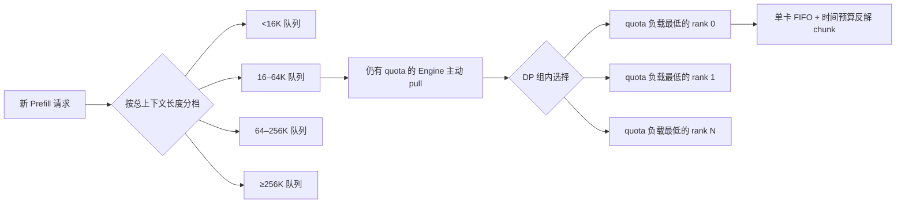
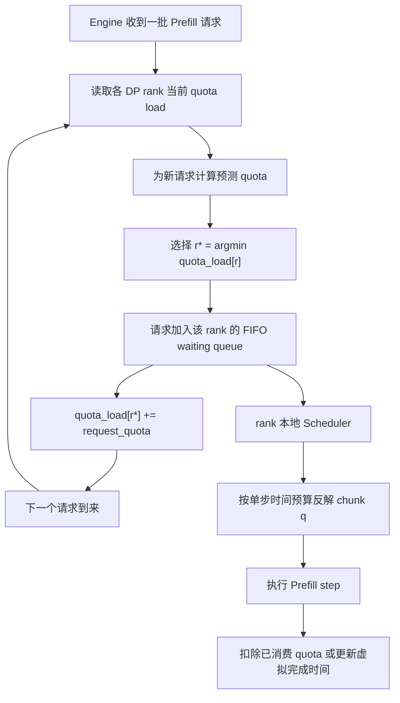
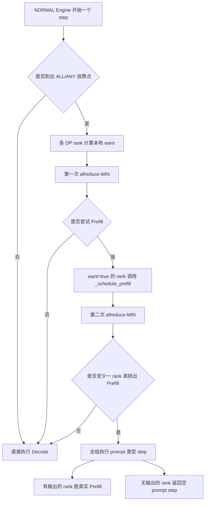
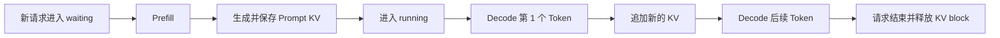
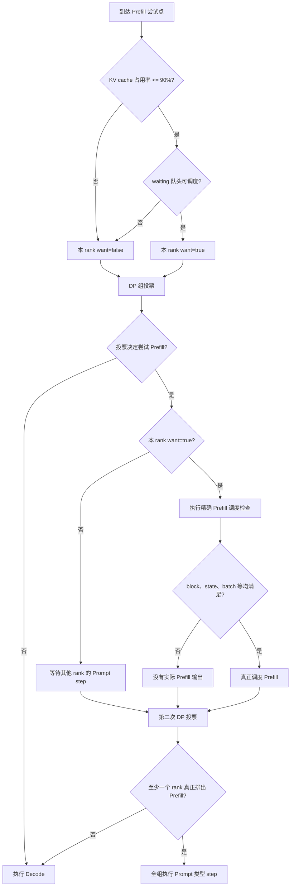
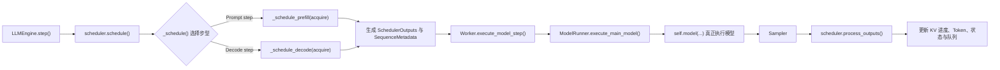
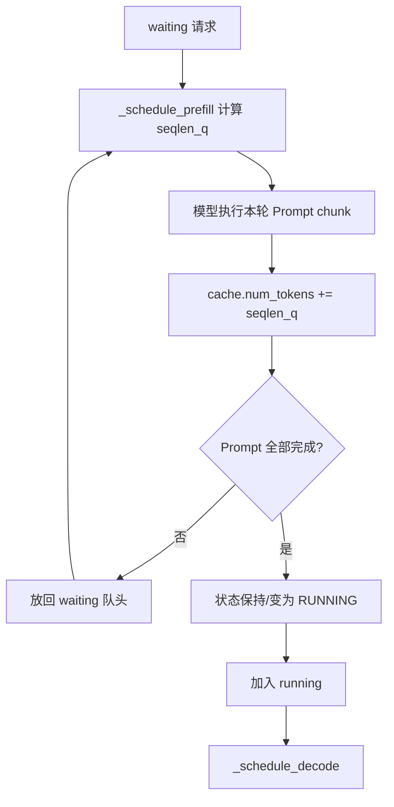
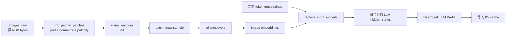
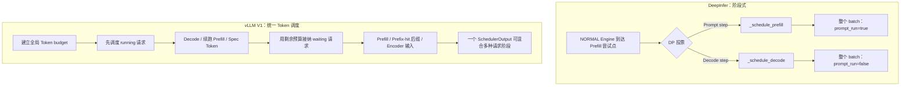

# DeepInfer 调度问答笔记

> 本文按会话顺序收录本次归档指令之前已经完成的 7 组原问题与原回答。问题和回答正文均从会话记录原样提取；新增内容仅包括标题、目录、锚点及“原问题 / 原回答”分隔标题。

## 目录

1. [问题 1：三层负载均衡与 Prefill chunk 时间预算](#问题-1)
2. [问题 2：Engine 数量动态分配公式与 compute-quota 需求](#问题-2)
3. [问题 3：DP 组内选择 quota 最低的 rank](#问题-3)
4. [问题 4：PROMPT、COMPLETION、NORMAL Engine 与 DP 投票](#问题-4)
5. [问题 5：KV cache 使用率不超过 90% 时为何 want=true](#问题-5)
6. [问题 6：_schedule_prefill、_schedule_decode 与多模态 encode](#问题-6)
7. [问题 7：DeepInfer 与 vLLM 调度流程的主要区别](#问题-7)

---

<a id="问题-1"></a>

## 问题 1：三层负载均衡与 Prefill chunk 时间预算

### 原问题

请你结合D:\Code\DeepInfer 文件夹下的内容，回答以下问题。你在回答问题的时候可以辅助进行一些网络知识的搜索，请尽量详细回答，并配合适当举例和图表。涉及代码的时候要尽量给出代码的执行过程，不要跳过。回答内容注意语句连贯以及语句之间的因果关系，我的问题如下：解释一下下面的说法：

1. 三层负载均衡：Prefill 负载均衡按输入长度把请求分成 4 档（<16K / 16–64K / 64–256K / ≥256K），每档分多少机器按上一轮的算力需求动态调整；DP 组间各引擎按剩余算力配额领活，因为任何引擎都能命中任何前缀，不需要前缀亲和路由。单卡内部，每个 Prefill 步分配一个时间预算，用一个拟合出的二次成本模型 cost(q, c) 预测耗时，反解出预算内能装下的最大 chunk。DeepInfer 部署问答里 Prefill 的 chunk 大小求解——每步给一个纳秒级时间预算，用二次成本模型反解能装下的最大 Token 数

### 原回答

## 结论先行

这段话描述的是一种“由粗到细”的三级 Prefill 调度体系：

1. **集群层**先按总上下文长度把请求分成四档，并根据上一轮各档消耗的计算配额，动态调整各档拥有的 Prefill Engine 数量。
2. **Engine / DP 层**不把请求固定粘在某台机器上，而是让仍有计算余量的 Engine 主动取任务；进入某个 DP 组后，再把请求交给当前 quota 负载最低的 DP rank。
3. **单卡层**不使用固定 chunk size，而是先规定“这一轮最多运行多少纳秒”，再利用实测拟合的 `cost(q,c)` 模型，把时间预算反解成这一轮最多能处理多少个新 token。

它的核心思想不是“平均分请求数”，而是：

> 从机器数量、Engine 配额一直到单次 GPU forward，都使用尽可能接近真实耗时的“计算配额”作为统一调度货币。

不过需要特别说明：我检查的 `D:\Code\DeepInfer` 当前版本为 commit `9bd9cf243fc53ef9afbf8f04d391d989117d6ab9`。生产环境的负载均衡和纳秒级二次模型只在部署问答中公开了算法描述，完整实现并未开源。仓库 README 也明确把“DP 副本间负载均衡”列为当前发布版不包含的完整服务组件，见 [README.md:38](D:/Code/DeepInfer/README.md:38) 和 [README.md:42](D:/Code/DeepInfer/README.md:42)，官方 GitHub 页面也给出了同样的边界说明：[DeepInfer README](https://github.com/deepseek-ai/DeepInfer)。

---

## 一、为什么不能简单地按“请求数”平均分配

两个 Prefill 请求即使都是一个请求，成本也可能相差几个数量级：

| 请求 | 总上下文长度 | 已命中前缀 `c` | 需要新算 `q` | 特征 |
|---|---:|---:|---:|---|
| A | 8K | 0 | 8K | 短请求 |
| B | 128K | 120K | 8K | 新算 token 与 A 相同，但注意力要面对更长历史 |
| C | 300K | 0 | 300K | 必须经历很多个 chunk |
| D | 300K | 292K | 8K | 属于超长档，但实际重算量较小 |

如果只计算请求数，一台机器拿到 A，另一台机器拿到 C，看起来都是一个请求，计算量却完全不同。

即使只按“未缓存 token 数”计算，A 和 B 都是 8K，也仍然不一定同价，因为 B 的新 query 需要访问更长的已有前缀。生产调度因此同时关心：

- 总上下文长度：用于选择长短请求档位；
- 未缓存、新计算的 token 数 `q`；
- 已经计算完成的前缀长度 `c`；
- 当前 Engine、DP rank 和本步还剩多少计算配额。

部署问答对这几个层次的原始描述集中在 [inference_deployment_qa.md:105](D:/Code/DeepInfer/doc/inference_deployment_qa.md:105) 到 [inference_deployment_qa.md:115](D:/Code/DeepInfer/doc/inference_deployment_qa.md:115)，官方在线版本见 [DeepInfer inference deployment Q&A](https://github.com/deepseek-ai/DeepInfer/blob/main/doc/inference_deployment_qa.md)。

---

## 二、第一层：按总上下文长度划分四个 tier

四档是：

\[
[0,16K),\quad[16K,64K),\quad[64K,256K),\quad[256K,+\infty)
\]

对应源码文档 [inference_deployment_qa.md:109](D:/Code/DeepInfer/doc/inference_deployment_qa.md:109)。

### 2.1 为什么按长度分档

长短请求混合调度容易出现两个问题。

第一，**短请求被超长请求阻塞**。一个 300K 请求如果长期占用同一批 Prefill Engine，会显著抬高短请求的 TTFT。

第二，不同上下文区间的运行特征不同，例如：

- attention 的工作量不同；
- KV 加载量和显存压力不同；
- kernel 的最优 batch/chunk 区间可能不同；
- 成本模型在不同区间内更容易拟合准确；
- 每档可以设置不同的单批 `compute-quota` 上限。

所以 tier 不只是排队标签，它同时形成了相对独立的容量池和调度参数域。

### 2.2 “按上一轮需求动态分机器”是什么意思

假设有 100 台 Prefill Engine。上一轮四档累计请求的计算配额需求分别是：

| tier | 上一轮 quota 需求 | 需求占比 | 简化后的引擎分配 |
|---|---:|---:|---:|
| `<16K` | 10 | 10% | 10 |
| `16–64K` | 30 | 30% | 30 |
| `64–256K` | 50 | 50% | 50 |
| `≥256K` | 10 | 10% | 10 |

概念上可写成：

\[
N_i \approx N_{\text{total}}
 \frac{D_i^{\text{prev}}}{\sum_j D_j^{\text{prev}}}
\]

其中：

- \(D_i^{\text{prev}}\)：第 \(i\) 档上一轮累计的 compute-quota 需求；
- \(N_i\)：下一轮分给该档的 Engine 数量。

这只是解释性公式。文档没有公开生产系统实际采用的：

- 统计轮次长度；
- 滑动平均或指数平滑方法；
- 最小保底机器数；
- 取整及余数分配方法；
- 防抖、迟滞和扩缩容速率限制。

因此不能把上式当成 DeepSeek 的完整生产代码。

### 2.3 为什么依据 quota，而不是 token 数

如果一个 8K chunk 的预测耗时为 8 ms，另一个 8K chunk 因为前缀很长需要 20 ms，那么它们的 token 数相同，但 quota 需求并不相同。

动态分配依据的是“预计占用多少计算时间”，就能更接近真实算力需求。这样不会因为某一档请求数不多，就误以为它不需要很多 GPU。

---

## 三、第二层：Engine 主动领活，再在 DP 组内选择 rank

部署问答其实还区分了两个子层次：

- DP 组之间：Engine 根据剩余 quota 主动取任务；
- DP 组内部：请求进入当前 quota 负载最低的 DP rank。

对应 [inference_deployment_qa.md:111](D:/Code/DeepInfer/doc/inference_deployment_qa.md:111) 和 [inference_deployment_qa.md:113](D:/Code/DeepInfer/doc/inference_deployment_qa.md:113)。



### 3.1 为什么采用 pull，而不是中央调度器直接 push

中央调度器看到的 Engine 状态可能已经过时。尤其在请求耗时差异很大时，“给每台机器发同样数量的请求”很容易失衡。

pull 模式中：

1. Engine 完成或预留完当前任务；
2. 计算自己的剩余 compute quota；
3. 有余量时向所属 tier 的队列请求下一批任务；
4. 配额不足时暂时停止取任务。

这是一种自然的背压机制：快的 Engine 会更快回来继续取任务，慢的 Engine 不会继续积压。

### 3.2 “任何 Engine 都能命中任何前缀”并不等于所有 KV 都在本机

这里容易误解。它真正表示的是：

> 前缀 KV 在系统范围内具有全局可达性，因此路由器不必把相同前缀的请求固定送回原机器。

文档说明：

- paged block KV 位于专用 3FS 存储集群，[inference_deployment_qa.md:135](D:/Code/DeepInfer/doc/inference_deployment_qa.md:135)；
- 这种设计使所有 Prefill 机器都能命中任意前缀，从而避免“前缀亲和”和“算力负载均衡”相互冲突，[inference_deployment_qa.md:141](D:/Code/DeepInfer/doc/inference_deployment_qa.md:141)；
- KV 获取通过单独进程异步从 3FS 搬到共享内存，再逐层交换到 HBM，[inference_deployment_qa.md:157](D:/Code/DeepInfer/doc/inference_deployment_qa.md:157)；
- SWA 状态虽然保留在产生它的机器内存中，但有全局目录，其他机器命中后可以远程拉取，[inference_deployment_qa.md:169](D:/Code/DeepInfer/doc/inference_deployment_qa.md:169)。

所以“不做亲和路由”指的是不把缓存位置设成硬路由约束，并不表示：

- 所有机器都在本地 HBM 保存所有 KV；
- 远程命中完全没有传输成本；
- 任意机器的命中延迟都完全一样。

这是一种用共享存储和异步搬运换取全局调度自由度的设计。

### 3.3 DP 组内为什么仍然要选 quota 最低的 rank

即使一个 Engine 整体还有余量，其内部不同 DP rank 的当前任务也可能不同。

如果按轮询分配：

- rank 0 上一个请求是 256K；
- rank 1 上一个请求是 8K；
- 下一个长请求仍可能被轮询到 rank 0。

按当前 quota 负载选择，就会优先交给 rank 1。这里平衡的是预测计算时间，而不是请求个数。

---

## 四、第三层：从纳秒预算反解 chunk 大小

这是整段话最关键的部分，对应 [inference_deployment_qa.md:115](D:/Code/DeepInfer/doc/inference_deployment_qa.md:115)。

### 4.1 `q` 和 `c` 分别是什么

对某条正在 Prefill 的序列：

- `c`：本步开始前已经算完的前缀长度；
- `q`：本步准备新算的 token 数；
- 本步结束后的 key 长度通常是：

\[
k=c+q
\]

例如一个 100K prompt 已经处理了 64K：

```text
[----------- 已完成前缀 c=64K -----------][--- 尚未处理 36K ---]
                                             ↑
                                    本步从这里取 q 个 token
```

如果本步反解得到 `q=12K`，那么：

- 本步 query 数量是 12K；
- attention 能看到的结束位置是 76K；
- 下一个 chunk 开始时，新的 `c` 变成 76K。

因为 `c` 在逐步增大，所以即使每步时间预算完全相同，后面的 chunk 通常也会逐渐缩小。

### 4.2 为什么成本近似是二次函数

对普通因果 attention，可以从 query-key 对数直观看出。

已有前缀长度为 `c`，新增 `q` 个 query。第一个新 query 大约访问 `c+1` 个 key，第二个访问 `c+2` 个，依次类推：

\[
(c+1)+(c+2)+\cdots+(c+q)
\]

展开得到：

\[
qc+\frac{q(q+1)}{2}
\]

也就是同时含有：

- \(qc\)：新 query 访问已有前缀；
- \(q^2\)：本 chunk 内部新 token 之间的因果注意力。

而 MLP、投影、归一化等工作通常更接近 \(O(q)\)。因此一个具有物理解释的简化模型是：

\[
\hat T(q,c)
 = a q^2 + bqc + dq + h(c) + t_0
\]

固定 `c` 后，它就是关于 `q` 的一元二次函数：

\[
\hat T(q\mid c)
 = A q^2+B(c)q+C(c)
\]

这里应注意：DeepInfer 文档只说“拟合的二次代价模型”，没有公开具体多项式形式和系数。上式是帮助理解的合理形式，不是生产源码还原。

当前开源代码也提供了这个二次来源的旁证：

- Scheduler 直接统计 `seqlen_q × seqlen_k`，见 [scheduler.hpp:696](D:/Code/DeepInfer/csrc/engine/scheduler.hpp:696) 和 [scheduler.hpp:709](D:/Code/DeepInfer/csrc/engine/scheduler.hpp:709)；
- `FlopsEstimator` 把非 attention 计算按 query 行数线性累计，见 [flops_estimator.hpp:280](D:/Code/DeepInfer/csrc/engine/flops_estimator.hpp:280)；
- attention 则显式累计 query-key pair 数量，见 [flops_estimator.hpp:237](D:/Code/DeepInfer/csrc/engine/flops_estimator.hpp:237) 到 [flops_estimator.hpp:256](D:/Code/DeepInfer/csrc/engine/flops_estimator.hpp:256)。

不过 V4.1 还存在压缩、SWA、Top-K 和 candidate-block 上限，所以真实代价会是分段、饱和和 kernel 相关的。生产系统使用实测拟合而不是简单拿理论 FLOPs 除以峰值算力，正是为了吸收这些因素。

### 4.3 怎样反解最大 `q`

设当前剩余时间预算为 \(R\)，固定前缀长度 `c` 后：

\[
Aq^2+B(c)q+C(c)\le R
\]

如果 \(A>0\)，正根是：

\[
q_{\text{time}}
=
\frac{-B(c)+
\sqrt{B(c)^2+4A(R-C(c))}}
{2A}
\]

随后调度器不能直接使用这个浮点数，而要取满足约束的最大整数：

\[
q^*
=
\max\{q\in\mathbb Z_{\ge0}\mid\hat T(q,c)\le R\}
\]

然后再叠加其他硬约束：

\[
q_{\text{final}}
=
\min
\left(
q_{\text{time}},
q_{\text{request-remain}},
q_{\text{token-budget-remain}},
32768,
q_{\text{checkpoint}},
q_{\text{memory}}
\right)
\]

所以文档里的“正好把剩余预算吃满”应理解为：

\[
\hat T(q^*,c)\le R
\quad\text{且通常}\quad
\hat T(q^*+1,c)>R
\]

它并不意味着纳秒级完全相等。token 必须是整数，还可能有 CP 对齐、多模态边界、kernel tile 对齐以及 32,768-token 上限。如果先碰到这些硬上限，时间预算自然会有剩余。

### 4.4 一个带数字的示例

下面使用一个纯示意模型，系数不是 DeepSeek 生产参数：

\[
T(q,c)
=
2
+2\times10^{-8}q^2
+5\times10^{-9}qc
+1.2\times10^{-4}q
\quad\text{ms}
\]

当本步预算为 10 ms 时：

| 已完成前缀 `c` | 反解出的最大 `q` | 预测耗时 |
|---:|---:|---:|
| 0 | 17,223 | 约 9.9994 ms |
| 64K | 11,726 | 约 9.9995 ms |
| 256K | 5,211 | 约 9.9986 ms |

因此，同样是 10 ms：

- 刚开始处理短前缀时，一步可以装入约 17K token；
- 前缀达到 64K 后，只能装约 12K；
- 前缀达到 256K 后，可能只剩约 5K。

这正是固定 chunk size 不够稳健的原因。固定 `q=16K` 时，短上下文也许只花 9 ms，但长上下文可能需要几十毫秒，导致 TTFT 和组内同步时间剧烈波动。

visualize{"path":"C:\Users\h00926491\.codex\visualizations\2026\10\22\01a1617e-c180-7e23-9517-aef970d2ccf9\prefill-budget-solver.html"}

---

## 五、为什么预算还要经过 DP 组内 `allreduce-MIN`

假设一个 DP 组有四个 rank，各自根据当前已排入任务得到剩余预算：

```text
rank 0: 12 ms
rank 1:  9 ms
rank 2: 15 ms
rank 3: 11 ms
```

进行 MIN 后：

\[
R_{\text{effective}}=\min(12,9,15,11)=9\text{ ms}
\]

然后各 rank 都按照不超过 9 ms 的共同预算继续排 chunk。

这样做的原因是组内 rank 并不是完全互不相关的独立服务器。MoE/EP 通信、collective 和 step 推进通常要求大家保持兼容的执行节奏。组的实际完成时间接近：

\[
T_{\text{group}}=\max_r T_r
\]

如果 rank 2 按 15 ms 排任务，而 rank 1 只能容纳 9 ms，那么其他 rank 最终仍然可能在同步点等待 rank 2。采用最小剩余预算，相当于让最紧张的 rank 决定共同安全边界。

这里也必须区分开源实现和生产描述：

- 生产问答说的是对“时间预算”执行 `allreduce-MIN`；
- 当前开源 `scheduler.hpp` 中能够直接看到的 MIN all-reduce，主要用于 NORMAL Engine 在 Prefill/Decode 步型之间做 ALL/ANY 投票，见 [scheduler.hpp:296](D:/Code/DeepInfer/csrc/engine/scheduler.hpp:296)、[scheduler.hpp:316](D:/Code/DeepInfer/csrc/engine/scheduler.hpp:316) 和 [scheduler.hpp:332](D:/Code/DeepInfer/csrc/engine/scheduler.hpp:332)；
- 开源代码里没有 `compute_quota_limit`，不能把这段布尔投票代码误认成生产时间预算的实现。

---

## 六、当前开源 DeepInfer 真正执行的 chunk 调度过程

虽然生产二次成本模型没有开源，但当前 `scheduler.hpp` 的 Prefill chunk 执行链可以完整追踪。

### 6.1 Python Engine 进入 C++ Scheduler

每个 Engine step 在 [llm_engine.py:860](D:/Code/DeepInfer/deepinfer/engine/llm_engine.py:860) 开始。

执行到 [llm_engine.py:881](D:/Code/DeepInfer/deepinfer/engine/llm_engine.py:881) 后：

```python
seq_metadata_list, scheduler_outputs = self.scheduler.schedule(
    self.sequence_metadata_pool
)
```

也就是先由 C++ Scheduler 确定：

- 本步是 prompt 还是 decode；
- 哪些序列参加本步；
- 每条序列的 `seqlen_q`；
- 总 batch token 数；
- KV block/state 的分配和复制动作。

### 6.2 决定本轮是否执行 Prefill

对于纯 PROMPT Engine，C++ 直接进入 `_schedule_prefill()`，见 [scheduler.hpp:288](D:/Code/DeepInfer/csrc/engine/scheduler.hpp:288)。

对于 NORMAL Engine，则先在 DP 组内投票：

- ALL 点：所有 rank 都有 Prefill 工作才做；
- ANY 点：只要任意 rank 有工作就做，用来避免孤立请求长期饿死；
- 若本轮确实有人排出了 Prefill，其他无任务 rank 会执行空 prompt step，以保持组内步型一致。

这段流程见 [scheduler.hpp:295](D:/Code/DeepInfer/csrc/engine/scheduler.hpp:295) 到 [scheduler.hpp:340](D:/Code/DeepInfer/csrc/engine/scheduler.hpp:340)。

### 6.3 FIFO 读取 waiting 队首

`_schedule_prefill()` 从 [scheduler.hpp:351](D:/Code/DeepInfer/csrc/engine/scheduler.hpp:351) 开始，初始化本步的：

```cpp
scheduled
seqlens_q
num_batched_tokens
prefill_sum_seqlen_k_remain
```

随后在 [scheduler.hpp:360](D:/Code/DeepInfer/csrc/engine/scheduler.hpp:360) 始终读取：

```cpp
auto &seq = waiting.front();
```

这就是文档所说的单卡 FIFO。队首不可调度时会停止继续向后选择，而不是跳过队首无限挑后面的请求。

### 6.4 检查前缀缓存和 KV 容量

在 [scheduler.hpp:372](D:/Code/DeepInfer/csrc/engine/scheduler.hpp:372)：

```cpp
int num_prompt_tokens =
    seq->get_len() - seq->cache.num_tokens;
```

这里：

- `seq->get_len()` 是请求当前完整长度；
- `seq->cache.num_tokens` 是已有缓存 token；
- 两者之差就是当前还要 Prefill 的 token 数。

随后会检查：

- prompt 是否超过 `prompt_limit`；
- block manager 是否有足够 KV block；
- fork/prefix-hit 请求是否需要克隆已有 block；
- 当前序列数是否超过 `max_num_prompts`；
- `sum_seqlen_k` 是否超过额外上限。

相关逻辑位于 [scheduler.hpp:374](D:/Code/DeepInfer/csrc/engine/scheduler.hpp:374) 到 [scheduler.hpp:449](D:/Code/DeepInfer/csrc/engine/scheduler.hpp:449)。

### 6.5 当前开源版按 token 预算裁剪 chunk

在 [scheduler.hpp:460](D:/Code/DeepInfer/csrc/engine/scheduler.hpp:460)：

```cpp
int seq_workload = num_prompt_tokens;
int seqlen_q = seq_workload;
```

也就是先假定本步处理完全部剩余 prompt。

接着在 [scheduler.hpp:470](D:/Code/DeepInfer/csrc/engine/scheduler.hpp:470) 比较本步剩余 token 容量：

```cpp
if (seq_workload >
    (max_num_batched_tokens - num_batched_tokens)
      / cp_align * cp_align) {
    seqlen_q = ...
}
```

当前公开实现的核心约束因此是：

\[
q
\le
\left\lfloor
\frac{
\text{max\_num\_batched\_tokens}
-\text{num\_batched\_tokens}
}{
\text{cp\_align}
}
\right\rfloor
\text{cp\_align}
\]

而不是调用生产环境的 `cost(q,c)` 反解器。

### 6.6 继续处理 checkpoint 和多模态边界

chunk 初步裁剪后：

1. [scheduler.hpp:477](D:/Code/DeepInfer/csrc/engine/scheduler.hpp:477) 取得 `start_offset = cache.num_tokens`；
2. [scheduler.hpp:481](D:/Code/DeepInfer/csrc/engine/scheduler.hpp:481) 找下一个 chunk checkpoint；
3. 如果 chunk 跨越 checkpoint，就在 checkpoint 截断；
4. [scheduler.hpp:488](D:/Code/DeepInfer/csrc/engine/scheduler.hpp:488) 调用 `_adjust_chunk_size()`，避免把一张图片的 token 单元切成两半。

多模态调整函数本身在 [scheduler.hpp:232](D:/Code/DeepInfer/csrc/engine/scheduler.hpp:232)：

- 可以向后扩到图片单元末尾；
- 若扩展后超过本步 token 预算，则向前缩到图片单元之前；
- 因此实际 `q` 还可能小于初次计算结果。

### 6.7 提交调度结果并执行 forward

确定最终 `seqlen_q` 后：

- [scheduler.hpp:515](D:/Code/DeepInfer/csrc/engine/scheduler.hpp:515) 把 CP 对齐后的 `q` 加到本步 token 总量；
- [scheduler.hpp:518](D:/Code/DeepInfer/csrc/engine/scheduler.hpp:518) 首次运行的序列分配 KV；
- [scheduler.hpp:528](D:/Code/DeepInfer/csrc/engine/scheduler.hpp:528) 加入 `scheduled`；
- [scheduler.hpp:532](D:/Code/DeepInfer/csrc/engine/scheduler.hpp:532) 把最终 `seqlen_q` 写入输出；
- 如果没处理完，[scheduler.hpp:533](D:/Code/DeepInfer/csrc/engine/scheduler.hpp:533) 记录剩余 chunk 长度。

回到 Python 后，`LLMEngine.step()` 在 [llm_engine.py:952](D:/Code/DeepInfer/deepinfer/engine/llm_engine.py:952) 调用 worker。Worker 汇总所有 Prefill 序列的 `seqlen_q`，见 [worker.py:116](D:/Code/DeepInfer/deepinfer/worker/worker.py:116)，然后在 [worker.py:122](D:/Code/DeepInfer/deepinfer/worker/worker.py:122) 执行主模型 forward。

完整链路可以压缩为：

```text
LLMEngine.step()
  └─ Scheduler.schedule()
      ├─ 决定 prompt/decode 步型
      └─ _schedule_prefill()
          ├─ FIFO 读取 waiting.front()
          ├─ 检查缓存、KV block、序列数
          ├─ 计算剩余 prompt token
          ├─ 按 max_num_batched_tokens / CP 对齐裁剪
          ├─ 按 checkpoint 裁剪
          ├─ 避免切开多模态图片单元
          ├─ 分配 KV block
          └─ 输出每条序列的 seqlen_q
  └─ Worker.execute_model_step()
      └─ ModelRunner.execute_main_model()
```

---

## 七、生产方案和当前开源实现的准确对应关系

| 能力 | 部署问答描述的生产系统 | 当前 checkout 可直接看到的实现 |
|---|---|---|
| 四档长度分桶 | 有 | 未开源 |
| 根据上一轮 quota 动态调整机器数 | 有 | 未开源 |
| Engine 按剩余 quota 主动 pull | 有 | 未开源 |
| 任意 Engine 命中任意前缀 | 依赖 3FS、目录和远程拉取 | 完整服务组件未随本次发布提供 |
| DP rank 按 quota 负载选择 | 有 | 跨副本 LB 未开源 |
| 纳秒级 `compute_quota_limit` | 有 | 没有对应公开符号 |
| 二次 `cost(q,c)` 反解 chunk | 有 | 未开源 |
| 固定 token 上限 | 32,768 | `max_num_batched_tokens` 可配置，示例默认常为 32,768 |
| FIFO | 有 | `_schedule_prefill()` 明确从 `waiting.front()` 取 |
| checkpoint/CP 对齐/多模态边界 | 生产实现也必然要考虑类似硬约束 | 当前代码已实现 |
| FLOPs / q×k 统计 | 可作为模型输入或观测指标 | 已实现，但目前用于统计，不用于反解 chunk |

特别值得注意的是，开源的 `FlopsEstimator` 虽然接收 `q` 和 `k`，但 Scheduler 仅在开启统计时调用它，见 [scheduler.hpp:712](D:/Code/DeepInfer/csrc/engine/scheduler.hpp:712) 到 [scheduler.hpp:718](D:/Code/DeepInfer/csrc/engine/scheduler.hpp:718)。它不能被当作部署问答里那个纳秒级运行时间预测器。

---

## 八、这套设计最终解决了什么

三层机制分别解决不同尺度的失衡：

- **四档 tier**：防止长请求吞掉短请求容量，并让每个长度区间使用适合自己的 batch quota。
- **Engine/DP quota 调度**：解决不同机器、不同 rank 当前负载不一致的问题。
- **时间预算反解 chunk**：解决同样 token 数在不同前缀长度下耗时差异巨大的问题。

因此它形成了一个闭环：

```text
实际流量
  → 各 tier 产生 quota 需求
  → 下一轮重新分配 Engine
  → Engine 按剩余 quota 取请求
  → 请求落到 quota 最低的 DP rank
  → 单卡把剩余纳秒预算反解成 q
  → 实际耗时重新反馈给成本模型和下一轮容量分配
```

最凝练地说：

> 四档分桶负责“把性质接近的请求放在一起”，剩余 quota 负责“把请求交给还有能力的执行单元”，二次模型负责“把抽象时间预算转换成这一轮真正能执行的 token 数”。

这样，超长请求仍然能够持续推进，但不会通过一个固定的巨大 chunk 长时间独占 GPU；短请求也更容易获得稳定的 TTFT。

---

<a id="问题-2"></a>

## 问题 2：Engine 数量动态分配公式与 compute-quota 需求

### 原问题

请你结合D:\Code\DeepInfer 文件夹下的内容，回答以下问题。你在回答问题的时候可以辅助进行一些网络知识的搜索，请尽量详细回答，并配合适当举例和图表。涉及代码的时候要尽量给出代码的执行过程，不要跳过。回答内容注意语句连贯以及语句之间的因果关系，我的问题如下：解释一下下面的说法：

1. 请详细解释一下这个公式的含义  (N\_i \approx N\_{\text{total}}
   \frac{D\_i^{\text{prev}}}{\sum\_j D\_j^{\text{prev}}})  。 你说(D\_i^{\text{prev}})是第 (i) 档上一轮累计的 compute-quota 需求， 这个具体应该要怎么理解？为什么我没有从这个公式中理解到分给该档的 Engine 数量随着时间动态变化呢？

### 原回答

你没有从原公式中直观看出“动态变化”，主要是因为我之前的公式省略了完整的时间下标。更准确的写法应该是：

\[
\boxed{
N_i^{(t+1)}
\approx
N_{\text{total}}^{(t+1)}
\frac{D_i^{(t)}}{\sum_j D_j^{(t)}}
}
\]

它表达的是：

> 在第 \(t\) 个统计周期观察各档的算力需求，然后用这组需求决定第 \(t+1\) 个调度周期每档分多少台 Engine。

因此，真正体现动态变化的不是分数本身，而是每一轮都会重新测量的 \(D_i^{(t)}\)。当流量结构改变时，\(D_i^{(t)}\) 改变，下一轮的 \(N_i^{(t+1)}\) 就随之改变。

还要先澄清：这个公式是我根据 DeepInfer 文档描述写出的“解释性比例分配模型”，不是仓库里公开的生产源码公式。文档只说明“每档引擎台数按上一轮 compute-quota 需求占比动态重分”，见 [inference_deployment_qa.md:109](D:/Code/DeepInfer/doc/inference_deployment_qa.md:109)。具体统计窗口、平滑方法、整数取整、最小保底机器数等实现目前没有开源。

---

## 一、先逐个解释公式里的量

完整公式是：

\[
N_i^{(t+1)}
\approx
N_{\text{total}}^{(t+1)}
\frac{D_i^{(t)}}{\sum_j D_j^{(t)}}
\]

各个量的含义如下。

| 符号 | 含义 |
|---|---|
| \(i\) | 上下文长度档位，例如 `<16K`、`16–64K`、`64–256K`、`≥256K` |
| \(t\) | 当前统计周期，也就是“上一轮” |
| \(t+1\) | 下一轮资源分配周期 |
| \(D_i^{(t)}\) | 第 \(t\) 轮内，第 \(i\) 档产生的累计 compute-quota 需求 |
| \(\sum_j D_j^{(t)}\) | 第 \(t\) 轮四个档位的总算力需求 |
| \(N_{\text{total}}^{(t+1)}\) | 下一轮可供分配的 Prefill Engine 总数 |
| \(N_i^{(t+1)}\) | 下一轮分给第 \(i\) 档的 Engine 数量 |

公式右侧的分数：

\[
\frac{D_i^{(t)}}{\sum_j D_j^{(t)}}
\]

就是第 \(i\) 档占全部 Prefill 算力需求的比例。

例如第 2 档贡献了总算力需求的 30%，那么在最简单的比例分配模型中，下一轮也给它约 30% 的 Engine。

---

## 二、为什么原公式看不出动态变化

之前的公式写成：

\[
N_i
\approx
N_{\text{total}}
\frac{D_i^{\text{prev}}}
{\sum_j D_j^{\text{prev}}}
\]

其中 `prev` 虽然隐含了“上一轮”，但是左边的 \(N_i\) 没有写明是“下一轮”的结果，所以它看起来像一个静态比例公式。

把时间下标补全后，反馈关系就清楚了：

\[
\underbrace{D_i^{(t)}}_{\text{第 t 轮观察到的需求}}
\quad\Longrightarrow\quad
\underbrace{N_i^{(t+1)}}_{\text{第 t+1 轮的机器分配}}
\]

下一轮继续观察：

\[
D_i^{(t+1)}
\quad\Longrightarrow\quad
N_i^{(t+2)}
\]

于是形成一个离散时间反馈循环：

```text
第 t 轮实际流量
    ↓
统计各档 compute-quota 需求 D_i^(t)
    ↓
计算各档需求占比
    ↓
重新分配第 t+1 轮 Engine：N_i^(t+1)
    ↓
第 t+1 轮流量和排队情况
    ↓
统计新的 D_i^(t+1)
    ↓
重新分配第 t+2 轮 Engine
```

所以它不是“一个公式自己随着时间动”，而是：

> 调度系统每隔一个控制周期，用最新统计值重新执行一次这个公式。

---

## 三、什么是“累计 compute-quota 需求”

这是最重要的概念。

它不是简单的：

- 请求个数；
- token 个数；
- Engine 已经运行了多少秒；
- GPU 利用率百分比。

更合理的理解是：

> 把这一轮到达或等待的 Prefill 工作转换成统一的“预测计算时间”或“计算配额单位”，然后按档位累加。

结合部署问答中的定义，单卡每个 Prefill step 的 `compute_quota_limit` 使用纳秒表示，见 [inference_deployment_qa.md:115](D:/Code/DeepInfer/doc/inference_deployment_qa.md:115)。因此，在集群层统计每个 tier 的需求时，最自然的解释是把请求或 chunk 的预测执行成本转换成同一类时间配额，再累加起来。

但要注意：公开文档没有说明生产系统究竟累计的是：

- 新到达请求申报的 quota；
- 实际成功调度的 quota；
- 已完成计算的预测 quota；
- 当前排队 backlog 的 quota；
- 还是上述几项的组合。

下面使用的是便于理解的等价模型，不是未公开源码的精确复现。

### 3.1 单个请求怎样产生 quota 需求

假设一条请求当前有：

- 已完成前缀长度 \(c_r\)；
- 需要在本轮计算的新 token 数 \(q_r\)。

成本模型预测：

\[
\widehat T_r
=
\operatorname{cost}(q_r,c_r)
\]

例如：

```text
请求 A：cost(8K, 0)   = 8 ms
请求 B：cost(8K, 64K) = 15 ms
请求 C：cost(4K, 256K)= 18 ms
```

虽然 B 和 A 都要新计算 8K token，但 B 已经有 64K 前缀，计算代价可能更高，所以：

\[
\text{quota}_B>\text{quota}_A
\]

### 3.2 一个档位怎样累计 quota

假设第 \(i\) 档在第 \(t\) 轮有请求集合 \(\mathcal R_i^{(t)}\)，最简单的累计方式是：

\[
D_i^{(t)}
=
\sum_{r\in\mathcal R_i^{(t)}}
\widehat T_r
\]

也就是：

\[
D_i^{(t)}
=
\sum_{r\in\mathcal R_i^{(t)}}
\operatorname{cost}(q_r,c_r)
\]

如果一条超长请求被拆成多个 chunk，它可能在同一轮或多个轮次中贡献多次 quota：

\[
D_i^{(t)}
=
\sum_{\text{chunk }k\text{ of tier }i}
\operatorname{cost}(q_k,c_k)
\]

而且随着 chunk 推进，前缀长度不断增大：

\[
c_{k+1}=c_k+q_k
\]

因此同一条长请求后续 chunk 的预测成本也可能发生变化。

---

## 四、为什么不能用请求数量代替 \(D_i^{(t)}\)

假设一轮里有两档请求。

### `<16K` 档

有 1000 个短请求，每个预测耗时 2 ms：

\[
D_0^{(t)}
=
1000\times2\text{ ms}
=
2000\text{ ms}
\]

### `≥256K` 档

只有 100 个超长请求，每个预测需要 20 ms：

\[
D_3^{(t)}
=
100\times20\text{ ms}
=
2000\text{ ms}
\]

如果按请求数量分配：

```text
短请求档：1000 / 1100 ≈ 91%
长请求档： 100 / 1100 ≈  9%
```

但按算力需求看：

```text
短请求档：2000 / 4000 = 50%
长请求档：2000 / 4000 = 50%
```

也就是说，请求数相差十倍，真实计算需求却相同。

这就是 \(D_i^{(t)}\) 的价值：它把不同长度、不同缓存命中状态、不同 chunk 成本的请求，转换成一种可比较的“算力货币”。

---

## 五、用四轮数据观察 Engine 数量怎样变化

假设 Prefill 资源池中始终有：

\[
N_{\text{total}}=100
\]

台 Engine。

### 第 0 轮的需求

假设第 0 轮四档累计 quota 为：

\[
D^{(0)}
=
[10,30,50,10]
\]

总需求：

\[
\sum_jD_j^{(0)}=100
\]

那么第 1 轮分配：

\[
N^{(1)}
=
100
\frac{[10,30,50,10]}{100}
=
[10,30,50,10]
\]

即：

| 档位 | 第 0 轮需求 | 第 1 轮 Engine |
|---|---:|---:|
| `<16K` | 10 | 10 |
| `16–64K` | 30 | 30 |
| `64–256K` | 50 | 50 |
| `≥256K` | 10 | 10 |

### 第 1 轮流量结构改变

假设短请求突然增加，第 1 轮需求变成：

\[
D^{(1)}
=
[40,20,30,10]
\]

那么第 2 轮：

\[
N^{(2)}
=
100
\frac{[40,20,30,10]}{100}
=
[40,20,30,10]
\]

可以看到：

- `<16K` 档从 10 台增加到 40 台；
- `16–64K` 档从 30 台减少到 20 台；
- `64–256K` 档从 50 台减少到 30 台；
- `≥256K` 档保持 10 台。

### 第 2 轮超长请求增加

若需求进一步变为：

\[
D^{(2)}
=
[20,20,20,40]
\]

那么：

\[
N^{(3)}
=
[20,20,20,40]
\]

此时 `≥256K` 档从 10 台增加到了 40 台。

合并起来就是：

| 用于统计的轮次 | 各档 quota 需求 \(D^{(t)}\) | 被决定的下一轮 | 下一轮 Engine 分配 |
|---:|---|---:|---|
| 0 | `[10,30,50,10]` | 1 | `[10,30,50,10]` |
| 1 | `[40,20,30,10]` | 2 | `[40,20,30,10]` |
| 2 | `[20,20,20,40]` | 3 | `[20,20,20,40]` |
| 3 | `[25,35,25,15]` | 4 | `[25,35,25,15]` |

visualize{"path":"C:\Users\h00926491\.codex\visualizations\2026\10\22\01a1617e-c180-7e23-9517-aef970d2ccf9\tier-engine-feedback.html"}

动态变化来自：

\[
D^{(0)}\ne D^{(1)}\ne D^{(2)}
\]

所以：

\[
N^{(1)}\ne N^{(2)}\ne N^{(3)}
\]

如果每一轮的流量结构完全相同，需求比例不变，那么分配数量当然也不会变化。这并不表示公式不是动态的，只表示系统当前处于稳定状态。

---

## 六、需要区分“需求总量”和“需求占比”

这个公式主要根据需求占比划分固定资源池。

假设两轮需求分别是：

\[
D^{(0)}=[10,30,50,10]
\]

和：

\[
D^{(1)}=[100,300,500,100]
\]

第二轮总需求是第一轮的 10 倍，但比例完全相同：

\[
\frac{D^{(0)}}{\sum D^{(0)}}
=
\frac{D^{(1)}}{\sum D^{(1)}}
=
[10\%,30\%,50\%,10\%]
\]

如果 \(N_{\text{total}}\) 固定为 100 台，那么两轮都会得到：

\[
N=[10,30,50,10]
\]

因此这个公式只能回答：

> 在已有的 \(N_{\text{total}}\) 台 Engine 中，各档应当占多少比例？

它不能单独回答：

> 总共需要多少台 Engine 才能消化全部流量？

总容量需要另一个扩缩容公式。例如，若每台 Engine 每轮可以提供 \(C\) 个 quota 单位的能力，粗略所需总机器数应是：

\[
N_{\text{needed}}^{(t+1)}
\approx
\left\lceil
\frac{\sum_jD_j^{(t)}}{C}
\right\rceil
\]

然后再将这些机器按档位需求比例分配：

\[
N_i^{(t+1)}
\approx
N_{\text{needed}}^{(t+1)}
\frac{D_i^{(t)}}{\sum_jD_j^{(t)}}
\]

DeepInfer 文档也把这两个问题分开描述：

- 各档 Engine 数量按 quota 需求比例重新分配：[inference_deployment_qa.md:109](D:/Code/DeepInfer/doc/inference_deployment_qa.md:109)；
- Prefill 总机器数根据非缓存 token 数决定：[inference_deployment_qa.md:197](D:/Code/DeepInfer/doc/inference_deployment_qa.md:197)。

所以系统逻辑更接近：

```text
先决定 Prefill 总共需要多少台机器
              ↓
得到 N_total
              ↓
再根据四档 quota 需求占比
              ↓
把 N_total 分给四个 tier
```

---

## 七、实际执行时还需要处理整数取整

公式算出来的结果可能不是整数。例如：

\[
N_{\text{total}}=17
\]

需求为：

\[
D=[10,20,30,40]
\]

则理论分配是：

\[
N=
17\times[0.1,0.2,0.3,0.4]
=
[1.7,3.4,5.1,6.8]
\]

但 Engine 不可能分配 1.7 台。实际需要一个整数化过程，例如：

1. 先向下取整：

\[
[1,3,5,6]
\]

总共只分了 15 台，还剩 2 台。

2. 按小数余数大小补齐：

```text
第 4 档余数 0.8
第 1 档余数 0.7
第 2 档余数 0.4
第 3 档余数 0.1
```

于是把两台分别补给第 4 档和第 1 档：

\[
[2,3,5,7]
\]

满足：

\[
2+3+5+7=17
\]

生产系统还可能附加：

- 每档至少 1 台；
- 某档没有请求时可以是 0 台；
- 单轮最多增加或减少若干台；
- Engine 只能按机器组或 EP/DP 拓扑成组迁移；
- 迁移后需要等待当前请求结束；
- 为突发流量保留冗余池。

这些规则都会使实际分配不完全等于纯比例公式，因此使用的是近似符号 \(\approx\)，而不是严格等号。

---

## 八、为什么使用“上一轮”而不是实时瞬间值

如果每来一个请求就立即重新分配机器，系统很容易振荡。

例如：

```text
短请求突然增加
→ 大量 Engine 切到短请求档
→ 短请求很快被清空
→ 系统又把 Engine 切回长请求档
→ 此时新的短请求到达
→ 再次切回
```

因此更常见的方法是按统计周期更新：

```text
一个周期内：
    Engine 分配基本稳定
    持续累计 D_i^(t)

周期结束：
    计算下一轮 N_i^(t+1)
    受速率限制地调整机器
```

如果需要进一步平滑，还可以先对需求做指数移动平均：

\[
\bar D_i^{(t)}
=
\alpha D_i^{(t)}
+
(1-\alpha)\bar D_i^{(t-1)}
\]

然后用平滑后的需求计算：

\[
N_i^{(t+1)}
\approx
N_{\text{total}}
\frac{\bar D_i^{(t)}}{\sum_j\bar D_j^{(t)}}
\]

其中：

- \(\alpha\) 大：更快响应流量变化，但更容易抖动；
- \(\alpha\) 小：更稳定，但扩容响应更慢。

DeepInfer 文档没有公开它是否采用这种平滑公式，所以这是工程上常见的完善方式，不是代码事实。

---

## 九、累计的是“已完成工作”还是“真正需求”很重要

假设 `≥256K` 档只有 5 台 Engine，但排队非常严重。

如果 \(D_i^{(t)}\) 只统计“已经完成的 GPU 工作量”，该档因为机器少、完成得慢，观测到的消耗反而可能较小。调度器就可能错误地认为这个档位需求不大。

因此，一个更合理的需求统计应当考虑：

\[
D_i^{(t)}
\approx
D_{i,\text{arrival}}^{(t)}
+
D_{i,\text{backlog}}^{(t)}
\]

也就是同时考虑：

- 本轮新到达请求的预测 quota；
- 上轮遗留队列的预测 quota；
- 必要时减去已经完成的 quota。

例如：

```text
本轮新到达 quota：  50 秒
本轮实际完成 quota：20 秒
轮末仍排队 quota：  80 秒
```

如果只看完成量，会认为需求只有 20 秒；但真实未满足需求已经积累到 80 秒。

公开问答使用的是“compute-quota 需求”而不是“已执行 compute-quota”，这在语义上更倾向于需求侧统计；但具体是否包含 backlog、怎样避免重复计数，未公开代码无法确认。

---

## 十、对应到一个可能的执行过程

下面的伪代码只是将文档描述展开，不是 DeepInfer 仓库中的真实实现：

```python
# 第 t 个统计周期
demand = [0, 0, 0, 0]

for request in requests_arriving_or_waiting:
    context_len = request.total_context_len

    if context_len < 16 * 1024:
        tier = 0
    elif context_len < 64 * 1024:
        tier = 1
    elif context_len < 256 * 1024:
        tier = 2
    else:
        tier = 3

    q = request.non_cached_tokens
    c = request.cached_prefix_tokens

    predicted_quota_ns = cost(q, c)
    demand[tier] += predicted_quota_ns

# 周期结束，计算第 t+1 轮分配
total_demand = sum(demand)

for tier in range(4):
    ratio = demand[tier] / total_demand
    ideal_engines[tier] = total_engines * ratio

engine_allocation = integer_rounding_with_constraints(
    ideal_engines,
    min_engines_per_tier,
    max_change_per_round,
)
```

每一轮重新执行后：

```text
demand[t]       → allocation[t+1]
demand[t+1]     → allocation[t+2]
demand[t+2]     → allocation[t+3]
```

这就是“随着时间动态变化”的完整含义。

当前开源仓库中没有这段 tier 分配器。README 明确说明 Prefill/Decode 的 DP 副本间负载均衡不包含在当前发布中，见 [README.md:38](D:/Code/DeepInfer/README.md:38) 到 [README.md:42](D:/Code/DeepInfer/README.md:42)。当前能看到的 C++ Scheduler 主要负责单 Engine 内的 waiting 队列、token 上限、KV 分配和 chunk 裁剪，而不是跨机器 tier 数量重分。

---

## 最后概括

原公式应当从：

\[
N_i
\approx
N_{\text{total}}
\frac{D_i^{\text{prev}}}{\sum_jD_j^{\text{prev}}}
\]

改写为更明确的：

\[
\boxed{
N_i^{(t+1)}
\approx
N_{\text{total}}^{(t+1)}
\frac{D_i^{(t)}}{\sum_jD_j^{(t)}}
}
\]

其中：

- \(D_i^{(t)}\) 不是请求数，而是第 \(t\) 轮第 \(i\) 档累计产生的预测算力需求；
- 每条请求或 chunk 可以通过 `cost(q,c)` 转换成统一的时间 quota；
- 同一档所有请求的 quota 累加得到 \(D_i^{(t)}\)；
- 第 \(t\) 轮的需求比例决定第 \(t+1\) 轮的 Engine 比例；
- 当流量结构随时间变化时，\(D_i^{(t)}\) 改变，\(N_i^{(t+1)}\) 就跟着改变；
- 如果只有总需求同比放大、各档占比不变，那么 tier 比例不变，但系统可能通过另一个总量扩缩容机制增大 \(N_{\text{total}}\)。

---

<a id="问题-3"></a>

## 问题 3：DP 组内选择 quota 最低的 rank

### 原问题

请你结合D:\Code\DeepInfer 文件夹下的内容，回答以下问题。你在回答问题的时候可以辅助进行一些网络知识的搜索，请尽量详细回答，并配合适当举例和图表。涉及代码的时候要尽量给出代码的执行过程，不要跳过。回答内容注意语句连贯以及语句之间的因果关系，我的问题如下：解释一下下面的说法：2. "3.3 DP 组内为什么仍然要选 quota 最低的 rank"这句话中提到的quota, 这里rank级别的quota可能是怎么得到的？当前开源的部分有这个逻辑吗？  

### 原回答

## 结论

“把请求交给当前 quota 负载最低的 DP rank”中的 rank 级 quota，最合理的理解是：

> 每个 DP rank 当前已经承诺、但尚未完成的 Prefill 预测计算量。它通常用预测执行时间——例如纳秒——而不是请求数或 token 数来记账。

一种可能的计算形式是：

\[
L_r
=
Q_{r,\text{inflight}}
+
\sum_{x\in \text{waiting}(r)}
Q_{\text{remaining}}(x)
\]

其中：

- \(L_r\)：DP rank \(r\) 当前的 quota 负载；
- \(Q_{r,\text{inflight}}\)：该 rank 已经送入当前 step、尚未执行完的预算；
- \(Q_{\text{remaining}}(x)\)：请求 \(x\) 剩余 Prefill 工作的预测成本。

新请求 \(x\) 到来时，选择：

\[
r^*=\arg\min_r L_r
\]

然后把该请求的预测 quota 加到选中 rank：

\[
L_{r^*}\leftarrow L_{r^*}+Q(x)
\]

但需要明确：上面是结合部署问答构造出的合理实现模型，不是已经公开的 DeepInfer 生产代码。当前 `D:\Code\DeepInfer` 中没有开源“比较所有 DP rank quota、选择最小者”的请求路由器，也没有 rank 级 `compute_quota_load` 变量。README 明确说明 Prefill/Decode 的 DP 副本间负载均衡不包含在当前发布中，见 [README.md:38](D:/Code/DeepInfer/README.md:38) 和 [README.md:42](D:/Code/DeepInfer/README.md:42)。

---

## 一、先区分三种容易混淆的 quota

部署问答在连续几行里使用了 quota，但实际上对应三个不同层次。

| 层次 | 文档表述 | quota 的合理含义 |
|---|---|---|
| tier 层 | 上一轮各档 compute-quota 需求 | 一个统计周期内，该长度档累计产生的预测算力需求 |
| Engine/DP rank 层 | 当前 quota 负载最低的 rank | 已经分配给该 rank、但尚未完成的预测工作量 |
| 单卡 step 层 | `compute_quota_limit` | 一个 Prefill step 最多允许消耗的时间预算，单位纳秒 |

文档原文位于：

- tier 动态分配：[inference_deployment_qa.md:109](D:/Code/DeepInfer/doc/inference_deployment_qa.md:109)；
- DP 组间按剩余 quota 拉取任务：[inference_deployment_qa.md:111](D:/Code/DeepInfer/doc/inference_deployment_qa.md:111)；
- DP 组内交给 quota 负载最低的 rank：[inference_deployment_qa.md:113](D:/Code/DeepInfer/doc/inference_deployment_qa.md:113)；
- 单卡通过纳秒预算反解 chunk：[inference_deployment_qa.md:115](D:/Code/DeepInfer/doc/inference_deployment_qa.md:115)。

所以 rank 级 `quota load` 更像“负债”，越小越空闲；而 `remaining quota` 更像“余额”，越大越空闲。两者方向相反：

\[
\text{remaining quota}_r
=
\text{quota limit}_r-\text{quota load}_r
\]

因此：

\[
\arg\min_r \text{load}_r
\quad\Longleftrightarrow\quad
\arg\max_r \text{remaining}_r
\]

前提是各 rank 的 quota limit 相同。

---

## 二、为什么 rank quota 不能只是请求数

假设一个 Engine 内有 4 个 DP rank：

| rank | 当前请求数 | 请求特征 |
|---|---:|---|
| rank 0 | 1 | 300K 上下文，还需计算 32K |
| rank 1 | 2 | 两个 4K 短请求 |
| rank 2 | 1 | 64K 上下文，命中 60K，只需计算 4K |
| rank 3 | 0 | 空闲 |

如果只看请求数量：

```text
rank 0 = 1
rank 1 = 2
rank 2 = 1
rank 3 = 0
```

rank 3 显然最空闲，但处理一个请求之后，下一条请求可能会在 rank 0 和 rank 2 之间随机选择，因为它们请求数相同。

可是 rank 0 上的 300K 请求可能比 rank 2 上只需补算 4K 的请求昂贵得多。请求数无法表示真实负载。

同样，未缓存 token 数也不一定足够。两个请求都需要新算 8K token：

```text
A: c = 0,    q = 8K
B: c = 128K, q = 8K
```

它们的 attention 计算规模近似分别是：

\[
A:\quad q(c+q)=8K\times8K
\]

\[
B:\quad q(c+q)=8K\times136K
\]

因此 rank 级 quota 应该尽量把：

- 新算 token 数 `q`；
- 已完成前缀长度 `c`；
- 缓存命中长度；
- attention、MoE 和其他算子成本；
- chunk 后续剩余工作；

统一换算成预测时间或虚拟算力单位。

---

## 三、rank 级 quota 可能怎样计算

部署问答没有公开精确公式。根据它同时给出的 `cost(q,c)` 和纳秒时间预算，比较合理的实现至少有以下三种。

### 方案一：等待队列预测成本之和

这是最直观的实现：

\[
L_r
=
\sum_{x\in W_r}
\widehat Q(x)
+
Q_{r,\text{inflight}}
\]

其中 \(W_r\) 是 rank \(r\) 的 waiting queue。

对于请求 \(x\)，如果剩余未缓存 token 数是 \(q_x\)，缓存前缀长度是 \(c_x\)，可以估算：

\[
\widehat Q(x)
=
\operatorname{cost}(q_x,c_x)
\]

但如果请求很长、需要拆成多个 chunk，就不能简单把全部 token 当成一个 chunk。更合理的是：

\[
\widehat Q(x)
=
\sum_{k=0}^{m-1}
\operatorname{cost}(q_k,c_k)
\]

并且：

\[
c_{k+1}=c_k+q_k
\]

这里每个 \(q_k\) 都受单步时间预算和 32,768-token 上限约束。

这种定义表达的是：

> 如果不再有新请求到来，这个 rank 大约还有多少纳秒的 Prefill 工作没有完成。

### 方案二：只计算近期可执行的 quota

完整剩余工作量可能非常大。例如一个 1M 请求会贡献很大的 quota，但它不会在一个 step 内全部执行。

所以生产系统也可能只计算近期调度窗口内的负载：

\[
L_r
=
Q_{r,\text{current batch}}
+
\sum_{x\in W_r}
\min\bigl(Q(x),Q_{\text{batch-cap}}\bigr)
\]

这会用 tier 的单批 quota 上限对超长请求截断，避免一条极长请求使某个 rank 的负载数字长时间极端偏大。

部署问答在 [inference_deployment_qa.md:109](D:/Code/DeepInfer/doc/inference_deployment_qa.md:109) 提到“每档有各自的单批 compute-quota 上限”，因此 rank 负载与单批上限结合是合理推断，但具体截断位置没有公开。

### 方案三：虚拟完成时间

还可以把 quota 转换成“这个 rank 预计什么时候空闲”。

令 \(F_r\) 表示 rank \(r\) 的虚拟完成时间。新请求 \(x\) 到来时：

\[
r^*=\arg\min_r F_r
\]

选中后更新：

\[
F_{r^*}
=
\max(F_{r^*},t_{\text{now}})
+
\widehat Q(x)
\]

如果 rank 速度不同，还可以除以该 rank 的有效处理速度：

\[
F_{r^*}
=
\max(F_{r^*},t_{\text{now}})
+
\frac{\widehat Q(x)}{S_{r^*}}
\]

其中 \(S_r\) 是 rank 的相对算力。

这种写法不需要不断从 load 中减去实际流逝时间，因为“预计空闲时间”天然会随着当前时间推进而过期。工程上常称为 virtual finish time 或 least-work-left 类型调度。

---

## 四、一次请求分配的可能执行过程

生产逻辑可能近似如下：



这里有两个阶段不能混为一谈：

1. **请求到达 Engine 时**，跨 rank 路由器选择哪个 rank；
2. **请求已经进入某个 rank 后**，该 rank 的本地 Scheduler 决定本步取多少 token。

也就是说，rank quota 是外层的请求分配指标；`cost(q,c)` 反解 chunk 是内层的执行机制。

---

## 五、一个具体分配例子

假设 4 个 DP rank 当前未完成 quota 负载为：

\[
L=[12,5,9,7]\text{ ms}
\]

现在依次到达四个请求，预测 quota 为：

\[
Q=[6,3,10,4]\text{ ms}
\]

使用“每次选择当前 quota 最低的 rank”的贪心调度。

### 请求 1：6 ms

当前：

\[
[12,5,9,7]
\]

最低的是 rank 1，因此：

\[
L_1\leftarrow5+6=11
\]

结果：

\[
[12,11,9,7]
\]

### 请求 2：3 ms

最低的是 rank 3：

\[
L_3\leftarrow7+3=10
\]

结果：

\[
[12,11,9,10]
\]

### 请求 3：10 ms

最低的是 rank 2：

\[
L_2\leftarrow9+10=19
\]

结果：

\[
[12,11,19,10]
\]

### 请求 4：4 ms

最低的是 rank 3：

\[
L_3\leftarrow10+4=14
\]

最终：

\[
[12,11,19,14]
\]

对应关系如下：

| 请求 | 预测 quota | 分配前最低 rank | 分配后负载 |
|---|---:|---:|---|
| 1 | 6 ms | rank 1 | `[12,11,9,7]` |
| 2 | 3 ms | rank 3 | `[12,11,9,10]` |
| 3 | 10 ms | rank 2 | `[12,11,19,10]` |
| 4 | 4 ms | rank 3 | `[12,11,19,14]` |

第三个请求比较重，所以即使 rank 2 原先最空闲，分配后它也暂时变成最忙。下一个请求不会继续交给它。

这是典型的在线 list scheduling：

\[
r^*=\arg\min_r L_r
\]

\[
L_{r^*}\leftarrow L_{r^*}+Q(x)
\]

它无法保证全局最优，因为未来请求尚不可知，但计算简单，且比按请求数或 round-robin 更能适应长短不一的 Prefill 工作。

---

## 六、请求 quota 本身可能怎样由 `cost(q,c)` 得到

假设新请求总长度为 80K，已经命中 64K 前缀：

\[
c=64K,\qquad q_{\text{remaining}}=16K
\]

如果成本模型预测整个 16K 后缀需要：

\[
\operatorname{cost}(16K,64K)=14\text{ ms}
\]

那么可以把 14 ms 作为该请求的初始 quota。

但如果单步预算只有 8 ms，Scheduler 可能反解得到：

```text
第一个 chunk: q0 = 10K, cost(10K,64K) ≈ 8 ms
第二个 chunk: q1 = 6K, cost(6K,74K) ≈ 5 ms
```

那么更准确的剩余 quota 是：

\[
Q(x)
=
8+5
=
13\text{ ms}
\]

而不是简单地假定一次处理完整个 16K。

请求进入 rank 后，quota 账本可能经历：

```text
初始负载增加 13 ms
    ↓
第一个 chunk 执行完
    ↓
负载减少约 8 ms
    ↓
还剩约 5 ms
    ↓
第二个 chunk 执行完
    ↓
该请求的 rank quota 负债归零
```

实际生产系统也可能在每次 chunk 完成后，用真实耗时校正预测误差：

\[
L_r
\leftarrow
L_r-\widehat T_{\text{chunk}}
\]

或者：

\[
L_r
\leftarrow
L_r-T_{\text{actual}}
\]

还可以通过 EWMA 修正模型：

\[
\widehat T_{\text{corrected}}
=
\alpha T_{\text{actual}}
+
(1-\alpha)\widehat T_{\text{model}}
\]

这些属于合理实现方式，但没有公开代码证实 DeepInfer 具体选用了哪一种。

---

## 七、DP 组内 all-reduce MIN 与 rank quota 是什么关系

部署问答还说：

> 单卡的剩余时间预算会被 DP 组内的 all-reduce MIN 进一步减小。

这和“选择 quota 最低的 rank”是两个不同动作。

### 7.1 rank 路由阶段

请求尚未进入具体 rank：

\[
r^*=\arg\min_rL_r
\]

目标是让各 rank 的未完成负载接近。

### 7.2 单步 chunk 调度阶段

请求已经分配完毕。每个 rank 计算本地剩余时间预算：

\[
B_r^{\text{remain}}
\]

组内做：

\[
B_{\text{effective}}
=
\min_rB_r^{\text{remain}}
\]

然后各 rank 用这个共同预算反解 chunk。

原因是 DP/EP rank 在模型执行中存在组级同步。如果某个 rank 安排了一个 20 ms step，其他 rank 只安排 8 ms，最终其他 rank 仍可能在 collective 或下一步边界等待它。

所以：

- rank quota 路由解决长期负载分布；
- all-reduce MIN 解决当前 step 的同步时间上界；
- 二者使用相同的“时间成本”思想，但不是同一个变量。

---

# 八、当前开源代码是否实现了 rank quota 路由

答案是：**没有。**

当前开源代码实现了：

- 每个 rank 自己的本地 Scheduler；
- 本地 waiting/running/prompted 队列；
- DP rank 之间的 step 类型投票；
- 本地 token 数、KV cache、序列数和 chunk 约束；
- 一些可以用于监控的 rank 本地指标。

但没有实现：

- 收集所有 rank 的 quota load；
- 比较这些 quota；
- 选择 quota 最低 rank；
- 将请求从 Engine 入口分发给该 rank；
- 分配完成后更新 rank quota 账本。

下面沿代码执行过程说明。

---

## 九、当前开源版请求怎样进入某个 rank

### 9.1 DP rank 被启动为独立进程

示例启动代码会为每个 DP rank 创建独立进程：

```python
for dp_rank in range(dp_size):
    procs.append(
        ctx.Process(
            target=main_fn,
            args=(dp_size, dp_rank)
        )
    )
```

位置见 [examples/_launch.py:26](D:/Code/DeepInfer/examples/_launch.py:26) 到 [examples/_launch.py:44](D:/Code/DeepInfer/examples/_launch.py:44)。

也就是说，每个 rank 都有自己的：

- `LLMEngine`；
- C++ `Scheduler`；
- `waiting` 队列；
- `running` 队列；
- GPU/设备上下文。

### 9.2 示例代码事先决定各 rank 的输入

`offline_inference.py` 的 `main(dp_size, dp_rank)` 为当前 rank 创建自己的 LLM，见 [offline_inference.py:34](D:/Code/DeepInfer/examples/offline_inference.py:34) 到 [offline_inference.py:57](D:/Code/DeepInfer/examples/offline_inference.py:57)。

随后直接为当前 rank 准备 prompt：

```python
prompts, multi_modal_data, sampling_params = (
    prepare_offline_prompts(dp_rank, llm)
)
```

见 [offline_inference.py:63](D:/Code/DeepInfer/examples/offline_inference.py:63)。

最后调用当前 rank 的本地：

```python
llm.generate(...)
```

见 [offline_inference.py:95](D:/Code/DeepInfer/examples/offline_inference.py:95)。

这里没有一个中央 router 先读取所有 rank 负载并选择最小 rank。示例的请求属于哪个 rank，是调用方在进入 `llm.generate()` 前就决定的。

---

## 十、请求进入 LLMEngine 后直接加入本地 Scheduler

本地调用链是：

```text
当前 rank 的 LLM.generate()
    ↓
当前 rank 的 LLMEngine.add_request()
    ↓
创建 Sequence
    ↓
当前 rank 的 Scheduler.add_sequence()
    ↓
当前 rank 的 waiting.push_back()
```

### 10.1 创建 Sequence

`LLMEngine.add_request()` 从 [llm_engine.py:471](D:/Code/DeepInfer/deepinfer/engine/llm_engine.py:471) 开始。

它依次完成：

1. 处理采样参数；
2. 记录 arrival time；
3. 处理多模态输入；
4. 校验 token；
5. 在 [llm_engine.py:593](D:/Code/DeepInfer/deepinfer/engine/llm_engine.py:593) 创建 `Sequence`；
6. 在 [llm_engine.py:620](D:/Code/DeepInfer/deepinfer/engine/llm_engine.py:620) 定义入队回调；
7. 在 [llm_engine.py:623](D:/Code/DeepInfer/deepinfer/engine/llm_engine.py:623) 调用：

```python
self.scheduler.add_sequence(s)
```

这里没有：

```python
loads = query_all_dp_rank_quota()
rank = argmin(loads)
send_to_rank(rank, request)
```

### 10.2 加入本地 FIFO 队列

C++ `Scheduler::add_sequence()` 位于 [scheduler.hpp:135](D:/Code/DeepInfer/csrc/engine/scheduler.hpp:135)：

```cpp
void add_sequence(std::shared_ptr<Sequence> seq) {
    seq->request.arrival_time = get_timestamp_ms();

    if (engine_type == EngineType::NORMAL) {
        seq->reserve_output_tokens();
        seq->cache.block_table.reserve(
            _block_table_capacity(*seq)
        );
    }

    waiting.push_back(std::move(seq));
}
```

最关键的是 [scheduler.hpp:141](D:/Code/DeepInfer/csrc/engine/scheduler.hpp:141)：

```cpp
waiting.push_back(std::move(seq));
```

它只是把请求放入“当前 rank 的本地 waiting 队列”，没有读取其他 rank 的状态。

---

## 十一、开源代码里的 DP all-reduce 做了什么

当前开源 Scheduler 确实保存了：

```cpp
dp_size
dp_rank
dp_group
```

见 [scheduler.hpp:1146](D:/Code/DeepInfer/csrc/engine/scheduler.hpp:1146) 到 [scheduler.hpp:1149](D:/Code/DeepInfer/csrc/engine/scheduler.hpp:1149)。

它也提供了通用 `_dp_allreduce()`，见 [scheduler.hpp:169](D:/Code/DeepInfer/csrc/engine/scheduler.hpp:169)。

但是当前调用 all-reduce 的地方主要是判断 NORMAL Engine 本轮应该做 Prefill 还是 Decode。

### ALL 投票点

```cpp
do_prefill =
    (_dp_allreduce(
        want ? 1 : 0,
        c10d::ReduceOp::MIN
    ) == 1);
```

见 [scheduler.hpp:318](D:/Code/DeepInfer/csrc/engine/scheduler.hpp:318)。

所有 rank 都 `want=true`，MIN 才是 1，也就是全部都有 Prefill 工作才进入 prompt step。

### ANY 投票点

```cpp
do_prefill =
    (_dp_allreduce(
        want ? 0 : 1,
        c10d::ReduceOp::MIN
    ) == 0);
```

见 [scheduler.hpp:316](D:/Code/DeepInfer/csrc/engine/scheduler.hpp:316)。

只要任意 rank 想做 Prefill，就至少有一个 0，MIN 结果就是 0。

### 第二轮确认

在 [scheduler.hpp:332](D:/Code/DeepInfer/csrc/engine/scheduler.hpp:332)，Scheduler 再确认是否至少有一个 rank 真正排出了 Prefill 请求。

因此开源代码的 MIN all-reduce 当前归约的是：

- 布尔意图；
- 是否成功调度；

而不是：

- rank quota load；
- `compute_quota_limit`；
- 各 rank 的预测纳秒负载。

不能因为看到了 `ReduceOp::MIN`，就认为 rank quota 调度已经开源。

---

## 十二、当前单 rank Scheduler 如何工作

进入当前 rank 后，`_schedule_prefill()` 从本地队首取请求：

```cpp
auto &seq = waiting.front();
```

见 [scheduler.hpp:360](D:/Code/DeepInfer/csrc/engine/scheduler.hpp:360) 和 [scheduler.hpp:361](D:/Code/DeepInfer/csrc/engine/scheduler.hpp:361)。

接下来：

1. 计算未缓存 prompt token：

   ```cpp
   num_prompt_tokens =
       seq->get_len() - seq->cache.num_tokens;
   ```

   见 [scheduler.hpp:372](D:/Code/DeepInfer/csrc/engine/scheduler.hpp:372)。

2. 检查 KV block、状态槽和 prompt 上限。

3. 将剩余 prompt token 先作为 `seq_workload`：

   ```cpp
   int seq_workload = num_prompt_tokens;
   int seqlen_q = seq_workload;
   ```

   见 [scheduler.hpp:460](D:/Code/DeepInfer/csrc/engine/scheduler.hpp:460)。

4. 如果超过本地 `max_num_batched_tokens`，按 token 余量截断：

   ```cpp
   seqlen_q =
       max_num_batched_tokens - num_batched_tokens;
   ```

   实际代码还加入了 CP 对齐，见 [scheduler.hpp:470](D:/Code/DeepInfer/csrc/engine/scheduler.hpp:470)。

5. 处理 checkpoint 和多模态边界。

6. 把最终 `seqlen_q` 加入本地 batch，见 [scheduler.hpp:515](D:/Code/DeepInfer/csrc/engine/scheduler.hpp:515) 和 [scheduler.hpp:532](D:/Code/DeepInfer/csrc/engine/scheduler.hpp:532)。

因此当前开源调度器实现的是：

> 请求已经属于某个 rank 之后，该 rank 怎样从自己的 FIFO 队列构建一个 Prefill batch。

它没有实现：

> 请求到达 Engine 时，应该属于哪一个 rank。

---

## 十三、开源代码是否有可用于构造 rank quota 的指标

有一些局部指标，但它们还没有被组成生产 rank quota 路由器。

### 13.1 waiting/running 队列统计

Scheduler 提供：

```cpp
get_sum_prompt_len_waiting()
get_sum_prompt_len_running()
get_sum_prompt_len_chunked()
```

例如 [scheduler.hpp:848](D:/Code/DeepInfer/csrc/engine/scheduler.hpp:848) 会遍历当前 rank 的 `waiting` 队列，返回：

- 等待请求数；
- prompt 长度总和。

这些指标可以作为外部路由器的输入，但 prompt 长度总和不等价于 `cost(q,c)` 纳秒负载。

### 13.2 GPU KV cache 使用率

StatsLogger 在 [stats_logger.py:410](D:/Code/DeepInfer/deepinfer/engine/stats_logger.py:410) 到 [stats_logger.py:418](D:/Code/DeepInfer/deepinfer/engine/stats_logger.py:418) 采集：

- GPU cache 使用率；
- state cache 使用率；
- pending 数；
- running 数；
- chunked 请求数。

这些也是健康度和背压指标，不是 rank quota 选择算法。

### 13.3 `q×k` 和 FLOPs

Scheduler 会统计：

```cpp
sum_seqlen_qxk += seqlen_q * seqlen_k;
```

见 [scheduler.hpp:709](D:/Code/DeepInfer/csrc/engine/scheduler.hpp:709)。

开启日志后还会调用：

```cpp
flops_estimator->calc_flops(
    seqlen_q,
    seqlen_k,
    ...
)
```

见 [scheduler.hpp:712](D:/Code/DeepInfer/csrc/engine/scheduler.hpp:712) 到 [scheduler.hpp:718](D:/Code/DeepInfer/csrc/engine/scheduler.hpp:718)。

但其结果被累计为：

```cpp
attn_tflops
total_tflops
```

用于性能统计，见 [scheduler.hpp:730](D:/Code/DeepInfer/csrc/engine/scheduler.hpp:730)。它没有被写入类似：

```cpp
rank_quota_load[dp_rank]
```

的结构，更没有用于新请求的 `argmin` 路由。

### 13.4 EPLB 中的 `rank_loads` 不是这里的 quota

仓库里还能搜到：

```python
rank_loads = ...
```

例如 [eplb/__init__.py:298](D:/Code/DeepInfer/deepinfer/model_executor/eplb/__init__.py:298) 到 [eplb/__init__.py:310](D:/Code/DeepInfer/deepinfer/model_executor/eplb/__init__.py:310)。

这里统计的是：

- MoE 逻辑专家收到多少 token；
- 这些专家映射到物理 GPU 后，各 GPU 的专家负载是否均衡；
- 用来重新摆放冗余专家。

这是 **Expert-Parallel Load Balancing**，不是 Prefill 请求在 DP rank 之间的路由 quota。二者虽然都叫 rank load，但对象完全不同：

| 指标 | 负载对象 | 用途 |
|---|---|---|
| Prefill rank quota | 请求或 chunk 的预测运行时间 | 选择请求交给哪个 DP rank |
| EPLB `rank_loads` | 各物理专家接收到的 token 数 | 调整专家副本和专家摆放 |

---

## 十四、生产逻辑与开源逻辑的边界

| 能力 | 部署问答中的生产系统 | 当前开源代码 |
|---|---|---|
| Engine 接收一批请求 | 有 | 离线 API 只接收当前进程请求 |
| 收集每个 DP rank quota | 有此语义 | 没有实现 |
| 选择 quota 最低 rank | 明确描述 | 没有实现 |
| 更新 rank quota 账本 | 必须存在某种实现 | 未公开 |
| 每个 rank 独立 FIFO 队列 | 有 | 已实现 |
| rank 本地 chunk 裁剪 | 纳秒预算反解二次模型 | 当前只按 token、CP 对齐、checkpoint、多模态边界裁剪 |
| DP 组内同步 | 时间预算 MIN | 当前开源的是 Prefill/Decode 步型布尔投票 |
| pending/running/cache 指标 | 可供 LB 使用 | 已实现本地统计 |
| `q×k`、FLOPs 指标 | 可能帮助成本建模 | 已实现，但仅用于统计 |

---

## 最后概括

这里的 rank quota 最可能是：

\[
\boxed{
L_r
=
\text{该 rank 已接收但尚未完成的预测计算时间}
}
\]

它可能由以下几部分构成：

\[
L_r
=
Q_{\text{inflight}}
+
Q_{\text{waiting}}
+
Q_{\text{chunked remaining}}
\]

对新请求估算：

\[
Q(x)
\approx
\sum_k\operatorname{cost}(q_k,c_k)
\]

然后：

\[
r^*=\arg\min_r L_r
\]

分配后：

\[
L_{r^*}\leftarrow L_{r^*}+Q(x)
\]

执行完成后再扣除已消费 quota，或者用虚拟完成时间自然推进。

当前开源 DeepInfer 没有这层跨 rank 路由。当前真实代码路径是：

```text
调用方预先确定 dp_rank
  → 该 rank 的 LLMEngine.add_request()
  → 创建 Sequence
  → 该 rank 的 Scheduler.add_sequence()
  → waiting.push_back()
  → 本地 FIFO _schedule_prefill()
```

开源 Scheduler 中 DP rank 之间的 all-reduce 目前用于统一 Prefill/Decode 步型，而不是收集 quota 并选择最低负载 rank。完整的 Prefill DP Load Balancer 属于 README 明确列出的未发布服务组件。

---

<a id="问题-4"></a>

## 问题 4：PROMPT、COMPLETION、NORMAL Engine 与 DP 投票

### 原问题

请你结合D:\Code\DeepInfer 文件夹下的内容，回答以下问题。你在回答问题的时候可以辅助进行一些网络知识的搜索，请尽量详细回答，并配合适当举例和图表。涉及代码的时候要尽量给出代码的执行过程，不要跳过。回答内容注意语句连贯以及语句之间的因果关系，我的问题如下：解释一下下面的说法：3. 纯 PROMPT Engine 、COMPLETION Engine和NORMAL Engine是怎样划分的？对于 NORMAL Engine决定本轮是否执行 Prefill的逻辑中，在 DP 组内投票的过程和原理请再详细解释一下。  

### 原回答

## 结论先行

`PROMPT`、`COMPLETION` 和 `NORMAL` 不是根据某个请求临时切换出来的三种状态，而是 **Engine 创建时确定的三种部署角色**：

- `PROMPT Engine`：只执行 Prefill。
- `COMPLETION Engine`：只执行 Decode。
- `NORMAL Engine`：同一个 Engine 既执行 Prefill，也执行 Decode，每个 step 开始前决定本轮是哪一种。

其中，NORMAL Engine 的 DP 组内投票不是在做“哪个 rank 负载最低”的请求路由，也不是上一问中的 quota 负载均衡。它解决的是另一个问题：

> 同一个 DP/EP 通信组里的所有 rank，在同一个 step 必须一致选择 Prefill 或 Decode，不能一部分 rank 跑 Prefill、另一部分 rank 跑 Decode。

当前代码用两个周期性投票点实现这种协调：

- `ALL` 点：只有所有 rank 都有可执行 Prefill 时才切换到 Prefill，追求效率；
- `ANY` 点：只要任意 rank 有 Prefill，就让全组一起进入 Prefill，防止少数 rank 的请求长期饿死。

而且它不是只投一次票，而是分成：

1. 第一次投票：是否值得尝试 Prefill；
2. 第二次投票：尝试之后是否真的至少有一个 rank 排出了 Prefill。

---

# 一、三种 Engine 是在哪里定义的

Python 枚举定义在 [engine_type.py:4](D:/Code/DeepInfer/deepinfer/engine/engine_type.py:4)：

```python
class EngineType(enum.Enum):
    NORMAL = 0      # process prompts & completions
    PROMPT = 1      # only process prompts
    COMPLETION = 2  # only process completions
```

对应含义是：

| EngineType | Prefill | Decode | 典型部署 |
|---|---:|---:|---|
| `PROMPT` | 是 | 否 | P/D 分离中的 Prefill Engine，简称 PE |
| `COMPLETION` | 否 | 是 | P/D 分离中的 Decode/Completion Engine，简称 CE |
| `NORMAL` | 是 | 是 | 不做 P/D 分离的完整推理 Engine |

C++ Scheduler 中有数值完全一致的枚举，见 [scheduler.hpp:37](D:/Code/DeepInfer/csrc/engine/scheduler.hpp:37)：

```cpp
enum class EngineType : int {
    NORMAL = 0,
    PROMPT = 1,
    COMPLETION = 2,
};
```

Python 注释特别要求两个定义保持一致，因为 `LLMEngine` 会把 Python 枚举值写入 `scheduler_config`，然后由 C++ 强制转换回来。

---

# 二、Engine 类型怎样从启动参数传到 C++ Scheduler

## 2.1 `EngineArgs` 中选择类型

`EngineArgs` 的默认类型是 `NORMAL`，见 [arg_utils.py:41](D:/Code/DeepInfer/deepinfer/engine/arg_utils.py:41)：

```python
engine_type: EngineType = EngineType.NORMAL
```

也就是说，如果调用方没有指定 P/D 分离角色，默认就是一个能够同时完成 Prefill 和 Decode 的 NORMAL Engine。

创建配置时，`engine_type` 被写入：

- `ModelConfig`；
- `ParallelConfig`；
- 最终的 `LLMEngine`。

对应 [arg_utils.py:62](D:/Code/DeepInfer/deepinfer/engine/arg_utils.py:62) 到 [arg_utils.py:113](D:/Code/DeepInfer/deepinfer/engine/arg_utils.py:113)。

## 2.2 计算当前 DP rank

`ParallelConfig` 根据 `engine_rank` 计算：

```python
self.data_parallel_rank = engine_rank % data_parallel_size
```

见 [config.py:150](D:/Code/DeepInfer/deepinfer/config.py:150) 到 [config.py:169](D:/Code/DeepInfer/deepinfer/config.py:169)。

所以每个 Engine 进程知道：

- 自己属于哪个 DP group；
- 自己是组内哪个 DP rank；
- 当前 Engine 是 `PROMPT`、`COMPLETION` 还是 `NORMAL`。

## 2.3 写入 C++ SchedulerConfig

`LLMEngine` 创建 Scheduler 前执行：

```python
scheduler_config.engine_type = engine_type.value
```

见 [llm_engine.py:251](D:/Code/DeepInfer/deepinfer/engine/llm_engine.py:251)。

然后 `_create_scheduler()` 把：

- DP process group；
- `scheduler_config`；
- cache/block manager；
- FLOPs estimator；

传给 C++ Scheduler，见 [llm_engine.py:307](D:/Code/DeepInfer/deepinfer/engine/llm_engine.py:307) 到 [llm_engine.py:327](D:/Code/DeepInfer/deepinfer/engine/llm_engine.py:327)。

C++ 构造函数读取：

```cpp
engine_type = static_cast<EngineType>(
    scheduler_config.attr("engine_type").cast<int>()
);
```

见 [scheduler.hpp:94](D:/Code/DeepInfer/csrc/engine/scheduler.hpp:94) 到 [scheduler.hpp:108](D:/Code/DeepInfer/csrc/engine/scheduler.hpp:108)。

因此，三种模式的选择链是：

```text
EngineArgs.engine_type
    ↓
ParallelConfig / ModelConfig
    ↓
LLMEngine.engine_type
    ↓
scheduler_config.engine_type = engine_type.value
    ↓
C++ Scheduler::engine_type
    ↓
每个 step 在 _schedule() 中选择分支
```

---

# 三、纯 PROMPT Engine 是什么

PROMPT Engine 对应 P/D 分离中的 Prefill 节点。

它负责：

1. 接收尚未 Prefill 的 prompt；
2. 处理前缀缓存命中和 KV block；
3. 运行 Prefill forward；
4. 生成首个 token；
5. 准备 Prefill 产生的 KV cache、状态以及请求元数据；
6. 将处理后的请求交给 Completion Engine。

## 3.1 Scheduler 永远走 Prefill 分支

C++ `_schedule()` 对 `PROMPT` 的处理是：

```cpp
case EngineType::PROMPT:
    return _schedule_prefill(acquire);
```

见 [scheduler.hpp:288](D:/Code/DeepInfer/csrc/engine/scheduler.hpp:288)。

因此 PROMPT Engine：

- 不进入 `_schedule_decode()`；
- 不需要在 Prefill 和 Decode 之间投票；
- 即使当前没有请求，也返回一个空的 Prefill 输出。

代码注释明确写着：

```cpp
// PROMPT 引擎只做 prefill，
// 即使没调度到请求也返回（空的）prefill 结果
```

“空 Prefill 输出”仍然保持 `prompt_run=true`，便于外层执行循环把这个 step 当作 Prefill 类型处理。

## 3.2 Prefill 完成后不会在本 Engine 中继续 Decode

`process_outputs()` 中有一段注释：

```cpp
if (engine_type == EngineType::NORMAL) {
    // prefill_engine won't change status
    // because it will be transferred to complete_engine
}
```

见 [scheduler.hpp:940](D:/Code/DeepInfer/csrc/engine/scheduler.hpp:940)。

它表达的设计意图是：

- NORMAL Engine 的 Prefill 请求完成后进入自身的 running/decode 生命周期；
- PROMPT Engine 的请求完成 Prefill 后，应当被转移到 Completion Engine，而不是在 PE 本地继续生成。

Python 外层在每个 PROMPT step 处理完输出后调用：

```python
if self.engine_type == EngineType.PROMPT:
    self.send_processed_prompts()
```

见 [llm_engine.py:1010](D:/Code/DeepInfer/deepinfer/engine/llm_engine.py:1010)。

但当前基类中的 `send_processed_prompts()` 只是一个空的虚拟钩子：

```python
def send_processed_prompts(self) -> None:
    "虚函数，把已经处理完的 prompt sequence 发送给 completion engine 并从 scheduler 中删除"
```

见 [llm_engine.py:848](D:/Code/DeepInfer/deepinfer/engine/llm_engine.py:848)。

仓库中没有找到实际覆盖它的开源子类。这与 README 的说明一致：当前发布未包含完整的 VE/Prefill/Decode 分离基础设施，见 [README.md:38](D:/Code/DeepInfer/README.md:38) 到 [README.md:42](D:/Code/DeepInfer/README.md:42)。

所以要区分：

- **Engine 类型和调度分支已经开源**；
- **PE 到 CE 的完整请求/KV 传输实现没有完整开源**。

## 3.3 PROMPT Engine 的其他特征

当前代码中：

- `COMPLETION` 之外的 Engine 可以构造多模态处理器，因此 PROMPT 可以处理多模态输入，见 [llm_engine.py:209](D:/Code/DeepInfer/deepinfer/engine/llm_engine.py:209)；
- PROMPT Engine 默认不使用 CUDA Graph，见 [model_runner.py:72](D:/Code/DeepInfer/deepinfer/worker/model_runner.py:72)；
- MTP info pool 只为非 PROMPT Engine 初始化，见 [model_runner.py:98](D:/Code/DeepInfer/deepinfer/worker/model_runner.py:98)。

这符合 Prefill 和 Decode 的负载特征差异：Prefill 的形状高度可变，而 Decode 更适合固定图和投机解码。

---

# 四、纯 COMPLETION Engine 是什么

COMPLETION Engine 是 P/D 分离中的 Decode 节点。它不负责从原始 prompt 重新构建前缀，而是接收已经完成 Prefill 的请求和 KV 状态，继续逐 token 生成。

## 4.1 Scheduler 永远走 Decode 分支

代码直接执行：

```cpp
case EngineType::COMPLETION:
    return _schedule_decode(acquire);
```

见 [scheduler.hpp:292](D:/Code/DeepInfer/csrc/engine/scheduler.hpp:292)。

所以它：

- 不检查 waiting 中是否有原始 prompt；
- 不进入 `_schedule_prefill()`；
- 不参与 NORMAL Engine 的 Prefill/Decode 类型投票；
- 每个 step 都是 completion/decode step。

## 4.2 为什么 Completion Engine 不允许通过 Prefill 重算

Decode 期间可能因为 KV block 不足而抢占请求。NORMAL Engine 被抢占后，可以清空本地滚动状态，将请求重新放入 waiting 队首，再执行 Prefill 重算：

```cpp
seq->reset_for_recompute();
waiting.push_front(seq);
```

见 [scheduler.hpp:781](D:/Code/DeepInfer/csrc/engine/scheduler.hpp:781) 到 [scheduler.hpp:787](D:/Code/DeepInfer/csrc/engine/scheduler.hpp:787)。

但 COMPLETION Engine 没有 Prefill 调度通道，因此无法自行重算被抢占请求。构造函数明确检查：

```cpp
TORCH_CHECK(
    engine_type != EngineType::COMPLETION
        || stop_preempted_request,
    "COMPLETION engine cannot recompute preempted requests ..."
);
```

见 [scheduler.hpp:101](D:/Code/DeepInfer/csrc/engine/scheduler.hpp:101)。

因此纯 CE 必须设置：

```text
stop_preempted_request = true
```

一旦抢占就终止或交给外层容错，而不能像 NORMAL Engine 那样放回 Prefill 队列。

## 4.3 Completion Engine 不构造多模态预处理器

在 [llm_engine.py:210](D:/Code/DeepInfer/deepinfer/engine/llm_engine.py:210)：

```python
mm_enabled = (
    hasattr(model_class, "multi_modal_mapper")
    and engine_type != EngineType.COMPLETION
)
```

说明多模态图片编码和 prompt 展开应在 VE/Prefill 一侧完成，Completion Engine 接收的是处理后的模型状态。

## 4.4 当前纯 CE 仍缺少完整接入路径

`_schedule_decode()` 会先从 `prompted` 队列把已经完成 Prefill 的序列移入 `running`，见 [scheduler.hpp:581](D:/Code/DeepInfer/csrc/engine/scheduler.hpp:581) 到 [scheduler.hpp:619](D:/Code/DeepInfer/csrc/engine/scheduler.hpp:619)。

但开源仓库中没有完整的 PE→CE 接收器把远端序列送进这个队列。`init_pd_split()` 同样只是空虚拟钩子，见 [llm_engine.py:801](D:/Code/DeepInfer/deepinfer/engine/llm_engine.py:801)。

所以纯 PROMPT/COMPLETION 模式更准确地说是：

> 核心 Engine 和 Scheduler 已经具备角色分支，但完整生产级 P/D 传输、路由、KV 管理仍依赖未开源基础设施。

---

# 五、NORMAL Engine 是什么

NORMAL Engine 在同一套 GPU/进程中完成完整请求生命周期：

```text
请求进入 waiting
    ↓
执行 Prefill
    ↓
请求进入 running
    ↓
连续执行 Decode
    ↓
请求结束并释放 KV
```

它是 `EngineArgs` 的默认类型。

每个 step 都调用同一个：

```text
LLMEngine.step()
    ↓
Scheduler.schedule()
    ↓
Scheduler._schedule()
```

但 `_schedule()` 必须在 Prefill 和 Decode 之间做选择。



---

# 六、为什么 NORMAL Engine 需要 DP 组内投票

假设一个 DP 组有 4 个 rank：

```text
rank 0：有待处理 prompt
rank 1：只有 running decode 请求
rank 2：有待处理 prompt
rank 3：只有 running decode 请求
```

如果每个 rank 完全独立选择：

```text
rank 0 → Prefill
rank 1 → Decode
rank 2 → Prefill
rank 3 → Decode
```

会产生几个问题。

## 6.1 不同 step 类型的数据结构不同

Prefill 和 Decode 的：

- `seqlen_q`；
- batch 规模；
- KV 元数据；
- MTP 元数据；
- attention kernel；
- MoE token 分发量；
- sampling 行为；

都不相同。

## 6.2 组内通信顺序可能不一致

DeepInfer 的 DP/EP 组织并不是完全互不通信的四个独立服务进程。模型执行包含组级 collective。如果某些 rank 进入 Prefill 路径，另一些进入 Decode 路径，可能发生：

- collective 调用次序不同；
- tensor shape 不同；
- 某些 rank 等待另一些根本不会进入的通信；
- 最终死锁或数据错位。

因此代码要求：

```cpp
// dp 内必须同型，靠投票统一
```

见 [scheduler.hpp:295](D:/Code/DeepInfer/csrc/engine/scheduler.hpp:295)。

“同型”的意思是当前 step 的 `prompt_run` 必须在组内一致。

---

# 七、`decode_step` 是整个投票机制的时钟

Scheduler 保存：

```cpp
uint32_t decode_step{0};
```

见 [scheduler.hpp:1135](D:/Code/DeepInfer/csrc/engine/scheduler.hpp:1135)。

它表示：

> 自上一次 prompt step 以后，连续执行了多少个 decode step。

在 `schedule()` 完成一次调度后：

```cpp
if (scheduler_outputs.prompt_run) {
    decode_step = 0;
} else {
    decode_step += 1;
}
```

见 [scheduler.hpp:675](D:/Code/DeepInfer/csrc/engine/scheduler.hpp:675) 到 [scheduler.hpp:680](D:/Code/DeepInfer/csrc/engine/scheduler.hpp:680)。

所以：

- 只要执行一次 prompt step，计数立即归零；
- 每执行一次 decode step，计数加一；
- 计数不是服务启动以来的全局 step；
- 它是“距离最近一次 Prefill 已过去多少个 Decode step”。

这非常重要，因为投票点是相对于最近一次 Prefill 重新计时的。

---

# 八、ALL 和 ANY 两种投票点

默认配置来自 [environ.py:173](D:/Code/DeepInfer/deepinfer/environ.py:173)：

```python
DEEPINFER_PREFILL_ATTEMPT_INTERVAL = 70
DEEPINFER_PREFILL_ANY_ATTEMPT_INTERVAL = 100
```

它们写入 `SchedulerConfig`，见 [config.py:185](D:/Code/DeepInfer/deepinfer/config.py:185) 到 [config.py:205](D:/Code/DeepInfer/deepinfer/config.py:205)。

代码计算：

```cpp
bool is_any_point =
    (decode_step != 0)
    && (decode_step % prefill_any_attempt_interval == 0);

bool is_all_point =
    (decode_step % prefill_attempt_interval == 0);
```

见 [scheduler.hpp:308](D:/Code/DeepInfer/csrc/engine/scheduler.hpp:308)。

默认值下：

| `decode_step` | ALL 点 | ANY 点 | 行为 |
|---:|---:|---:|---|
| 0 | 是 | 否 | 尝试 ALL 投票 |
| 1–69 | 否 | 否 | 直接 Decode |
| 70 | 是 | 否 | ALL 投票 |
| 71–99 | 否 | 否 | 直接 Decode |
| 100 | 否 | 是 | ANY 投票 |
| 140 | 是 | 否 | ALL 投票 |
| 200 | 否 | 是 | ANY 投票 |
| 700 | 是 | 是 | 按 ANY 处理 |

但一旦中途执行 Prefill，`decode_step` 会归零，后续序列从头重新计算。因此这个表只是“没有发生 Prefill 时”的演进。

---

# 九、本地 `want` 是怎样计算的

到达投票点后，每个 rank 独立计算：

```cpp
bool want =
    (get_gpu_cache_usage() <= GPU_CACHE_PREFILL_WATERMARK)
    && _has_prefill_waiting();
```

见 [scheduler.hpp:313](D:/Code/DeepInfer/csrc/engine/scheduler.hpp:313)。

水位线是：

```cpp
GPU_CACHE_PREFILL_WATERMARK = 0.9
```

见 [scheduler.hpp:80](D:/Code/DeepInfer/csrc/engine/scheduler.hpp:80)。

所以一个 rank 的 `want=true` 需要同时满足：

1. GPU KV cache 使用率不超过 90%；
2. 本地 waiting 队列存在真正可调度的 Prefill 请求。

`_has_prefill_waiting()` 的实现是：

```cpp
return !waiting.empty()
    && waiting.front()->schedule.schedulable;
```

见 [scheduler.hpp:270](D:/Code/DeepInfer/csrc/engine/scheduler.hpp:270)。

它只检查队首，因为代码假设 `schedulable` 在队列里具有单调性：如果队首都不可调度，后面的请求也不应越过队首执行。

需要注意，`want` 只是一次便宜的预检查。它没有完整检查：

- 是否还能分配所需 KV block；
- state slot 是否足够；
- `max_num_prompts` 是否已经满；
- `prefill_max_sum_seqlen_k` 是否允许；
- chunk 是否能满足最小 token 要求。

因此 `want=true` 不保证 `_schedule_prefill()` 最后一定能排出请求。这也是为什么需要第二次投票。

---

# 十、第一次投票：决定是否尝试 Prefill

## 10.1 ALL 点的编码

在 ALL 点，每个 rank 提交：

\[
v_r=
\begin{cases}
1,& want_r=true\\
0,& want_r=false
\end{cases}
\]

然后执行：

\[
V=\min_r v_r
\]

代码是：

```cpp
do_prefill =
    (_dp_allreduce(
        want ? 1 : 0,
        ReduceOp::MIN
    ) == 1);
```

见 [scheduler.hpp:317](D:/Code/DeepInfer/csrc/engine/scheduler.hpp:317)。

因为使用 MIN：

- 只有所有 rank 都提交 1，结果才是 1；
- 只要一个 rank 提交 0，结果就是 0。

例如：

| rank | `want` | 提交值 |
|---|---:|---:|
| 0 | true | 1 |
| 1 | true | 1 |
| 2 | false | 0 |
| 3 | true | 1 |

归约结果：

\[
\min(1,1,0,1)=0
\]

所以：

```text
do_prefill = false
→ 全组继续 Decode
```

ALL 点的目标是效率：只有大家都有 Prefill 工作时才切换，避免大量 rank 空跑 prompt step。

## 10.2 ANY 点的编码

ANY 点要表达“只要有一个 rank 想 Prefill就触发”。

代码仍然使用 MIN，但把编码反过来：

\[
u_r=
\begin{cases}
0,& want_r=true\\
1,& want_r=false
\end{cases}
\]

然后：

\[
U=\min_r u_r
\]

代码是：

```cpp
do_prefill =
    (_dp_allreduce(
        want ? 0 : 1,
        ReduceOp::MIN
    ) == 0);
```

见 [scheduler.hpp:315](D:/Code/DeepInfer/csrc/engine/scheduler.hpp:315)。

例如仍然是：

| rank | `want` | ANY 编码 |
|---|---:|---:|
| 0 | true | 0 |
| 1 | false | 1 |
| 2 | false | 1 |
| 3 | false | 1 |

归约结果：

\[
\min(0,1,1,1)=0
\]

因此：

```text
do_prefill = true
```

即使只有 rank 0 有 Prefill，全组也会进入 prompt 类型 step。

ANY 点的目标是公平性：避免某个 rank 的孤立 Prefill 请求永远等不到“所有 rank 同时有活”的时刻。

---

# 十一、为什么既要 ALL，又要 ANY

如果只有 ALL：

```text
只有 rank 0 有一个 prompt
其他 rank 一直只有 decode 或没有 prompt
```

那么每次 ALL 投票都是：

\[
[1,0,0,0]\xrightarrow{\min}0
\]

rank 0 的 prompt 可能无限等待。

如果只有 ANY：

```text
任何一个 rank 来一个很小的 prompt
→ 全组立即切换 Prefill
→ 其他 rank 大量陪跑
```

会产生频繁切换和空转，损害 Decode 吞吐。

所以代码使用双时间尺度：

- 70-step ALL：较频繁地寻找“大家都有工作”的高效率 Prefill 机会；
- 100-step ANY：较低频率地为孤立请求兜底。

可以理解为：

```text
ALL = throughput-oriented fast path
ANY = starvation-prevention fallback
```

默认注释也明确说 ANY 用于“防饿死”，见 [environ.py:175](D:/Code/DeepInfer/deepinfer/environ.py:175)。

---

# 十二、ALL 与 ANY 同时成立时为什么按 ANY

代码结构是：

```cpp
if (is_any_point) {
    // ANY
} else {
    // ALL
}
```

所以当两者同时成立时，ANY 优先。

默认周期是 70 和 100，它们的最小公倍数是 700。因此如果连续 700 个 Decode step 都没执行 Prefill：

```text
decode_step = 700
700 % 70  == 0
700 % 100 == 0
```

两种投票点同时成立，但代码按 ANY 处理。

这是合理的：已经等待了一个很长周期，此时公平性兜底比“必须全员有活”的效率要求更重要。

---

# 十三、为什么 `decode_step == 0` 是 ALL 点

`decode_step == 0` 满足：

\[
0\bmod70=0
\]

所以刚执行完一个 prompt step，下一轮又立即落到 ALL 点。

但 ANY 特别排除了零：

```cpp
decode_step != 0
```

这带来的行为是：

- 如果所有 rank 仍有 Prefill 工作，可以连续再执行一个 prompt step；
- 如果只有部分 rank 还有 Prefill 工作，就转回 Decode；
- 不会因为 `0 % 100 == 0` 而立即触发 ANY，使少数 rank 连续霸占 prompt step。

例如：

```text
刚完成一个 Prefill step
decode_step = 0

四个 rank want = [1,1,1,1]
→ ALL 通过
→ 可以继续 Prefill

四个 rank want = [1,0,0,0]
→ ALL 失败
→ 转入 Decode
→ 等到后续 ANY 点再照顾 rank 0
```

这防止一个孤立长 Prefill 请求连续触发全组 Prefill，压制 Decode。

---

# 十四、为什么需要第二次投票

第一次投票使用的 `want` 只检查：

```text
waiting 队首可调度
并且 GPU cache 使用率 ≤ 90%
```

但真正执行 `_schedule_prefill()` 时还要检查更多约束。

例如：

```cpp
if (num_curr_seqs + 1 > max_num_prompts)
    break;
```

见 [scheduler.hpp:440](D:/Code/DeepInfer/csrc/engine/scheduler.hpp:440)。

还要检查总 key 长度预算：

```cpp
if (prefill_sum_seqlen_k_remain < seq->get_len())
    break;
```

见 [scheduler.hpp:444](D:/Code/DeepInfer/csrc/engine/scheduler.hpp:444)。

以及 KV block/state 能否分配，见 [scheduler.hpp:386](D:/Code/DeepInfer/csrc/engine/scheduler.hpp:386)。

因此可能发生：

```text
第一次投票时：
    rank 0 want=true

真正调度时：
    KV block 暂时不够
    _schedule_prefill() 没排出任何请求
    outputs=nullptr
```

对于 NORMAL Engine，如果既没有 scheduled 请求，也没有 ignored 请求，`_schedule_prefill()` 返回 `nullptr`，见 [scheduler.hpp:548](D:/Code/DeepInfer/csrc/engine/scheduler.hpp:548) 到 [scheduler.hpp:553](D:/Code/DeepInfer/csrc/engine/scheduler.hpp:553)。

于是代码进行第二次投票。

---

# 十五、第二次投票的编码和含义

每个 rank 提交：

\[
s_r=
\begin{cases}
0,& outputs_r\ne nullptr\\
1,& outputs_r=nullptr
\end{cases}
\]

然后：

\[
S=\min_r s_r
\]

代码是：

```cpp
bool any_scheduled =
    (_dp_allreduce(
        outputs ? 0 : 1,
        ReduceOp::MIN
    ) == 0);
```

见 [scheduler.hpp:328](D:/Code/DeepInfer/csrc/engine/scheduler.hpp:328) 到 [scheduler.hpp:332](D:/Code/DeepInfer/csrc/engine/scheduler.hpp:332)。

只要至少一个 rank 的 `outputs` 非空，它提交 0，MIN 就是 0：

\[
\exists r,\ outputs_r\ne nullptr
\quad\Longrightarrow\quad
any\_scheduled=true
\]

## 情况一：所有 rank 都没排出 Prefill

```text
outputs = [null, null, null, null]
编码    = [1,    1,    1,    1]
MIN     = 1
```

于是：

```cpp
if (!any_scheduled) {
    return _schedule_decode(acquire);
}
```

见 [scheduler.hpp:333](D:/Code/DeepInfer/csrc/engine/scheduler.hpp:333)。

全组回退 Decode。

## 情况二：至少一个 rank 排出了 Prefill

```text
outputs = [prompt, null, prompt, null]
编码    = [0,      1,    0,      1]
MIN     = 0
```

全组确认这是一个 prompt step。

- 有真实输出的 rank 返回自己的 Prefill batch；
- 没有输出的 rank 返回空 prompt step：

```cpp
return _make_outputs(
    {},
    true,
    0,
    {},
    {},
    {},
    0
);
```

见 [scheduler.hpp:336](D:/Code/DeepInfer/csrc/engine/scheduler.hpp:336) 到 [scheduler.hpp:340](D:/Code/DeepInfer/csrc/engine/scheduler.hpp:340)。

关键是第二个参数 `true`，表示：

```text
prompt_run = true
```

即使这个 rank 本地没有请求，它也在控制面上与其他 rank 保持同一种 step 类型。

---

# 十六、如果没有第二次投票会发生什么

假设：

```text
decode_step = 100，进入 ANY 点
rank 0 want=true
其他 rank want=false
```

第一次 ANY 投票通过。

但是 rank 0 真正调度时发现 KV block 不足，最终一个 prompt 都没排出来。

如果此时仍然强行执行一个空 prompt step：

1. 所有 rank 都没有做实际工作；
2. `schedule()` 看到 `prompt_run=true`；
3. 将 `decode_step` 清零；
4. 下一轮 `decode_step=0`，又是 ALL 投票点；
5. 可能继续空转；
6. Decode 请求也无法推进。

代码注释将其描述为：

```text
空 prompt step
→ decode_step 清零
→ 下一步继续投票
→ 继续空手
→ running 满 + waiting 非空时形成死循环
```

见 [scheduler.hpp:328](D:/Code/DeepInfer/csrc/engine/scheduler.hpp:328) 到 [scheduler.hpp:331](D:/Code/DeepInfer/csrc/engine/scheduler.hpp:331)。

第二次投票就是为了把“有意愿”与“有能力真正排出工作”区分开。

---

# 十七、完整示例：4 个 rank 的一次 ANY 投票

假设：

```text
decode_step = 100
GPU cache watermark = 90%
```

本地状态：

| rank | waiting 队首可调度 | GPU cache 使用率 | `want` |
|---|---:|---:|---:|
| 0 | 是 | 70% | true |
| 1 | 否 | 60% | false |
| 2 | 是 | 95% | false |
| 3 | 是 | 80% | true |

## 第一次 ANY 投票

ANY 编码：

| rank | `want` | 提交值 |
|---|---:|---:|
| 0 | true | 0 |
| 1 | false | 1 |
| 2 | false | 1 |
| 3 | true | 0 |

归约：

\[
\min(0,1,1,0)=0
\]

所以全组尝试 Prefill。

## 本地调度

- rank 0 调用 `_schedule_prefill()`，成功；
- rank 1 因 `want=false`，不调用；
- rank 2 因 cache 超过 90%，不调用；
- rank 3 调用 `_schedule_prefill()`，但 state slot 不足，返回空。

得到：

```text
outputs = [real, null, null, null]
```

## 第二次投票

编码：

```text
[0,1,1,1]
```

归约：

\[
\min(0,1,1,1)=0
\]

所以 `any_scheduled=true`。

最终：

| rank | 本轮结果 |
|---|---|
| rank 0 | 执行真实 Prefill |
| rank 1 | 空 prompt step |
| rank 2 | 空 prompt step |
| rank 3 | 空 prompt step |

所有 rank 的 `prompt_run` 都是 `true`，随后各自执行：

\[
decode\_step\leftarrow0
\]

下一轮在 `decode_step=0` 处进行 ALL 投票。

---

# 十八、NORMAL Engine 的完整 step 执行链

```text
LLMEngine.step()
  │
  ├─ scheduler.schedule()
  │    │
  │    └─ Scheduler::_schedule()
  │         │
  │         ├─ PROMPT     → _schedule_prefill()
  │         ├─ COMPLETION → _schedule_decode()
  │         └─ NORMAL
  │              │
  │              ├─ 检查 decode_step 是否到投票点
  │              ├─ 计算本地 want
  │              ├─ 第一次 allreduce-MIN
  │              ├─ want rank 尝试 _schedule_prefill()
  │              ├─ 第二次 allreduce-MIN
  │              ├─ 至少一个成功 → 全组 prompt step
  │              └─ 全部失败     → 全组 decode step
  │
  ├─ post_schedule()
  ├─ Worker.execute_model_step()
  ├─ forward / sample
  ├─ Scheduler.process_outputs()
  └─ 更新 decode_step
       ├─ prompt_run=true  → 0
       └─ prompt_run=false → +1
```

Python 入口调用 `self.scheduler.schedule()` 的位置是 [llm_engine.py:881](D:/Code/DeepInfer/deepinfer/engine/llm_engine.py:881)，模型执行入口是 [llm_engine.py:952](D:/Code/DeepInfer/deepinfer/engine/llm_engine.py:952)。

---

# 十九、几个容易混淆的地方

## 19.1 投票不是 rank quota 负载均衡

前一问中的：

```text
请求交给 quota load 最低的 rank
```

发生在请求进入 rank 之前。

本问中的：

```text
ALL/ANY allreduce-MIN
```

发生在请求已经位于各 rank 本地队列之后，用于统一本轮 step 类型。

两者关系是：

```text
外层请求路由
    ↓
每个 rank 获得自己的 waiting 队列
    ↓
NORMAL Engine 组内投票
    ↓
决定这轮全组 Prefill 还是 Decode
```

当前仓库开源了后半段投票，没有开源前半段生产级 quota 路由。

## 19.2 `want=false` 不等于 rank 没有任何请求

它还可能表示：

- waiting 队首暂时不可调度；
- GPU cache 使用率超过 90%。

因此 `want` 更准确地表示：

> 当前 rank 在这个投票点上，是否希望并具备初步条件进入 Prefill。

## 19.3 ANY 不等于所有 rank 都执行真实 Prefill

ANY 只要求至少一个 rank 想 Prefill。

最终可以是：

```text
rank 0：真实 Prefill
rank 1：空 prompt
rank 2：空 prompt
rank 3：空 prompt
```

全组统一的是 step 类型，不是每个 rank 都必须拥有真实请求。

## 19.4 “最多等待 100 个 decode step”是有条件的

环境变量注释说孤立请求最多等待 `prefill_any_attempt_interval` 个 Decode step。但这依赖于：

- 请求仍然 `schedulable`；
- GPU cache 不超过 90%；
- 真正调度时能分配到 block/state；
- 没有其他硬约束使 `_schedule_prefill()` 失败。

如果请求在 ANY 点仍然无法真正调度，第二次投票会回退 Decode，等待时间可能继续延长。因此它是防饿死机制，不是无条件的严格实时上界。

---

## 总结

三种 Engine 的本质划分是：

| 类型 | Scheduler 分支 | 请求生命周期 |
|---|---|---|
| PROMPT | 永远 `_schedule_prefill()` | Prefill 后交给外部 Completion Engine |
| COMPLETION | 永远 `_schedule_decode()` | 接收已 Prefill 请求并持续生成 |
| NORMAL | Prefill/Decode 二选一 | 在本 Engine 内完成完整生命周期 |

NORMAL Engine 的投票逻辑可以压缩成：

\[
\text{ALL 点：}
\quad
do\_prefill=\bigwedge_r want_r
\]

\[
\text{ANY 点：}
\quad
do\_prefill=\bigvee_r want_r
\]

代码统一用 `allreduce-MIN` 实现：

- ALL：`want=true → 1`，只有全是 1，MIN 才是 1；
- ANY：`want=true → 0`，只要存在 0，MIN 就是 0。

第一次投票回答：

> 有没有必要尝试 Prefill？

第二次投票回答：

> 尝试之后，是否真的至少有一个 rank 排出了 Prefill？

只有第二次也成功，全组才确认当前是 prompt step；没有真实工作的 rank 返回空 prompt 输出陪跑。这样同时保证：

- DP 组内 step 类型一致；
- 尽量减少无意义的空 Prefill；
- Decode 不会被空 prompt 死循环卡住；
- 少数 rank 的孤立 Prefill 请求不会永久饿死。

---

<a id="问题-5"></a>

## 问题 5：KV cache 使用率不超过 90% 时为何 want=true

### 原问题

上面的回答中，为什么在计算本地 `want` 的时候，GPU KV cache 使用率不超过 90%会把want认为是true呢？使用率低了，不是正说明卡可以用于访存频繁的decode阶段吗？怎么会是prefill阶段？

### 原回答

关键在于：代码中的 `GPU KV cache usage` 表示的是“KV block 池的容量占用率”，并不是“当前 GPU 显存带宽利用率”。

因此：

- “Decode 通常是访存密集型”描述的是执行 Decode 时的带宽特征；
- “KV cache 使用率不超过 90%”描述的是还有没有足够的持久化 KV 存储空间；
- 二者虽然都与显存有关，但不是同一个指标，不能由“KV 容量空闲”直接推导出“本轮应该执行 Decode”。

更准确地说，这里的 `want=true` 不是“GPU 更适合跑 Prefill”，而是：

> 本 rank 有等待中的 Prefill 请求，并且当前 KV cache 还没有进入高水位区，所以允许尝试接纳新的 Prefill。

---

## 1. 先看代码到底判断了什么

NORMAL Engine 在 Prefill 尝试点执行：

```cpp
bool want =
    (get_gpu_cache_usage() <= GPU_CACHE_PREFILL_WATERMARK)
    && _has_prefill_waiting();
```

位置：

- 90% 常量：[scheduler.hpp:80](D:/Code/DeepInfer/csrc/engine/scheduler.hpp:80)
- `want` 判断：[scheduler.hpp:308](D:/Code/DeepInfer/csrc/engine/scheduler.hpp:308)
- 等待队列检查：[scheduler.hpp:270](D:/Code/DeepInfer/csrc/engine/scheduler.hpp:270)

其中：

```cpp
static constexpr float GPU_CACHE_PREFILL_WATERMARK = 0.9f;
```

而 `get_gpu_cache_usage()` 的实现是：

```cpp
float get_gpu_cache_usage(int num_gpu_blocks_to_use = 0) {
    int total_num_gpu_blocks = block_manager->num_blocks;
    int num_free_gpu_blocks = block_manager->get_num_free_blocks();
    int num_used_gpu_blocks =
        total_num_gpu_blocks
        - num_free_gpu_blocks
        + num_gpu_blocks_to_use;

    return 1.0 * num_used_gpu_blocks / total_num_gpu_blocks;
}
```

位置：[scheduler.hpp:830-834](D:/Code/DeepInfer/csrc/engine/scheduler.hpp:830)

也就是：

\[
U_{\mathrm{KV}}
=
\frac{N_{\mathrm{total\ blocks}}-N_{\mathrm{free\ blocks}}}
     {N_{\mathrm{total\ blocks}}}
\]

它统计的是：

> KV block 池中已有多少 block 被请求占用。

它没有统计：

- HBM 当前带宽；
- GPU 当前访存吞吐；
- Attention kernel 的 memory-bound 程度；
- SM 利用率；
- 本轮 Prefill/Decode 的预计执行时间。

所以这个 `usage` 更准确的中文名称应该是：

> KV cache 容量占用率

而不是：

> GPU 显存访问利用率。

---

## 2. 为什么 Prefill 更需要这个容量准入条件

一个新请求进入模型后，必须先执行 Prefill，才能生成这个请求的 KV cache。之后 Decode 才能在这些 KV 上逐 Token 生成。

请求生命周期是：



因此，Prefill 不只是做一次矩阵计算，它还意味着：

1. 接纳一个新请求；
2. 为该请求分配一批 KV blocks；
3. 将 Prompt 部分产生的 K/V 持久保存；
4. 让这个请求随后进入 Decode 阶段；
5. 在请求结束之前，这些 block 通常都不能释放。

这就是为什么调度器在决定“是否接纳新 Prefill”之前，要检查 KV cache 容量。

### Prefill 往往一次需要多块

Prefill 调度中，代码先计算请求需要的 block 数量：

```cpp
auto can_allocate =
    _can_allocate_with_state(seq->get_num_blocks());
```

位置：[scheduler.hpp:386](D:/Code/DeepInfer/csrc/engine/scheduler.hpp:386)

`Sequence::get_num_blocks()` 的实现是：

```cpp
int get_num_blocks() const {
    return (
        get_len()
        + schedule.total_inflight_tokens
        + get_nextn_len()
        + cache.block_size - 1
    ) / cache.block_size;
}
```

位置：[sequence.hpp:291-293](D:/Code/DeepInfer/csrc/engine/sequence.hpp:291)

如果可以调度，Prefill 会真正给这个请求分配 block：

```cpp
if (seq->cache.block_table.empty()) {
    acquire.allocate_seq(*seq);
}
```

位置：[scheduler.hpp:517-520](D:/Code/DeepInfer/csrc/engine/scheduler.hpp:517)

`allocate_seq()` 会一次性分配请求当前需要的多个 block：

```cpp
auto&& block_table =
    this->block_manager->allocate_nolock(
        seq.get_num_blocks());

seq.cache.block_table = std::move(block_table);
```

位置：[block_manager.hpp:206-213](D:/Code/DeepInfer/csrc/engine/block_manager.hpp:206)

因此，Prefill 是一种“新请求准入”行为，可能突然增加较多的 KV cache 占用。

---

## 3. Decode 对 KV cache 的需求方式不一样

Decode 并不是不需要 KV cache。恰恰相反，Decode 每生成一个新 Token，都可能向现有请求的 KV cache 追加空间。

但是它通常是逐步增长的。

在 Decode 调度中，对每条正在运行的序列，调度器检查是否还能追加一个 block：

```cpp
if (block_manager->can_allocate_single_nolock()) {
    _append_slot(*seq);
    scheduled.push_back(std::move(seq));
} else {
    _preempt(seq, ignored_seqs);
}
```

位置：[scheduler.hpp:628-640](D:/Code/DeepInfer/csrc/engine/scheduler.hpp:628)

`_append_slot()` 最多在需要时追加一个 block：

```cpp
int num_blocks = seq.get_num_blocks();

if (seq.cache.block_table.size() < num_blocks) {
    seq.cache.block_table.emplace_back(
        block_manager->allocate_single_nolock());
}
```

位置：[scheduler.hpp:817-827](D:/Code/DeepInfer/csrc/engine/scheduler.hpp:817)

因此，两者对 KV 容量的影响大致是：

| 阶段 | KV cache 行为 | 容量变化特点 |
|---|---|---|
| Prefill | 接纳新请求，建立整段 Prompt 的 KV | 可能一次增加很多 block |
| Decode | 给已有请求追加新 Token 的 KV | 通常逐 Token、逐 block 增长 |
| 请求完成 | 释放整个请求的 KV | 一次释放多个 block |
| Decode 抢占 | 释放或重置被抢占请求 | 缓解容量压力 |

所以 90% watermark 的主要作用是：

> KV cache 已经很紧张时，先不要继续接纳新的 Prefill 请求，优先推进或清理当前已经在 Decode 中的请求。

推进已有 Decode 请求，最终会让一部分请求完成并释放整条序列的 KV cache；继续 Prefill 则会引入更多尚未完成的请求，使容量压力进一步增大。

---

## 4. 你提出的理解哪里正确，哪里需要修正

你的理解中有一部分是正确的：

> Decode 是访存密集型，所以 GPU 可能适合利用低占用时期执行 Decode。

但这里混合了两种“低使用率”。

### 第一种：KV cache 容量占用率低

例如：

```text
KV block 总数：1000
已占用：600
空闲：400
KV cache usage：60%
```

这只能说明还有 400 个 block 可以用于保存更多请求的 KV。

它不能说明：

```text
HBM 带宽当前只用了 60%
```

更不能说明：

```text
Decode kernel 当前只能使用 60% 的显存带宽
```

### 第二种：显存带宽利用率低

这是类似下面的运行时指标：

\[
B_{\mathrm{usage}}
=
\frac{\text{当前实际 HBM 带宽}}
     {\text{硬件峰值 HBM 带宽}}
\]

它需要通过硬件 profiler 或运行时性能计数器获取。当前这段调度代码没有使用这个指标。

因此，下面两个量不能等同：

\[
\text{KV cache 容量占用率}
\neq
\text{HBM 带宽利用率}
\]

可以把它类比成仓库：

- KV cache 占用率：仓库里放了多少货；
- HBM 带宽利用率：叉车每秒正在搬多少货。

仓库只放了 50% 的货，不代表叉车当前不忙；仓库放了 90% 的货，也不代表叉车当前一定满负荷工作。

---

## 5. `want=true` 不等于“本轮一定执行 Prefill”

这一点很重要。`want` 只是本 rank 的一个初步意愿，也就是廉价准入判断：

\[
want_r =
(U_r \le 0.9)
\land
(\text{本 rank 有可调度的 waiting 请求})
\]

它并不是最终调度结果。

完整过程是：



所以 `want=true` 的真正含义是：

> 我有 Prefill 请求，而且 KV cache 尚未达到高水位，我愿意参加本次 Prefill 尝试。

接下来还要经过：

1. DP 组内 ANY/ALL 投票；
2. 请求实际 block 数量检查；
3. state cache 检查；
4. `max_num_prompts` 检查；
5. `prefill_max_sum_seqlen_k` 检查；
6. `max_num_batched_tokens` 和 chunk 检查；
7. 第二轮“是否真的调度成功”的投票。

所以不能将它理解为：

```text
KV 使用率低 → 调度器判定 Prefill 比 Decode 更快 → 一定执行 Prefill
```

正确理解是：

```text
KV 使用率没有过高
+
确实有等待的 Prompt
→ 允许尝试接纳 Prefill
```

---

## 6. 为什么使用率超过 90% 后更倾向 Decode

假设有 1000 个 KV blocks。

### 情况 A：已使用 850 blocks

\[
U_{\mathrm{KV}}=\frac{850}{1000}=85\%
\]

如果 waiting 队列存在可调度 Prompt：

```cpp
85% <= 90% && has_prefill_waiting
```

所以：

```text
want = true
```

这说明当前至少还有 150 个空闲 block，可以考虑接纳新请求。

### 情况 B：已使用 930 blocks

\[
U_{\mathrm{KV}}=\frac{930}{1000}=93\%
\]

此时：

```text
want = false
```

即使 waiting 中有 Prompt，也暂时不主动把它引入。

原因不是“93% 时 Decode 更符合访存特点”，而是：

- 当前运行请求已经占用了大量 KV；
- Decode 仍需要为后续 Token 追加 KV；
- 如果继续引入新 Prompt，可能迅速耗尽剩余 block；
- block 耗尽后，Decode 就需要抢占请求；
- 抢占可能导致请求停止或者回到 waiting 重新计算；
- 这会破坏吞吐和延迟稳定性。

当前 Decode 代码在 block 不足时会抢占请求：

```cpp
while (!block_manager->can_allocate_single_nolock()
       && r - l > 1) {
    auto victim_seq = running[l];
    _preempt(victim_seq, ignored_seqs);
    l += 1;
}
```

位置：[scheduler.hpp:628-633](D:/Code/DeepInfer/csrc/engine/scheduler.hpp:628)

NORMAL Engine 的被抢占请求可能被重置，并放回 waiting 队列等待重算：

```cpp
seq->reset_for_recompute();
waiting.push_front(seq);
seq->schedule.status = SequenceStatus::WAITING;
free_seq_nolock(*seq);
```

位置：[scheduler.hpp:781-787](D:/Code/DeepInfer/csrc/engine/scheduler.hpp:781)

因此，90% watermark 是在尝试避免这种循环：

```text
不断接纳 Prefill
    ↓
KV cache 越来越满
    ↓
Decode 无法追加 block
    ↓
抢占已有请求
    ↓
释放 KV，但请求需要重算
    ↓
增加额外 Prefill 和延迟
```

---

## 7. 90% 并不是严格的“调度后上限”

还要注意一个代码细节：当前检查的是“调度前使用率”：

```cpp
get_gpu_cache_usage() <= 0.9
```

它没有将待调度 Prompt 需要的 block 数提前加入 watermark 判断。

虽然 `get_gpu_cache_usage()` 接口有一个参数：

```cpp
get_gpu_cache_usage(int num_gpu_blocks_to_use = 0)
```

但 `want` 调用时没有传入预计新增 block 数，因此默认是 0。

这意味着：

> 90% 是一次 Prefill 尝试的入口高水位，不保证 Prefill 分配完成后仍然低于 90%。

例如：

```text
总 block 数：1000
当前使用：850
当前占用率：85%
新 Prompt 需要：100 blocks
```

初步判断：

```text
85% <= 90%
want = true
```

精确分配检查发现有 150 个空闲 block，100 个可以分配，于是 Prefill 被接纳。

分配后：

\[
\frac{850+100}{1000}=95\%
\]

所以最终占用率可以超过 90%。

这说明该 watermark 更像：

> 当前已经高于 90% 时，不再启动新的 Prefill 尝试。

而不是：

> 任何 Prefill 都不允许把 KV 使用率推过 90%。

真正防止非法分配的是后面的精确检查：

```cpp
auto can_allocate =
    block_manager->can_allocate_nolock(num_blocks);
```

如果空闲 block 不足，会返回 `LATER`：

```cpp
if (blocks.num_free_blocks() >= to_allocate_blocks) {
    return AllocStatus::OK;
}
return AllocStatus::LATER;
```

位置：[block_manager.hpp:128-135](D:/Code/DeepInfer/csrc/engine/block_manager.hpp:128)

所以这是两层控制：

| 层次 | 判断 | 作用 |
|---|---|---|
| 粗粒度高水位 | 当前 KV 使用率是否 ≤90% | 避免高压状态下频繁尝试接纳 Prefill |
| 精确分配检查 | 空闲 block 是否足够容纳该请求 | 保证不会实际超分配 |

---

## 8. 低 KV 占用时为什么仍然需要 Prefill

如果调度器采用“KV 占用率低时永远优先 Decode”，会遇到一个根本问题：

> 新请求不经过 Prefill，就永远无法进入 Decode。

例如：

```text
running：2 个 Decode 请求
waiting：20 个 Prompt 请求
KV 使用率：20%
```

如果一直认为：

```text
KV 使用率低 → 适合 Decode → 继续 Decode
```

那么只有原来的两个请求在跑，20 个新请求始终无法开始：

```text
低并发 Decode
    ↓
Prompt 一直等待
    ↓
GPU 批量规模不足
    ↓
吞吐可能反而很差
    ↓
新请求 TTFT 持续增加
```

而执行一轮 Prefill，可以把部分新请求转换成新的 Decode 请求：

```text
waiting Prompt
    ↓ Prefill
生成 KV
    ↓
进入 running
    ↓
扩大后续 Decode batch
```

所以低 KV cache 占用率实际上说明：

> 系统仍有能力接纳新请求，通过 Prefill 建立更多活跃序列。

这不但改善新请求的首 Token 延迟，也可能扩大后续 Decode batch，提高硬件利用率。

---

## 9. NORMAL Engine 也不是每次看到低于 90% 都执行 Prefill

Prefill 只在特定尝试点进行。其余绝大多数 step 直接执行 Decode：

```cpp
bool is_any_point =
    (decode_step != 0)
    && (decode_step % prefill_any_attempt_interval == 0);

bool is_all_point =
    (decode_step % prefill_attempt_interval == 0);

if (!is_any_point && !is_all_point) {
    return _schedule_decode(acquire);
}
```

位置：[scheduler.hpp:308-312](D:/Code/DeepInfer/csrc/engine/scheduler.hpp:308)

默认配置此前看到的是：

- ALL 尝试间隔：70 个 Decode step；
- ANY 尝试间隔：100 个 Decode step。

因此，假设没有 Prefill 成功导致计数器清零，过程近似是：

```text
Decode step 1
Decode step 2
...
Decode step 69
第 70 步：检查能否 Prefill
继续 Decode
...
第 100 步：检查是否至少一个 rank 需要 Prefill
继续 Decode
...
```

所以 90% 判断不是 Prefill/Decode 的连续性能选择器，而只是：

> 到达预先规定的 Prefill 尝试点后，判断本 rank 是否具备参加 Prefill 的基本条件。

这进一步说明，代码的整体策略本来就是“Decode 为常态、周期性插入 Prefill”，而不是“KV 低于 90% 就一直 Prefill”。

---

## 10. 最准确的一句话总结

你的疑问来自把下面两个概念混为一谈了：

```text
KV cache 容量占用率低
```

和：

```text
GPU 显存带宽利用率低
```

DeepInfer 这里检查的是前者。

因此：

\[
want =
(\text{KV cache 尚未进入高水位})
\land
(\text{存在等待 Prefill 的请求})
\]

它表达的不是：

> Prefill 比 Decode 更适合当前 GPU。

而是：

> 当前还有足够的 KV 容量，可以尝试接纳新请求；如果已经超过 90%，则优先推进已有 Decode 请求，避免新 Prefill 加剧 KV 压力和触发抢占。

换言之，90% 是一个“请求准入保护线”，不是一个“计算密集与访存密集的性能分界线”。

---

<a id="问题-6"></a>

## 问题 6：_schedule_prefill、_schedule_decode 与多模态 encode

### 原问题

请你结合D:\Code\DeepInfer 文件夹下的内容，回答以下问题。你在回答问题的时候可以辅助进行一些网络知识的搜索，请尽量详细回答，并配合适当举例和图表。涉及代码的时候要尽量给出代码的执行过程，不要跳过。回答内容注意语句连贯以及语句之间的因果关系，我的问题如下：解释一下下面的说法：4. 请分别解释一下 \_schedule\_prefill(acquire)和\_schedule\_decode(acquire)的具体执行过程。对于有多模态请求的encode 过程，有没有类似的函数呢？  

### 原回答

先给出最核心的结论：

1. `_schedule_prefill(acquire)` 和 `_schedule_decode(acquire)` 都只是“决定本轮哪些请求参加执行、为它们准备哪些 KV block 和元数据”的调度函数，本身不执行 Transformer。
2. 真正的模型计算发生在后续的 `execute_model_step → execute_main_model → self.model(...)`。
3. 多模态请求没有一个与 `_schedule_prefill()` 并列的 `_schedule_encode()`。当前开源代码将多模态处理分成两段：

   - CPU 侧异步预处理：图片解码、resize、元数据构造；
   - GPU/NPU 侧视觉编码：在 Prefill 的模型 forward 内部执行 `rgb_pad_to_patches → ViT → downsample → aligner → 替换图像 Token embedding`。

因此，多模态“encode”是嵌入在 Prefill 执行链中的，不是第三种独立调度 step。

以下基于当前检出的 DeepInfer 提交 `9bd9cf243fc53ef9afbf8f04d391d989117d6ab9` 分析。

---

# 一、先区分“调度”和“执行”

一次完整 step 可以概括为：



入口在：

- `LLMEngine.step()` 调用调度器：[llm_engine.py:881-908](D:/Code/DeepInfer/deepinfer/engine/llm_engine.py:881)
- 调度后调用 worker：[llm_engine.py:951-973](D:/Code/DeepInfer/deepinfer/engine/llm_engine.py:951)
- Worker 统一执行入口：[worker.py:89-127](D:/Code/DeepInfer/deepinfer/worker/worker.py:89)
- 真正调用模型：[model_runner.py:307-335](D:/Code/DeepInfer/deepinfer/worker/model_runner.py:307)

也就是说：

```text
_schedule_prefill / _schedule_decode
        ↓
决定“谁跑、跑多少 Token、使用哪些 block”
        ↓
execute_main_model
        ↓
真正执行 Attention、MoE、ViT 等计算
```

---

# 二、调度器中的三个主要请求队列

理解两个函数之前，先明确三类队列：

| 队列 | 含义 | 典型来源 |
|---|---|---|
| `waiting` | 还需要执行 Prefill 的请求 | 新请求、未完成的 chunked Prefill、被抢占后需要重算的请求 |
| `running` | 已完成 Prefill、正在参与 Decode 的请求 | NORMAL Engine 的 Prefill 完成请求 |
| `prompted` | 已经具有 Prompt/KV 状态、等待进入 Decode 的请求 | 当前开源代码主要用于已有前缀的 fork 请求；生产 P/D 传输逻辑未完整开放 |

队列定义在 [scheduler.hpp:1124-1126](D:/Code/DeepInfer/csrc/engine/scheduler.hpp:1124)。

`_schedule()` 首先持有：

```cpp
BlockManagerMutexAcquire acquire{
    block_manager,
    state_manager
};
```

位置：[scheduler.hpp:275-277](D:/Code/DeepInfer/csrc/engine/scheduler.hpp:275)

它同时锁住：

- KV block manager；
- 可选的 state manager。

锁实现见 [block_manager.hpp:189-203](D:/Code/DeepInfer/csrc/engine/block_manager.hpp:189)。

因此，两个调度函数看到的是一致的 block/state 状态；在调度期间不会有另一个线程同时修改空闲 block 链表。

---

# 三、`_schedule_prefill(acquire)` 的完整执行过程

函数主体位于：

[scheduler.hpp:347-553](D:/Code/DeepInfer/csrc/engine/scheduler.hpp:347)

它的目标是：

> 从 `waiting` 队头开始，按照 FIFO 顺序选择本轮可以执行 Prefill 的请求，并为每个请求确定本次处理的 `seqlen_q`。

这里的 `seqlen_q` 不一定等于完整 Prompt 长度，因为可能发生 chunked Prefill。

---

## 3.1 初始化本轮输出容器和预算

函数开始时创建：

```cpp
std::vector<SequencePtr> ignored_seqs;
std::vector<SequencePtr> scheduled;
std::vector<int> seqlens_q;

int num_curr_seqs = running.size();
int num_batched_tokens = 0;
int prefill_sum_seqlen_k_remain =
    prefill_max_sum_seqlen_k;
```

位置：[scheduler.hpp:351-358](D:/Code/DeepInfer/csrc/engine/scheduler.hpp:351)

这些变量分别表示：

- `ignored_seqs`：已失败、被忽略或输入过长的请求；
- `scheduled`：本轮真正参加 Prefill 的请求；
- `seqlens_q[i]`：第 `i` 个请求本轮处理多少个新 Token；
- `num_curr_seqs`：已有活跃请求数量；
- `num_batched_tokens`：本轮累计的 Prefill Token 数；
- `prefill_sum_seqlen_k_remain`：本轮允许的 K 长度总预算。

然后从 `waiting.front()` 开始循环：

```cpp
while (!waiting.empty()) {
    auto& seq = waiting.front();
    ...
}
```

位置：[scheduler.hpp:360-361](D:/Code/DeepInfer/csrc/engine/scheduler.hpp:360)

这意味着 Prefill 的基本顺序是 FIFO。如果队头暂时不能调度，后面的请求一般不会越过它。

---

## 3.2 清理已经失败或终止的请求

调度器首先检查：

```cpp
if (status == FINISHED_ABORTED ||
    status == FINISHED_VE_FAILED ||
    status == FINISHED_SO_FAILED) {
    ignored_seqs.push_back(seq);
    waiting.pop_front();
    continue;
}
```

位置：[scheduler.hpp:362-367](D:/Code/DeepInfer/csrc/engine/scheduler.hpp:362)

三类状态分别对应：

- 请求被用户取消；
- Vision Encoder 或多模态预处理失败；
- Structured Output 处理失败。

这些请求已经不应该进入模型执行，所以从 `waiting` 移出并放入 `ignored_seqs`，随后由输出处理路径向上层报告结束原因。

---

## 3.3 检查请求是否已经“可以调度”

接着检查：

```cpp
if (!seq->schedule.schedulable) {
    break;
}
```

位置：[scheduler.hpp:369-371](D:/Code/DeepInfer/csrc/engine/scheduler.hpp:369)

这一点对多模态请求尤其重要。

普通文本请求创建时：

```cpp
schedulable = multi_modal_data.is_none();
```

位置：[pybind_sequence.cpp:25-36](D:/Code/DeepInfer/csrc/engine/pybind_sequence.cpp:25)

所以：

- 纯文本请求：创建后立即 `schedulable=true`；
- 多模态请求：初始 `schedulable=false`；
- 等 CPU 多模态 worker 完成图片预处理后，才会变成 `true`。

由于这里是 `break` 而不是 `continue`，说明队头多模态请求尚未预处理完成时，后续请求也不会越过队头参加 Prefill。这保持了 FIFO 顺序。

---

## 3.4 计算当前还剩多少 Prompt Token

```cpp
int num_prompt_tokens =
    seq->get_len() - seq->cache.num_tokens;
```

位置：[scheduler.hpp:372](D:/Code/DeepInfer/csrc/engine/scheduler.hpp:372)

其中：

- `seq->get_len()`：请求目前的总 Token 长度；
- `seq->cache.num_tokens`：已经完成计算并写入 KV cache 的 Token 数；
- 两者相减：本轮之前尚未 Prefill 的 Token 数。

例如：

```text
Prompt 总长度：10,000
已经完成 Prefill：4,096
本次剩余工作量：5,904 Token
```

这就是 chunked Prefill 续跑时的初始 `seq_workload`。

---

## 3.5 检查 Prompt 长度和 KV/state 分配条件

### 3.5.1 尚未分配 block 的普通请求

如果：

```cpp
seq->cache.block_table.empty()
```

调度器会检查完整 Prompt 是否超过 `prompt_limit`，然后计算当前请求所需的 block 数：

```cpp
auto can_allocate =
    _can_allocate_with_state(
        seq->get_num_blocks());
```

位置：[scheduler.hpp:374-397](D:/Code/DeepInfer/csrc/engine/scheduler.hpp:374)

`get_num_blocks()` 为：

```cpp
return (
    get_len()
    + total_inflight_tokens
    + get_nextn_len()
    + block_size - 1
) / block_size;
```

位置：[sequence.hpp:291-293](D:/Code/DeepInfer/csrc/engine/sequence.hpp:291)

返回值有三种情况：

| 结果 | 含义 | 调度动作 |
|---|---|---|
| `OK` | 当前有足够 block/state | 继续调度 |
| `LATER` | 总容量允许，但当前空闲资源不够 | `break`，等待以后 |
| `NEVER` | 请求需要的资源超过整个池的容量 | 标记 `FINISHED_IGNORED` |

相关 block 判断见 [block_manager.hpp:128-135](D:/Code/DeepInfer/csrc/engine/block_manager.hpp:128)。

### 3.5.2 携带已有前缀的 fork 请求

如果请求有 block table，并且 `branch_id` 以 `_` 开头，则进入 fork 前缀处理路径：

[scheduler.hpp:398-438](D:/Code/DeepInfer/csrc/engine/scheduler.hpp:398)

主要过程是：

1. 计算已有完整 block 数；
2. 计算新分支还需要多少 block；
3. 检查 block/state 是否足够；
4. 为 state 分配新的副本；
5. 如果前缀最后一个 block 只写了一部分，为新分支复制该 block；
6. 替换新分支自己的 block table。

本质上是类似 copy-on-write：

```text
父请求已有前缀 KV
        ↓
新分支先共享/引用前缀
        ↓
真正继续生成前复制尾部 block 和 state
        ↓
父子分支以后分别修改
```

---

## 3.6 检查本轮并发请求数量

```cpp
if (num_curr_seqs + 1 > max_num_prompts) {
    break;
}
```

位置：[scheduler.hpp:440-442](D:/Code/DeepInfer/csrc/engine/scheduler.hpp:440)

这里限制的是本轮 Prefill 完成后会引入多少活跃序列。

如果已经有很多 `running` 请求，再接纳更多 Prompt 可能导致：

- 后续 Decode batch 过大；
- KV cache 压力变大；
- sampler 和状态管理开销增加。

因此，即使 Token 预算还足够，也可能因请求数量达到上限而停止接纳。

---

## 3.7 检查 Prefill 的总 K 长度预算

```cpp
if (prefill_sum_seqlen_k_remain
    < seq->get_len()) {
    break;
} else {
    prefill_sum_seqlen_k_remain
        -= seq->get_len();
}
```

位置：[scheduler.hpp:444-449](D:/Code/DeepInfer/csrc/engine/scheduler.hpp:444)

这里和 `max_num_batched_tokens` 不完全相同：

- `max_num_batched_tokens` 限制本轮新增的 Q Token 总数；
- `prefill_max_sum_seqlen_k` 限制所有请求完整 K 长度之和。

Attention 工作量与 `q × k` 密切相关，所以只限制 Q 总数不够。两个 batch 都有 4096 个新 Token，但：

```text
Batch A：Q=4096，K=4096
Batch B：Q=4096，K=131072
```

二者 Attention 代价明显不同。

需要注意：当前开源调度器这里使用的是长度上限，不是此前部署问答中描述的纳秒预算二次成本模型。

---

## 3.8 根据 Token budget 决定是否切 chunk

初始：

```cpp
int seq_workload = num_prompt_tokens;
int seqlen_q = seq_workload;
```

位置：[scheduler.hpp:460-462](D:/Code/DeepInfer/csrc/engine/scheduler.hpp:460)

如果完整剩余 Prompt 放不进本轮 Token 预算：

```cpp
if (seq_workload >
    (max_num_batched_tokens - num_batched_tokens)
      / cp_align * cp_align) {
    seqlen_q = ...
}
```

位置：[scheduler.hpp:467-475](D:/Code/DeepInfer/csrc/engine/scheduler.hpp:467)

这里还要按照 `cp_align` 向下对齐，因为 Context Parallel 要求各 CP rank 的 Token 切分满足对齐条件。

例如，假设：

```text
请求剩余 Prompt：6000 Token
本轮还剩 Token budget：4099
cp_align：8
```

那么可用预算先向下对齐：

\[
\left\lfloor\frac{4099}{8}\right\rfloor \times 8
=4096
\]

因此初步得到：

```text
seqlen_q = 4096
剩余 1904 Token 下一轮继续
```

---

## 3.9 应用显式 chunk checkpoint

请求可以携带 `chunk_checkpoints`。调度器先删除已经越过的 checkpoint：

```cpp
while (checkpoint <= start_offset) {
    pop_front();
}
```

然后，如果本轮原计划跨过下一个 checkpoint，就把 `seqlen_q` 截断到 checkpoint：

```cpp
if (start_offset + seqlen_q >= checkpoint &&
    checkpoint > start_offset) {
    seqlen_q = checkpoint - start_offset;
}
```

位置：[scheduler.hpp:477-486](D:/Code/DeepInfer/csrc/engine/scheduler.hpp:477)

例如：

```text
当前已经处理：2048
原计划本轮处理：4096
下一个 checkpoint：4096
```

原计划结束位置是：

\[
2048+4096=6144
\]

但会在 checkpoint 处停止：

\[
seqlen_q=4096-2048=2048
\]

---

## 3.10 多模态请求不能从一张图片中间切开

接着调用：

```cpp
_adjust_chunk_size(
    seqlen_q,
    seq->cache.num_tokens,
    seq->get_token_ids(),
    scheduled.empty());
```

位置：[scheduler.hpp:487-493](D:/Code/DeepInfer/csrc/engine/scheduler.hpp:487)

图片在 LLM Token 序列中的布局近似为：

```text
MM_TOKEN_IMAGE
MM_TOKEN_IMAGE_PAD
MM_TOKEN_IMAGE_PAD
...
```

如果 chunk 边界落在一组 `IMAGE_PAD` 中间，调度器会：

- 第一条请求且预算允许时，尝试向后扩到图片结尾；
- 如果扩张后超过 batch Token 上限，则向前缩到图片起点；
- 绝不把一张图片拆成两个 Prefill chunk。

具体逻辑在 [scheduler.hpp:214-259](D:/Code/DeepInfer/csrc/engine/scheduler.hpp:214)。

例如：

```text
本轮初步边界：Token 4096
图片区间：[4000, 4300)
```

4096 落在图片内部。调度器可能先尝试扩到 4300；如果 4300 超过本轮预算，就收缩到 4000，使完整图片留到下一轮处理。

这非常重要，因为一次 ViT 输出必须与该图片对应的整段图像 Token 对齐。

---

## 3.11 判断是否允许 chunked Prefill

```cpp
bool is_chunked =
    seqlen_q < seq_workload;

if (is_chunked && !chunked_prefill) {
    break;
}
```

位置：[scheduler.hpp:504-507](D:/Code/DeepInfer/csrc/engine/scheduler.hpp:504)

如果最终 `seqlen_q` 小于剩余 Prompt 长度，就说明本次只能执行一部分。

如果部署关闭了 chunked Prefill，则该请求本轮不能被调度。

调度器还要求：

```cpp
seqlen_q >= max(lookahead_tokens, 1)
```

位置：[scheduler.hpp:508-510](D:/Code/DeepInfer/csrc/engine/scheduler.hpp:508)

避免出现零长度或小于 speculative lookahead 要求的无效工作。

---

## 3.12 正式提交调度结果

前面的判断原则上尽量不产生副作用。全部通过后，才正式修改状态：

```cpp
num_batched_tokens += aligned_seqlen_q;

if (block_table.empty()) {
    acquire.allocate_seq(*seq);
}
```

位置：[scheduler.hpp:513-520](D:/Code/DeepInfer/csrc/engine/scheduler.hpp:513)

新请求在这里真正分配 KV block 和可选 state。

如果本次不是 chunk，即整个 Prompt 可以完成：

```cpp
seq->schedule.status = RUNNING;
allocate_mtp_info_slot(*seq);
```

位置：[scheduler.hpp:522-526](D:/Code/DeepInfer/csrc/engine/scheduler.hpp:522)

然后记录：

```cpp
scheduled.push_back(seq);
seqlens_q.push_back(seqlen_q);
waiting.pop_front();
```

位置：[scheduler.hpp:528-541](D:/Code/DeepInfer/csrc/engine/scheduler.hpp:528)

如果是 chunked Prefill：

```cpp
chunked_rest_len =
    total_len - current_prefill_len;
```

后续 `process_outputs()` 会把它重新放回 `waiting` 队头。

NORMAL Engine 一旦调度一个 chunked Prefill 就停止继续打包其他请求：

```cpp
if (is_chunked &&
    engine_type == EngineType::NORMAL) {
    break;
}
```

位置：[scheduler.hpp:543-545](D:/Code/DeepInfer/csrc/engine/scheduler.hpp:543)

---

## 3.13 返回 `SchedulerOutputs`

如果成功调度、忽略了失败请求，或者当前是纯 PROMPT Engine，就构造：

```cpp
_make_outputs(
    scheduled,
    true,                 // prompt_run
    num_batched_tokens,
    ...,
    seqlens_q,
    ...
);
```

位置：[scheduler.hpp:548-549](D:/Code/DeepInfer/csrc/engine/scheduler.hpp:548)

这里的 `prompt_run=true` 告诉后续：

- 按 Prompt metadata 准备输入；
- 使用 Prefill Attention 路径；
- 对多模态模型执行视觉 embedding 路径；
- 执行后把 `decode_step` 清零。

如果是 NORMAL Engine，并且既没有调度请求也没有待报告的 ignored 请求，则返回 `nullptr`：

```cpp
return nullptr;
```

位置：[scheduler.hpp:551-553](D:/Code/DeepInfer/csrc/engine/scheduler.hpp:551)

随后 `_schedule()` 的第二轮 DP 投票可能决定整组回退到 Decode。

---

# 四、`_schedule_decode(acquire)` 的完整执行过程

函数主体位于：

[scheduler.hpp:556-660](D:/Code/DeepInfer/csrc/engine/scheduler.hpp:556)

其目标是：

> 从已经完成 Prefill 的请求中选择本轮生成请求；为每个请求准备新 Token 所需的 KV slot；资源不足时抢占部分请求。

---

## 4.1 回收已经结束的 running 请求

首先执行：

```cpp
std::vector<SequencePtr> finished_seqs =
    free_finished_seqs();
```

位置：[scheduler.hpp:562](D:/Code/DeepInfer/csrc/engine/scheduler.hpp:562)

`free_finished_seqs()` 会：

1. 扫描 `running`；
2. 找出 `is_finished()` 的请求；
3. 释放其 MTP info slot；
4. 从 `running` 删除；
5. 放进 `finished_seqs` 返回。

实现位于 [scheduler.hpp:752-762](D:/Code/DeepInfer/csrc/engine/scheduler.hpp:752)。

真正的 KV block 释放在后续 `finalize_seq()` 中完成：

[llm_engine.py:830-846](D:/Code/DeepInfer/deepinfer/engine/llm_engine.py:830)。

---

## 4.2 清理 waiting 中已经失败的请求

Decode 路径也会扫描 `waiting`：

```cpp
for (auto it = waiting.begin();
     it != waiting.end();) {
    if ((*it)->is_finished()) {
        ignored_seqs.push_back(...);
        it = waiting.erase(it);
    } else {
        ++it;
    }
}
```

位置：[scheduler.hpp:564-577](D:/Code/DeepInfer/csrc/engine/scheduler.hpp:564)

这是一个兜底机制。

如果某个多模态请求预处理失败，它可能同时满足：

```text
status = FINISHED_VE_FAILED
schedulable = false
```

而 Prefill 的 `want` 检查要求队头 `schedulable=true`。如果 Decode 路径不清理，该失败请求可能永远留在 `waiting`，导致整个调度器一直认为还有未完成请求。

---

## 4.3 将 `prompted` 请求接纳进 running

接下来处理 `prompted`：

```cpp
while (!prompted.empty() &&
       running.size() < max_seqs) {
    ...
}
```

位置：[scheduler.hpp:581-620](D:/Code/DeepInfer/csrc/engine/scheduler.hpp:581)

普通请求会执行：

```cpp
status = RUNNING;
allocate_mtp_info_slot(*seq);
running.push_back(...);
```

位置：[scheduler.hpp:583-592](D:/Code/DeepInfer/csrc/engine/scheduler.hpp:583)

如果是 fork 请求，还要执行 copy-on-write：

1. 检查能否分配新 state 和一个新 block；
2. 克隆 state；
3. 分配一个新 block；
4. 复制最后一个可能只写了一部分的 KV block；
5. 丢弃多余的共享尾部 block 映射；
6. 再进入 `running`。

位置：[scheduler.hpp:595-619](D:/Code/DeepInfer/csrc/engine/scheduler.hpp:595)。

---

## 4.4 按已生成长度排序

调度器执行：

```cpp
std::sort(
    running.begin(),
    running.end(),
    [](a, b) {
        return a->get_output_len()
             > b->get_output_len();
    });
```

位置：[scheduler.hpp:622-625](D:/Code/DeepInfer/csrc/engine/scheduler.hpp:622)

排序后：

```text
running[0]                 running[last]
已生成 Token 多             已生成 Token 少
较老/推进较深               较新/推进较浅
```

随后调度器从右端 `r - 1` 选择请求：

```cpp
auto& seq = running[r - 1];
```

位置：[scheduler.hpp:627-629](D:/Code/DeepInfer/csrc/engine/scheduler.hpp:627)

所以代码实际优先尝试的是“当前输出长度较短”的请求。

注释将其称为 LCFS。结合实现看，它使用“已生成输出长度”作为近似优先级，而不是显式记录一个入栈时间戳。

---

## 4.5 检查能否为 Decode 追加 KV block

Decode 每轮会产生一个或多个新 Token。当前请求的 block table 不够时，需要追加一个 block。

核心检查是：

```cpp
block_manager->can_allocate_single_nolock()
```

如果没有空闲 block，同时还有多个候选请求，调度器从左侧选择 victim：

```cpp
auto victim_seq = running[l];
_preempt(victim_seq, ignored_seqs);
l += 1;
```

位置：[scheduler.hpp:628-633](D:/Code/DeepInfer/csrc/engine/scheduler.hpp:628)

因为左侧是输出长度较大的请求，所以资源紧张时，代码倾向于：

- 保留输出较短的请求；
- 抢占输出较长的请求。

抢占后，NORMAL Engine 请求通常会：

```cpp
seq->reset_for_recompute();
waiting.push_front(seq);
status = WAITING;
free_seq_nolock(*seq);
```

位置：[scheduler.hpp:765-788](D:/Code/DeepInfer/csrc/engine/scheduler.hpp:765)

也就是：

1. 释放其 KV；
2. 把请求放回 `waiting` 队头；
3. 以后重新执行 Prefill。

如果配置要求停止被抢占请求，或者 Structured Output 不支持重算，则直接将其标记为 `FINISHED_PREEMPTED`。

---

## 4.6 为可以执行的请求追加 slot

如果至少还有一个空闲 block：

```cpp
_append_slot(*seq);
scheduled.push_back(...);
```

位置：[scheduler.hpp:635-637](D:/Code/DeepInfer/csrc/engine/scheduler.hpp:635)

`_append_slot()` 根据最新长度重新计算请求应有的 block 数：

```cpp
int num_blocks = seq.get_num_blocks();
```

如果 block table 少了一个，就分配一个：

```cpp
block_table.emplace_back(
    allocate_single_nolock());
```

如果 block table 多了，则释放冗余 block。

实现位于 [scheduler.hpp:817-827](D:/Code/DeepInfer/csrc/engine/scheduler.hpp:817)。

因此 Decode 不是每步必然分配新 block。只有新 Token 跨过 block 边界时，`get_num_blocks()` 才会增加。

例如 block size 为 128：

```text
当前缓存 127 Token：已有 1 block
生成第 128 个 Token：仍可放在第 1 block
生成第 129 个 Token：需要第 2 block
```

---

## 4.7 所有 running 请求必须在本轮得到明确处置

循环结束后有断言：

```cpp
TORCH_CHECK(
    l == r,
    "decode 时 running 有排队...不应该");
```

位置：[scheduler.hpp:645](D:/Code/DeepInfer/csrc/engine/scheduler.hpp:645)

含义是：本轮不能让某些原 `running` 请求既没有进入 `scheduled`，也没有被抢占。

随后清空旧 `running`：

```cpp
running.clear();
```

新的 `running` 会在外层 `schedule()` 中被本轮 `scheduled_seqs` 替换。

---

## 4.8 为实际执行重新排序并计算 MTP 的 Q 长度

调度后的请求按照总长度降序排序：

```cpp
std::sort(
    scheduled.begin(),
    scheduled.end(),
    [](a, b) {
        return a->get_len() > b->get_len();
    });
```

位置：[scheduler.hpp:648-649](D:/Code/DeepInfer/csrc/engine/scheduler.hpp:648)

这里的排序目的已经不是选择谁被抢占，而是为模型执行准备更合适的 batch 顺序。

接着：

```cpp
_mtp_varlen.schedule(scheduled, seqlens_q);
```

位置：[scheduler.hpp:651-652](D:/Code/DeepInfer/csrc/engine/scheduler.hpp:651)

普通非 speculative Decode 中：

```text
每个请求 seqlen_q 通常为 1
```

启用 MTP/变长 speculative decode 后，一个请求本轮的 `seqlen_q` 可能是：

```text
1 个主 Token位置 + 若干待验证 draft Token
```

最后求和得到：

```cpp
num_batched_tokens =
    sum(seqlens_q);
```

并返回：

```cpp
_make_outputs(
    scheduled,
    false,       // prompt_run=false
    num_batched_tokens,
    finished_seqs,
    ignored_seqs,
    seqlens_q,
    ...
);
```

位置：[scheduler.hpp:654-659](D:/Code/DeepInfer/csrc/engine/scheduler.hpp:654)。

---

# 五、两个调度函数之后发生什么

无论 Prefill 还是 Decode，`schedule()` 都会遍历 `scheduled_seqs`，为每个请求建立 `SequenceMetadata`：

```cpp
seqlen_q = scheduler_outputs.seqlens_q[i];

seqlen_k =
    seq->cache.num_tokens
    + seq->schedule.total_inflight_tokens
    + seqlen_q;
```

位置：[scheduler.hpp:688-707](D:/Code/DeepInfer/csrc/engine/scheduler.hpp:688)

可理解为：

\[
L_K =
L_{\text{已经缓存}}
+
L_{\text{在途}}
+
L_{\text{本轮 Q}}
\]

随后 Metadata 携带：

- `is_prompt`；
- `seqlen_q`；
- `seqlen_k`；
- `block_table`；
- `multi_modal_data`；
- sampling 参数；
- MTP 状态；
- state id。

`multi_modal_data` 从 `Sequence` 传到 Metadata 的位置是：

[sequence.hpp:374-385](D:/Code/DeepInfer/csrc/engine/sequence.hpp:374)。

然后 Worker 调用：

```python
main_model_output =
    self.model_runner.execute_main_model(...)
```

最终执行：

```python
self.model(
    kv_caches=kv_caches,
    input_metadata=input_metadata,
)
```

位置：[model_runner.py:319-330](D:/Code/DeepInfer/deepinfer/worker/model_runner.py:319)。

这才是真正的模型 forward。

---

# 六、Prefill 执行完成后如何更新队列

模型和 sampler 执行完成后，调用：

```python
self.scheduler.process_outputs(...)
```

位置：[llm_engine.py:725-732](D:/Code/DeepInfer/deepinfer/engine/llm_engine.py:725)。

C++ 中首先把本轮处理的 Token 数推进到 KV 账本：

```cpp
seq.cache.advance_optimistically(
    scheduler_outputs.seqlens_q[i]);
```

位置：[scheduler.hpp:927](D:/Code/DeepInfer/csrc/engine/scheduler.hpp:927)。

对于 Prefill：

- 如果 `cache.num_tokens >= seq.get_len()`，Prompt 已完成；
- NORMAL Engine 将请求放进 `running`，随后参与 Decode；
- 如果还没完成，说明这是中间 chunk，请求被重新放回 `waiting.front()`。

对应代码：

- Prefill 完成：[scheduler.hpp:937-953](D:/Code/DeepInfer/csrc/engine/scheduler.hpp:937)
- Chunk 未完成重新入队：[scheduler.hpp:1011-1019](D:/Code/DeepInfer/csrc/engine/scheduler.hpp:1011)

流程是：



---

# 七、Decode 执行完成后如何更新状态

Decode 执行后：

1. 读取本轮接受的 draft Token；
2. 加入 sampler 输出的主 Token；
3. 将 Token 追加到请求；
4. 检查 EOS、`max_tokens`、最大模型长度；
5. 根据实际接受的 Token 数修正 KV 账本。

主要代码在：

- 提取 MTP 接受结果：[scheduler.hpp:955-971](D:/Code/DeepInfer/csrc/engine/scheduler.hpp:955)
- 追加输出 Token 和检查停止条件：[scheduler.hpp:973-989](D:/Code/DeepInfer/csrc/engine/scheduler.hpp:973)
- 修正实际 KV 推进量：[scheduler.hpp:997-1003](D:/Code/DeepInfer/csrc/engine/scheduler.hpp:997)
- 停止条件：[scheduler.hpp:1035-1051](D:/Code/DeepInfer/csrc/engine/scheduler.hpp:1035)

Decode 中之所以要“先乐观推进、再按接受结果修正”，是因为 speculative decode 可能计算了多个 draft Token，但不一定全部被接受。

---

# 八、多模态请求有没有类似 `_schedule_encode()` 的函数

严格回答是：

> 没有独立的 `_schedule_encode()`，也没有独立的 Encoder step 类型。多模态 CPU 预处理异步进行，而视觉模型编码被融合进 Prompt/Prefill 的模型 forward。

需要把“encode”拆成三层来看。

| 层次 | 做什么 | 对应代码 | 是否独立调度 step |
|---|---|---|---|
| Prompt 改写 | 一个图片占位符展开成多个图像 Token | `overwrite_prompt()` | 否 |
| CPU 图片预处理 | 解码、resize、构造 crop/token-type/raw bytes 元数据 | `multi_modal_mapper()` worker | 异步 worker，不是 GPU scheduler step |
| 视觉神经网络编码 | RGB→patch→ViT→downsample→aligner→融合 embedding | `VisionLanguageInstructTuner.forward()` | 融合在 Prefill forward 中 |

---

# 九、多模态请求从进入到执行的完整过程

## 9.1 初始化时判断模型是否支持多模态

引擎初始化时：

```python
mm_enabled =
    hasattr(model_class, "multi_modal_mapper")
    and engine_type != EngineType.COMPLETION
```

位置：[llm_engine.py:209-221](D:/Code/DeepInfer/deepinfer/engine/llm_engine.py:209)。

这说明：

- NORMAL Engine 可以进行多模态预处理和视觉编码；
- PROMPT Engine 可以进行多模态 Prefill；
- COMPLETION Engine 不创建 `MultimodalProcessor`，因为 Decode 不应重复处理图片。

---

## 9.2 图片占位符展开为图像 Token 区间

添加请求时调用：

```python
prompt_token_ids =
    self.multi_modal_processor.overwrite_prompt(
        prompt_token_ids,
        multi_modal_data,
    )
```

位置：[llm_engine.py:542-552](D:/Code/DeepInfer/deepinfer/engine/llm_engine.py:542)。

`overwrite_prompt()` 会把一个原始图片占位符：

```text
<image>
```

展开为：

```text
MM_TOKEN_IMAGE
MM_TOKEN_IMAGE_PAD
MM_TOKEN_IMAGE_PAD
...
```

Token 数由图片分辨率估计：

```python
num_image_tokens =
    image_processor.estimate_num_tokens(image_input)
```

实现见 [multimodal_processor.py:105-162](D:/Code/DeepInfer/deepinfer/ve/multimodal_processor.py:105)。

同时记录：

```python
image_spans = [
    (图像在展开后序列中的起点, 图像Token数量)
]
```

这些 span 后续用于：

- chunked Prefill 判断本次 chunk 与哪些图片相交；
- 避免从图片 Token 中间切开；
- Prefix cache 命中时跳过已经缓存的整张图片。

---

## 9.3 请求进入 waiting，但暂时不可调度

请求创建后先调用：

```python
self.scheduler.add_sequence(s)
```

再调用：

```python
self.multi_modal_processor.add(
    request_id,
    multi_modal_data,
)
```

位置：[llm_engine.py:617-630](D:/Code/DeepInfer/deepinfer/engine/llm_engine.py:617)。

因为 `multi_modal_data` 非空，Sequence 初始：

```text
schedulable = false
```

所以请求虽然已经在 `waiting`，但 `_schedule_prefill()` 会在它面前停下。

---

## 9.4 CPU 多模态 worker 异步预处理

`MultimodalProcessor.add()` 把请求放入 multiprocessing queue：

```python
self.input_queue.put((id, multi_modal_data))
```

位置：[multimodal_processor.py:248-262](D:/Code/DeepInfer/deepinfer/ve/multimodal_processor.py:248)。

worker 中执行：

```python
multi_modal_data =
    self.multi_modal_mapper(multi_modal_data)
```

位置：[multimodal_processor.py:197-217](D:/Code/DeepInfer/deepinfer/ve/multimodal_processor.py:197)。

DeepSeek-VL 的 mapper 会：

1. 根据 prefix cache 命中情况跳过已完全缓存的图片；
2. 将 segment 转换成多模态张量字典；
3. CPU 解码和 resize 图片；
4. 打包裸 RGB bytes；
5. 构造 `mm_token_type`；
6. 构造 `images_seq_mask`；
7. 构造 `images_spatial_crop`；
8. 构造图片 Token span 和 patch 前缀和。

核心实现在：

[deepseek_vl.py:105-187](D:/Code/DeepInfer/deepinfer/model_executor/models/deepseek_vl.py:105)。

注意，当前这一步还没有执行 ViT。mapper 输出的仍然包括裸 RGB bytes 和几何元数据。

---

## 9.5 预处理完成后放开 Prefill 调度

主线程每个 step 会调用：

```python
self.multi_modal_processor.fetch()
```

位置：[llm_engine.py:939-945](D:/Code/DeepInfer/deepinfer/engine/llm_engine.py:939)。

拿到 worker 结果后：

```python
self.scheduler.set_schedulable(id)
```

位置：[multimodal_processor.py:281-303](D:/Code/DeepInfer/deepinfer/ve/multimodal_processor.py:281)。

调度器内部将对应请求设置为：

```cpp
seq->schedule.schedulable = true;
```

位置：[scheduler.hpp:1054-1058](D:/Code/DeepInfer/csrc/engine/scheduler.hpp:1054)。

于是下一次 `_schedule_prefill()` 才能选择这个请求。

---

## 9.6 Prefill metadata 按当前 chunk 切出对应图片

在 ModelRunner 准备输入时，首先根据 `is_prompt` 选择：

```python
prepare_prompt
```

如果模型是 VL 且当前为 Prompt：

```python
multi_modal_dict =
    prepare_input_metadata_vl(
        seq_metadata_list,
        aligner_downsample_ratio,
    )
```

位置：[model_metadata_utils.py:146-188](D:/Code/DeepInfer/deepinfer/model_executor/model_metadata_utils.py:146)。

`prepare_input_metadata_vl()` 对每个请求计算当前 chunk：

\[
[\text{seqlen\_k}-\text{seqlen\_q},\ \text{seqlen\_k})
\]

位置：[prepare_tensor_input_vl.py:17-18](D:/Code/DeepInfer/deepinfer/ve/prepare_tensor_input_vl.py:17)。

然后只保留与当前 chunk 相交的图片：

[prepare_tensor_input_vl.py:31-74](D:/Code/DeepInfer/deepinfer/ve/prepare_tensor_input_vl.py:31)。

最后构造：

- `cu_seqlens_vit`；
- `max_seqlen_vit`；
- `images_raw`；
- `image_raw_sizes`；
- `cu_raw_bytes`；
- `num_downsampled_patch`；
- `total_image_patches`。

完整批处理过程见 [prepare_tensor_input_vl.py:77-138](D:/Code/DeepInfer/deepinfer/ve/prepare_tensor_input_vl.py:77)。

---

## 9.7 GPU/NPU 侧真正执行视觉编码

VL 模型的 forward 只有在 Prompt step 且未传入外部 hidden states 时才计算融合 embedding：

```python
if input_metadata.is_prompt
   and hidden_states is None:
    hidden_states =
        self.get_input_embeddings(input_metadata)
```

位置：[deepseek_vl.py:226-234](D:/Code/DeepInfer/deepinfer/model_executor/models/deepseek_vl.py:226)。

`get_input_embeddings()` 先计算文本 embedding：

```python
hidden_states =
    self.model.embed_tokens(input_ids)
```

如果当前 chunk 有需要计算的原始图片：

```python
if input_metadata.images_raw is not None:
    hidden_states =
        self.vision_language_tuner(...)
```

位置：[deepseek_vl.py:194-224](D:/Code/DeepInfer/deepinfer/model_executor/models/deepseek_vl.py:194)。

`VisionLanguageInstructTuner.forward()` 的执行顺序是：



对应代码：

1. RGB 转 patch：[vl_aligner.py:116-129](D:/Code/DeepInfer/deepinfer/model_executor/models/vision_encoder/vl_aligner.py:116)
2. ViT 编码：[vl_aligner.py:47-67](D:/Code/DeepInfer/deepinfer/model_executor/models/vision_encoder/vl_aligner.py:47)
3. 下采样：[vl_aligner.py:69-75](D:/Code/DeepInfer/deepinfer/model_executor/models/vision_encoder/vl_aligner.py:69)
4. Aligner 投影：[vl_aligner.py:76](D:/Code/DeepInfer/deepinfer/model_executor/models/vision_encoder/vl_aligner.py:76)
5. 替换图像 Token embedding：[vl_aligner.py:79-94](D:/Code/DeepInfer/deepinfer/model_executor/models/vision_encoder/vl_aligner.py:79)
6. 完整 forward：[vl_aligner.py:96-141](D:/Code/DeepInfer/deepinfer/model_executor/models/vision_encoder/vl_aligner.py:96)

---

# 十、为什么不需要独立的 `_schedule_encode()`

原因是视觉编码结果直接用于构造本次 LLM Prefill 的输入 embedding：

\[
\text{Image}
\xrightarrow{\mathrm{ViT+Aligner}}
E_{\mathrm{image}}
\xrightarrow{\mathrm{replace}}
E_{\mathrm{prompt}}
\xrightarrow{\mathrm{LLM\ Prefill}}
KV
\]

图像 embedding 与 Prompt Token 位置必须一一对齐，所以当前实现把它放在同一个 Prompt forward 中：

```text
视觉编码
    ↓
替换图像 Token embedding
    ↓
立即执行 LLM Prefill
    ↓
生成对应 KV
```

如果拆成独立 `_schedule_encode()`，还需要额外管理：

- 图像 embedding 缓存；
- Encoder step 与 Prefill step 之间的生命周期；
- 跨 step 显存占用；
- DP/CP rank 之间的同步；
- chunked Prefill 与图片边界；
- Prefix cache 命中时的图像结果复用。

当前开源代码没有建立这样一个独立的 encoder scheduler，而是选择了融合执行。

---

# 十一、Prefix cache 命中时会不会重复跑 ViT

不一定。

多模态处理会检查哪些图片的整个 Token span 已经被 KV cache 前缀覆盖：

[multimodal_processor.py:219-246](D:/Code/DeepInfer/deepinfer/ve/multimodal_processor.py:219)。

对完全被缓存前缀覆盖的图片：

- 剥离其 binary 数据；
- 用零 crop 占位保持图片下标对齐；
- `prepare_input_metadata_vl()` 过滤零 crop；
- 当前 batch 如果所有图片都 cache hit，则不生成有效 `cu_seqlens_vit`；
- `images_raw=None` 时，不进入 `vision_language_tuner()`。

对应判断见：

- 缓存图片剥离：[deepseek_vl.py:116-150](D:/Code/DeepInfer/deepinfer/model_executor/models/deepseek_vl.py:116)
- 空图片 batch 处理：[prepare_tensor_input_vl.py:123-137](D:/Code/DeepInfer/deepinfer/ve/prepare_tensor_input_vl.py:123)
- 跳过视觉 forward：[deepseek_vl.py:202-218](D:/Code/DeepInfer/deepinfer/model_executor/models/deepseek_vl.py:202)

因此，已经由 KV 前缀完整覆盖的图片可以跳过重复视觉编码。

---

# 十二、三条路径的最终对照

| 项目 | `_schedule_prefill()` | `_schedule_decode()` | 多模态 Encode |
|---|---|---|---|
| 调度对象 | `waiting` 请求 | `running`、`prompted` 请求 | 没有独立请求队列 |
| 核心资源 | Prompt Token budget、K 长度、KV blocks、state | 单 block 增长、MTP slot | CPU worker、图像张量、ViT/aligner |
| 是否可 chunk | 可以 | 不是 Prompt chunk 概念 | 随 Prefill chunk，只编码当前 chunk 涉及的完整图片 |
| 是否检查图片边界 | 是 | 否 | 是，与 Prefill chunk 对齐 |
| 模型计算 | 后续 LLM Prefill | 后续 LLM Decode | 嵌入 Prefill forward |
| 输出状态 | 完成则进入 `running`，未完成则回 `waiting` | 生成 Token，完成或继续运行 | 生成融合 embedding，不单独产出用户 Token |
| 独立 scheduler 函数 | `_schedule_prefill()` | `_schedule_decode()` | 没有 `_schedule_encode()` |

所以，最准确的整体理解是：

```text
CPU 多模态预处理
        ↓
请求变为 schedulable
        ↓
_schedule_prefill 选中请求和 Prompt chunk
        ↓
Prefill forward 内先运行 ViT/Aligner
        ↓
将图像 embedding 写入相应 Token 位置
        ↓
运行语言模型 Prefill 并生成 KV
        ↓
后续 _schedule_decode 只基于已有 KV 生成 Token
```

多模态视觉编码属于 Prefill 的输入构造阶段，而不是与 Prefill、Decode 平级的第三种 Engine step。

---

<a id="问题-7"></a>

## 问题 7：DeepInfer 与 vLLM 调度流程的主要区别

### 原问题

\_schedule\_prefill 决定“谁跑、跑多少 Token、使用哪些 block”这个过程，和 D:\Code\vllm-github目录下，vllm的调度流程有哪些主要区别？   

### 原回答

先给结论：当前两个目录中的调度思想已经有明显差异。

- DeepInfer 的 `_schedule_prefill()` 是“阶段式调度”：本轮先决定整个 DP 组执行 Prefill 还是 Decode；一旦选择 Prefill，本轮 batch 全是 Prompt Token，并由 `_schedule_prefill()` 专门处理。
- 当前 `D:\Code\vllm-github` 的 V1 Scheduler 是“统一 Token 调度”：源码明确说调度器中没有独立的 prefill phase 和 decode phase。它把请求统一看成“还有多少 Token 尚未计算”，先给 `running` 请求分配 Token，再用剩余预算接纳 `waiting` 请求。因此同一个 batch 可以同时包含 Decode Token、chunked Prefill Token、speculative Token 和多模态 encoder 输入。

对应版本：

- DeepInfer：`9bd9cf243fc53ef9afbf8f04d391d989117d6ab9`
- vLLM：`390836a3936629475696a2416378cf2f2aee8827`

需要强调：下面比较的是当前 `D:\Code\vllm-github` 中的 V1 Scheduler，不是旧版 vLLM V0 的 `Scheduler.schedule_prefills()`。

---

# 一、最根本区别：阶段式调度与统一 Token 调度

## 1.1 DeepInfer：先选本轮是 Prefill 还是 Decode

DeepInfer 的 `_schedule()` 最终只会走一个分支：

```cpp
_schedule_prefill(acquire)
```

或者：

```cpp
_schedule_decode(acquire)
```

NORMAL Engine 的选择逻辑位于 [scheduler.hpp:275-340](D:/Code/DeepInfer/csrc/engine/scheduler.hpp:275)。

并且 `SchedulerOutputs` 有一个全局字段：

```cpp
bool prompt_run;
```

因此一个 step 的所有请求必须具有相同步型：

```text
本轮全部是 Prefill
或者
本轮全部是 Decode
```

不能出现：

```text
请求 A：Decode 1 Token
请求 B：Decode 1 Token
请求 C：Prefill 4094 Token
```

在同一个模型 batch 中共同执行。

---

## 1.2 vLLM V1：没有独立的 Prefill/Decode phase

vLLM 在 `schedule()` 开头直接写明：

```python
# There's no "decoding phase" nor "prefill phase"
# in the scheduler.
#
# Each request just has the num_computed_tokens and
# num_tokens_with_spec.
#
# At each step, the scheduler tries to assign tokens
# to the requests so that each request's
# num_computed_tokens can catch up its
# num_tokens_with_spec.
```

位置：[scheduler.py:622-633](D:/Code/vllm-github/vllm/v1/core/sched/scheduler.py:622)。

其统一抽象是：

\[
N_{\text{new}}
=
N_{\text{tokens-with-spec}}
+
N_{\text{output-placeholders}}
-
N_{\text{computed}}
\]

对于不同请求，这个差额可能代表：

- 一个还没开始的 Prompt；
- 上一轮没处理完的 chunked Prefill；
- 一个普通 Decode Token；
- 若干 speculative draft Token；
- 抢占后需要重算的 Token。

调度器不先给请求贴上“本轮是 Prefill 请求”还是“本轮是 Decode 请求”的全局标签，而是为每个请求分别决定：

```python
num_scheduled_tokens[request_id]
```

所以根本结构是：



这是后面所有差异的来源。

---

# 二、“谁跑”的区别

## 2.1 DeepInfer `_schedule_prefill()`：只看 `waiting` 队列

DeepInfer 从：

```cpp
while (!waiting.empty()) {
    auto& seq = waiting.front();
}
```

开始，位置：[scheduler.hpp:360-361](D:/Code/DeepInfer/csrc/engine/scheduler.hpp:360)。

它不会在 Prefill step 中调度 `running` 的 Decode 请求。

基本顺序是：

1. 取 `waiting.front()`；
2. 请求失败则清理；
3. 请求尚不可调度则 `break`；
4. 资源不足则 `break`；
5. 放入 `scheduled`；
6. `waiting.pop_front()`；
7. 继续下一个 waiting 请求。

因此它是一种比较严格的队头 FIFO：

```text
waiting[0] 无法调度
        ↓
停止扫描 waiting
        ↓
后面的请求本轮也不能越过它
```

尤其是多模态请求尚未完成 CPU 预处理时：

```cpp
if (!seq->schedule.schedulable) {
    break;
}
```

位置：[scheduler.hpp:369-371](D:/Code/DeepInfer/csrc/engine/scheduler.hpp:369)。

这会形成显式的 head-of-line blocking。

---

## 2.2 vLLM：先调度 `running`，再考虑 `waiting`

vLLM 首先执行：

```python
# First, schedule the RUNNING requests.
while req_index < len(self.running)
      and token_budget > 0:
    ...
```

位置：[scheduler.py:713-715](D:/Code/vllm-github/vllm/v1/core/sched/scheduler.py:713)。

随后才执行：

```python
# Next, schedule the WAITING requests.
while token_budget > 0:
    ...
```

位置：[scheduler.py:956-975](D:/Code/vllm-github/vllm/v1/core/sched/scheduler.py:956)。

这意味着当前运行中的请求优先使用本轮 Token budget。它们既可能是：

- 正常 Decode 请求；
- 仍在执行 chunked Prefill 的请求；
- speculative decode 请求；
- 抢占后恢复的请求。

然后新请求才使用剩余预算。

---

## 2.3 vLLM 对 blocked waiting 请求允许绕过

vLLM waiting 循环会检查：

```python
ready_to_schedule =
    self._handle_blocked_waiting_request(request)

if not ready_to_schedule:
    skip_request(request_queue)
    continue
```

位置：[scheduler.py:983-989](D:/Code/vllm-github/vllm/v1/core/sched/scheduler.py:983)。

`skip_request()` 会把暂时不能运行的请求放进 `deferred_waiting`，然后继续检查后续请求。

所以即使采用 FCFS，vLLM 也不是绝对的“队头不动，后面全停”。源码甚至明确说明某些情况下使用 `continue` 是为了允许低优先级请求继续调度：

[scheduler.py:811-829](D:/Code/vllm-github/vllm/v1/core/sched/scheduler.py:811)。

对比：

| 场景 | DeepInfer | vLLM V1 |
|---|---|---|
| waiting 队头的多模态预处理没完成 | `break`，后续请求不能越过 | 可放入 deferred，继续检查后续请求 |
| waiting 队头 encoder budget 不足 | 当前代码没有独立 encoder budget | 可以缩短 Token 范围或跳过当前请求 |
| 调度策略 | Prefill 基本按 FIFO 队头 | 支持 FCFS 或 Priority |
| running 请求优先 | Prefill step 不处理 running Decode | 先调度 running，再接纳 waiting |

vLLM 的队列策略定义于：

- FCFS/Priority 枚举：[request_queue.py:13-18](D:/Code/vllm-github/vllm/v1/core/sched/request_queue.py:13)
- FCFS 实现：[request_queue.py:75-128](D:/Code/vllm-github/vllm/v1/core/sched/request_queue.py:75)
- Priority 实现：[request_queue.py:131-197](D:/Code/vllm-github/vllm/v1/core/sched/request_queue.py:131)

---

# 三、“跑多少 Token”的区别

## 3.1 DeepInfer：专门计算本轮 Prompt 的 `seqlen_q`

DeepInfer 对每个 waiting 请求先算：

```cpp
int num_prompt_tokens =
    seq->get_len() - seq->cache.num_tokens;
```

位置：[scheduler.hpp:372](D:/Code/DeepInfer/csrc/engine/scheduler.hpp:372)。

然后令：

```cpp
seq_workload = num_prompt_tokens;
seqlen_q = seq_workload;
```

位置：[scheduler.hpp:460-462](D:/Code/DeepInfer/csrc/engine/scheduler.hpp:460)。

接着逐层施加限制：

1. `max_num_batched_tokens`；
2. `cp_align`；
3. `chunk_checkpoints`；
4. 多模态图片边界；
5. `chunked_prefill` 是否开启；
6. `lookahead_tokens` 最小长度；
7. `prefill_max_sum_seqlen_k`；
8. `max_num_prompts`。

可以近似写成：

\[
q_i =
\operatorname{AdjustMM}
\left(
\operatorname{Checkpoint}
\left(
\operatorname{Align}_{CP}
\left(
\min(R_i,B_{\mathrm{remain}})
\right)
\right)
\right)
\]

其中：

- \(R_i\)：该请求尚未 Prefill 的 Token；
- \(B_{\mathrm{remain}}\)：当前 batch 剩余 Token budget；
- `AdjustMM`：避免边界落在一张图片内部。

相关位置：

- Token budget 与 CP 对齐：[scheduler.hpp:467-475](D:/Code/DeepInfer/csrc/engine/scheduler.hpp:467)
- checkpoint：[scheduler.hpp:477-486](D:/Code/DeepInfer/csrc/engine/scheduler.hpp:477)
- 多模态边界：[scheduler.hpp:487-493](D:/Code/DeepInfer/csrc/engine/scheduler.hpp:487)
- chunked Prefill 开关：[scheduler.hpp:504-510](D:/Code/DeepInfer/csrc/engine/scheduler.hpp:504)

---

## 3.2 vLLM：计算“待追赶 Token 数”

对于 running 请求，vLLM 计算：

```python
num_new_tokens = (
    request.num_tokens_with_spec
    + request.num_output_placeholders
    - request.num_computed_tokens
)
```

位置：[scheduler.py:759-763](D:/Code/vllm-github/vllm/v1/core/sched/scheduler.py:759)。

再取：

```python
num_new_tokens = min(
    num_new_tokens,
    token_budget,
    input_budget - draft_slots,
)
```

位置：[scheduler.py:764-768](D:/Code/vllm-github/vllm/v1/core/sched/scheduler.py:764)。

对于新接纳的 waiting 请求，在完成 prefix-cache 查询后：

```python
num_new_tokens =
    request.num_tokens - num_computed_tokens
```

位置：[scheduler.py:1187-1191](D:/Code/vllm-github/vllm/v1/core/sched/scheduler.py:1187)。

再经过：

- `long_prefill_token_threshold`；
- 当前请求可用 Token budget；
- Mamba block alignment；
- encoder input budget；
- MTP prefill lookahead；
- 最大模型长度。

相关位置：

- 长 Prefill 限流：[scheduler.py:1217-1218](D:/Code/vllm-github/vllm/v1/core/sched/scheduler.py:1217)
- chunked prefill：[scheduler.py:1220-1232](D:/Code/vllm-github/vllm/v1/core/sched/scheduler.py:1220)
- Mamba 对齐：[scheduler.py:1234-1255](D:/Code/vllm-github/vllm/v1/core/sched/scheduler.py:1234)
- encoder 调度：[scheduler.py:1257-1271](D:/Code/vllm-github/vllm/v1/core/sched/scheduler.py:1257)
- MTP lookahead：[scheduler.py:1273-1277](D:/Code/vllm-github/vllm/v1/core/sched/scheduler.py:1273)

---

## 3.3 两边预算维度不同

DeepInfer Prefill 的主要预算有：

| DeepInfer 预算 | 作用 |
|---|---|
| `max_num_batched_tokens` | 本轮 Prompt Q Token 总数 |
| `max_num_prompts` | 本轮 Prefill 后的活跃请求数 |
| `prefill_max_sum_seqlen_k` | 本轮请求 K 长度总和 |
| `cp_align` | Context Parallel Token 对齐 |
| `chunk_checkpoints` | 强制 chunk 边界 |

vLLM 当前版本的主要预算有：

| vLLM 预算 | 作用 |
|---|---|
| `max_num_scheduled_tokens` | Scheduler 最多签发多少 Token |
| `max_num_batched_tokens` / `input_budget` | 模型输入 batch Token 数 |
| `max_num_active_reqs` | 可进入 RUNNING 的请求数 |
| `long_prefill_token_threshold` | 单个长 Prefill 每轮最多使用多少 Token |
| `max_num_encoder_input_tokens` | 多模态 encoder 单独的计算预算 |
| `num_lookahead_tokens` | speculative decode 预留 slot |
| Mamba checkpoint/alignment | 混合模型状态边界 |

vLLM 初始化这些预算的位置见：

[scheduler.py:129-146](D:/Code/vllm-github/vllm/v1/core/sched/scheduler.py:129)。

这里一个明显差异是：

> DeepInfer 显式增加了 `prefill_max_sum_seqlen_k`，试图约束 Attention 的 K 侧总长度；当前 vLLM 主循环主要以 Token budget、encoder budget、KV block 和模型特定约束为中心，没有同形态的全局 `sum(seqlen_k)` Prefill 预算。

---

# 四、是否允许 Prefill 和 Decode 混跑

这是用户问题中最值得注意的区别。

假设当前有：

```text
两个 running Decode 请求：各需要 1 Token
一个 waiting Prompt 请求：还需要 Prefill 6000 Token
本轮 max_num_batched_tokens = 4096
不开 speculative decode
```

## 4.1 DeepInfer

如果 NORMAL Engine 本轮决定执行 Decode：

```text
Decode A：1 Token
Decode B：1 Token
Prompt C：0 Token
```

如果本轮决定执行 Prefill：

```text
Decode A：0 Token
Decode B：0 Token
Prompt C：最多 4096 Token
```

它不会形成混合 batch。

---

## 4.2 vLLM V1

vLLM 先处理 running：

```text
Decode A：1 Token
Decode B：1 Token
已消耗预算：2
剩余预算：4094
```

再接纳 waiting 请求：

```text
Prompt C：最多 4094 Token
```

最终可能得到：

```text
同一个 batch：
A：Decode 1
B：Decode 1
C：Prefill 4094
```

对应输出不是一个全局 `prompt_run`，而是：

```python
num_scheduled_tokens = {
    "A": 1,
    "B": 1,
    "C": 4094,
}
```

最终构造 `SchedulerOutput` 的位置是：

[scheduler.py:1588-1609](D:/Code/vllm-github/vllm/v1/core/sched/scheduler.py:1588)。

因此：

- DeepInfer 更强调步型一致、DP rank 同步和专门优化的纯 Prefill/纯 Decode kernel 路径；
- vLLM 更强调 continuous batching，让剩余 Token budget 尽量不空闲。

---

# 五、“使用哪些 KV block”的区别

## 5.1 DeepInfer：新请求初次 Prefill 时倾向于分配整个当前序列所需 block

DeepInfer 首先检查：

```cpp
_can_allocate_with_state(
    seq->get_num_blocks());
```

位置：[scheduler.hpp:386](D:/Code/DeepInfer/csrc/engine/scheduler.hpp:386)。

真正接纳请求时：

```cpp
if (seq->cache.block_table.empty()) {
    acquire.allocate_seq(*seq);
}
```

位置：[scheduler.hpp:517-520](D:/Code/DeepInfer/csrc/engine/scheduler.hpp:517)。

而 `allocate_seq()` 是：

```cpp
block_manager->allocate_nolock(
    seq.get_num_blocks());
```

位置：[block_manager.hpp:206-213](D:/Code/DeepInfer/csrc/engine/block_manager.hpp:206)。

因此，假设：

```text
Prompt 长度：6000
block_size：128
本轮只执行第一个 2048-Token chunk
```

新请求需要的 Prompt block 数约为：

\[
\left\lceil\frac{6000}{128}\right\rceil=47
\]

DeepInfer 虽然本轮只执行 2048 Token，但在初次接纳时，会为当前完整序列分配这 47 个 block，而不仅是第一个 chunk 对应的 16 个 block。

这样做的优点是：

- 请求一旦被接纳，后续 Prompt chunk 通常不会再因普通 KV block 不足而卡住；
- 调度逻辑简单；
- 减少 chunk 之间反复扩容。

代价是：

- 长 Prompt 第一轮只算一小段，也会提前占据完整 Prompt 的 KV 容量；
- 并发接纳能力较保守；
- 未立即计算的 Prompt 后缀对应 block 也被提前占位。

注意，它只是为 `block_table` 的 vector 预留了输出最大长度容量，并没有提前分配所有未来生成 Token 的物理 KV block：

[scheduler.hpp:189-191](D:/Code/DeepInfer/csrc/engine/scheduler.hpp:189)。

---

## 5.2 vLLM：实际 block 分配与本轮 Token 范围绑定

vLLM 调用：

```python
new_blocks =
    self.kv_cache_manager.allocate_slots(
        request,
        num_new_tokens,
        ...
    )
```

运行请求位置：[scheduler.py:831-840](D:/Code/vllm-github/vllm/v1/core/sched/scheduler.py:831)。

新 waiting 请求位置：[scheduler.py:1317-1337](D:/Code/vllm-github/vllm/v1/core/sched/scheduler.py:1317)。

`allocate_slots()` 的布局明确区分：

```text
已计算 Token
新命中的本地 Prefix Token
外部 Connector 命中的 Token
本轮新计算 Token
Speculative lookahead Token
```

见 [kv_cache_manager.py:420-465](D:/Code/vllm-github/vllm/v1/core/kv_cache_manager.py:420)。

实际需要 slot 的长度是：

```python
num_tokens_need_slot = min(
    total_computed_tokens
    + num_new_tokens
    + num_lookahead_tokens,
    max_model_len,
)
```

位置：[kv_cache_manager.py:541-544](D:/Code/vllm-github/vllm/v1/core/kv_cache_manager.py:541)。

所以实际物理分配更偏向：

\[
N_{\text{blocks actual}}
\approx
\left\lceil
\frac{
N_{\text{computed}}
+
N_{\text{this step}}
+
N_{\text{lookahead}}
}{B}
\right\rceil
\]

而不是直接为整个长 Prompt 全部分配。

---

## 5.3 但当前 vLLM 默认仍检查完整输入是否能容纳

当前 vLLM 配置：

```python
scheduler_reserve_full_isl: bool = True
```

位置：[scheduler.py:190-194](D:/Code/vllm-github/vllm/config/scheduler.py:190)。

因此，虽然物理 block 是增量分配的，但新请求接纳前默认检查完整 input sequence 是否最终放得下：

```python
if full_sequence_must_fit:
    full_num_tokens = min(
        request.num_tokens,
        max_model_len,
    )
    ...
    if required_blocks > free_blocks:
        return None
```

位置：[kv_cache_manager.py:522-539](D:/Code/vllm-github/vllm/v1/core/kv_cache_manager.py:522)。

所以要区分：

| 问题 | DeepInfer | vLLM |
|---|---|---|
| 接纳前是否检查完整 Prompt 容量 | 是 | 默认也是 |
| 初次接纳时是否立即分配完整 Prompt 的物理 block | 是 | 否，按 prefix hit + 当前 chunk + lookahead 增量分配 |
| 后续 chunk 是否继续扩展 block table | 通常 Prompt block 已经分好 | 是 |
| 是否支持多 KV cache group/hybrid cache | 当前 BlockManager 相对简单 | KVCacheManager/Coordinator 支持多 cache group、滑窗/Mamba 等 |

这是一个容易被误解的细节：vLLM 的“检查完整 ISL 能否容纳”不等于“立即把完整 ISL 的所有 block 分配出去”。

---

# 六、Prefix Cache 的处理差异

## 6.1 vLLM：Prefix Cache 查询是 scheduler admission 的正式组成部分

当 waiting 请求第一次调度且：

```python
request.num_computed_tokens == 0
```

vLLM 会调用：

```python
_get_local_prefix_cache_hit(request)
```

位置：[scheduler.py:1016-1024](D:/Code/vllm-github/vllm/v1/core/sched/scheduler.py:1016)。

内部调用：

```python
kv_cache_manager.get_computed_blocks(request)
```

位置：[scheduler.py:589-599](D:/Code/vllm-github/vllm/v1/core/sched/scheduler.py:589)。

如果配置了 KVConnector，还会查询远端 KV：

```python
connector.get_num_new_matched_tokens(...)
```

位置：[scheduler.py:1026-1039](D:/Code/vllm-github/vllm/v1/core/sched/scheduler.py:1026)。

并且支持：

- 本地 Prefix Cache；
- 远端 KVConnector；
- 异步 KV load；
- prefix replay；
- sliding-window block 释放；
- local partial-tail 与 remote hit 的选择；
- P/D KV 传输状态。

随后把命中的 computed blocks 传入 `allocate_slots()`：

```python
new_computed_blocks=...
num_new_computed_tokens=...
num_external_computed_tokens=...
```

---

## 6.2 DeepInfer：当前开源 `_schedule_prefill()` 不执行 hash prefix lookup

DeepInfer 当前函数中没有类似：

```text
get_computed_blocks(request)
hash lookup
connector.get_matched_tokens()
```

的逻辑。

它只观察请求上已经存在的：

- `seq->cache.num_tokens`；
- `seq->cache.block_table`；
- `branch_id`；
- 外部设置的 cached 状态。

例如 fork 请求可以继承已有 block table，并在需要时复制尾 block：

[scheduler.hpp:398-438](D:/Code/DeepInfer/csrc/engine/scheduler.hpp:398)。

`Sequence` 也暴露了：

```cpp
num_cached_tokens
cached_hit_tokens
```

绑定见 [pybind_sequence.cpp:117-127](D:/Code/DeepInfer/csrc/engine/pybind_sequence.cpp:117)。

但从当前公开 `_schedule_prefill()` 本身看：

> 它是 Prefix Cache 结果的消费者，而不是像 vLLM Scheduler 一样同时负责 Prefix Cache 查询、命中 block 接管和 connector load 规划。

因此不能仅根据 `num_cached_tokens` 字段就推断当前开源 DeepInfer 已包含与 vLLM 相同的完整 prefix-cache admission 数据面。

---

# 七、资源不足时的行为区别

## 7.1 DeepInfer Prefill：不为了新 Prompt 抢占 running 请求

DeepInfer `_schedule_prefill()` 中，如果当前空闲 block 不足：

```cpp
if (can_allocate == AllocStatus::LATER) {
    break;
}
```

位置：[scheduler.hpp:386-388](D:/Code/DeepInfer/csrc/engine/scheduler.hpp:386)。

也就是说，新 Prompt 暂时不进入。

它不会在 `_schedule_prefill()` 中主动抢占某个 `running` Decode 请求来给新 Prompt 腾位置。

抢占主要在 `_schedule_decode()` 中发生：

[scheduler.hpp:628-640](D:/Code/DeepInfer/csrc/engine/scheduler.hpp:628)。

---

## 7.2 vLLM：running 请求扩展失败时可以抢占低优先级请求

vLLM 在为 running 请求执行 `allocate_slots()` 时，如果失败，会选择 victim：

```python
if self.policy == PRIORITY:
    preempted_req = max(
        self.running,
        key=lambda r:
            (r.priority, r.arrival_time),
    )
else:
    preempted_req = self.running[-1]
```

位置：[scheduler.py:831-890](D:/Code/vllm-github/vllm/v1/core/sched/scheduler.py:831)。

然后：

```python
self._preempt_request(...)
```

位置：[scheduler.py:892-900](D:/Code/vllm-github/vllm/v1/core/sched/scheduler.py:892)。

但要注意：

> vLLM 新 waiting 请求的初次 admission 分配失败时，当前代码通常也是停止接纳，而不是立刻为这个新请求抢占 running 请求。

对应位置：

```python
if new_blocks is None:
    ...
    break
```

见 [scheduler.py:1339-1346](D:/Code/vllm-github/vllm/v1/core/sched/scheduler.py:1339)。

主要差别在于 vLLM 的 `running` 中既可能有 Decode，也可能有未完成的 Prefill chunk，因此统一的 running 抢占机制覆盖的状态更广。

---

# 八、多模态调度区别

## 8.1 DeepInfer：不能从单张图片 Token 区间中间切开

DeepInfer 调用：

```cpp
_adjust_chunk_size(...)
```

确保 chunk 边界不落在：

```text
MM_TOKEN_IMAGE
MM_TOKEN_IMAGE_PAD
MM_TOKEN_IMAGE_PAD
...
```

的内部。

位置：[scheduler.hpp:214-259](D:/Code/DeepInfer/csrc/engine/scheduler.hpp:214)。

因此一张图片对应的 LLM placeholder Token 区间要么：

- 整体进入当前 Prefill chunk；
- 整体推迟到下一个 chunk。

同时多模态 CPU 预处理没有完成时，该请求 `schedulable=false`，可能阻塞队头。

---

## 8.2 vLLM：显式调度 encoder input，并有独立 encoder budget/cache

vLLM 的 Scheduler 有：

```python
encoder_compute_budget =
    self.max_num_encoder_input_tokens
```

位置：[scheduler.py:650-653](D:/Code/vllm-github/vllm/v1/core/sched/scheduler.py:650)。

当当前 Token 范围与某个多模态 feature 相交时，调用：

```python
_try_schedule_encoder_inputs(...)
```

位置：

- running 请求：[scheduler.py:785-803](D:/Code/vllm-github/vllm/v1/core/sched/scheduler.py:785)
- waiting 请求：[scheduler.py:1257-1271](D:/Code/vllm-github/vllm/v1/core/sched/scheduler.py:1257)

该函数会检查：

1. 当前 Token window 是否与多模态 feature 相交；
2. encoder 输出是否已经在 cache；
3. 远端 ECConnector 是否有结果；
4. encoder compute budget 是否足够；
5. encoder cache 是否有空间；
6. 相同 identifier 的 embedding 数量是否匹配。

完整逻辑见 [scheduler.py:1876-2067](D:/Code/vllm-github/vllm/v1/core/sched/scheduler.py:1876)。

vLLM 因而显式产生：

```python
scheduled_encoder_inputs = {
    request_id: [input_id, ...]
}
```

并放入 `SchedulerOutput`：

[scheduler.py:1591-1608](D:/Code/vllm-github/vllm/v1/core/sched/scheduler.py:1591)。

---

## 8.3 图片 Token chunk 规则也不同

vLLM 配置项：

```python
disable_chunked_mm_input: bool = False
```

位置：[scheduler.py:167-173](D:/Code/vllm-github/vllm/config/scheduler.py:167)。

当它为 `True` 时，如果当前 chunk 只能覆盖一部分多模态 item，vLLM 会回退到图片开始之前：

```python
num_new_tokens =
    start_pos - num_computed_tokens
```

位置：[scheduler.py:1953-1971](D:/Code/vllm-github/vllm/v1/core/sched/scheduler.py:1953)。

但默认值是 `False`，所以当前 vLLM 可以：

- encoder 侧把整张图片作为一个 encoder item 计算并缓存；
- decoder/LLM placeholder Token 序列分多个 chunk 消费。

而 DeepInfer 当前 `_adjust_chunk_size()` 更严格：LLM Prompt chunk 本身也不能切在同一张图片中间。

---

# 九、DP Prefill 协调方式不同

## 9.1 DeepInfer：投票决定全组步型

DeepInfer NORMAL Engine 的 DP 组先投票决定：

```text
全组本轮是 Prompt step
还是
全组本轮是 Decode step
```

见 [scheduler.hpp:295-340](D:/Code/DeepInfer/csrc/engine/scheduler.hpp:295)。

如果某些 rank 有 Prompt、另一些没有，但组内决定执行 Prompt：

- 有 Prompt 的 rank 真正调度；
- 没有 Prompt 的 rank 返回空 Prompt placeholder；
- 所有 rank 保持相同步型。

---

## 9.2 当前 vLLM：DP 主要通过 cadence 节流 Prefill

vLLM 的 DP EngineCore 使用各 rank 一致的 `step_counter`：

```python
return (
    prefill_schedule_interval > 1
    and step_counter
        % prefill_schedule_interval != 0
)
```

位置：[core.py:2443-2450](D:/Code/vllm-github/vllm/v1/engine/core.py:2443)。

这个结果作为：

```python
scheduler.schedule(throttle_prefills)
```

传给 Scheduler。

Scheduler 在非 cadence step 中会延迟 Prefill，但 Decode 仍可填充当前 batch：

```python
defer_prefills =
    throttle_prefills
    and not prefill_capacity_bound
```

位置：[scheduler.py:668-672](D:/Code/vllm-github/vllm/v1/core/sched/scheduler.py:668)。

所以 vLLM 的含义更接近：

```text
当前 step 尽量不要安排 Prefill
但仍可安排 Decode
```

而不是 DeepInfer 的：

```text
全 DP 组投票后，本 step 被定义成纯 Prompt 或纯 Decode
```

当前 vLLM 还设置了 `prefill_capacity_bound` 逃逸条件：如果释放 Prefill 的 step 都不能排空 waiting 队列，就停止过度节流，避免 waiting 无限增长。相关逻辑见：

[scheduler.py:1475-1492](D:/Code/vllm-github/vllm/v1/core/sched/scheduler.py:1475)。

---

# 十、调度输出结构反映了架构差异

## DeepInfer 输出

核心上是：

```text
scheduled_seqs
prompt_run
num_batched_tokens
seqlens_q[]
finished_seqs
ignored_seqs
```

其中：

```text
prompt_run 是整个 batch 的公共属性
```

所以模型执行可以直接选择纯 Prompt 或纯 Decode 路径。

---

## vLLM 输出

核心上是：

```text
scheduled_new_reqs
scheduled_cached_reqs
num_scheduled_tokens[request_id]
scheduled_spec_decode_tokens
scheduled_encoder_inputs
req_to_new_blocks
KVConnector metadata
ECConnector metadata
```

位置：[scheduler.py:1588-1609](D:/Code/vllm-github/vllm/v1/core/sched/scheduler.py:1588)。

这里没有要求所有请求共享一个 `prompt_run`。每个请求由：

```text
已经计算多少 Token
本轮再计算多少 Token
是否有 encoder input
是否有 speculative Token
拿到了哪些 KV block
```

共同描述。

---

# 十一、主要区别汇总

| 维度 | DeepInfer `_schedule_prefill()` | vLLM V1 `schedule()` |
|---|---|---|
| 核心抽象 | 独立 Prefill 阶段 | 统一的 Token deficit |
| Prefill/Decode 是否分开 | 严格分开 | 同一 Scheduler、同一 batch 可混合 |
| DP 协调 | 投票决定全组 Prompt/Decode 步型 | cadence 节流 Prefill，Decode 仍可运行 |
| 谁先获得预算 | 本轮只处理 waiting Prompt | 先 running，再 waiting |
| waiting 队头阻塞 | 较严格，`schedulable=false` 会 `break` | blocked 请求可 defer，后续请求可继续 |
| 调度策略 | Prefill 基本 FIFO | FCFS 或 Priority |
| Token 数计算 | Prompt remaining → CP/checkpoint/MM 调整 | `num_tokens_with_spec - num_computed_tokens` |
| Attention 长度限制 | 有 `prefill_max_sum_seqlen_k` | 无同形态全局 sum-K 限制 |
| KV 实际分配 | 新 Prompt 初次接纳时分完整当前 Prompt block | prefix hit + 当前 chunk + lookahead 增量分配 |
| 完整 Prompt 容量检查 | 实际完整分配自然保证 | 默认 `scheduler_reserve_full_isl=True` 做准入检查 |
| Prefix Cache | `_schedule_prefill` 消费已有 cache 状态，不负责完整查找 | Scheduler 主动查询本地和远端 Prefix Cache |
| P/D KVConnector | 当前开源调度路径未完整提供 | SchedulerOutput 原生携带 connector load/store metadata |
| 多模态 | chunk 不可切在图片内部；视觉编码嵌入 Prefill | 独立 encoder budget/cache；可配置是否允许拆 MM placeholder |
| 资源不足 | Prefill 直接等待；Decode 中抢占 | running 扩容失败可按 FCFS/Priority 抢占 |
| 输出表达 | 全局 `prompt_run` + `seqlens_q[]` | 每请求 `num_scheduled_tokens` + encoder/spec/KV metadata |

---

# 十二、如何理解这两种设计的取舍

DeepInfer 的设计更接近：

> 把 Prefill 和 Decode 当成两种硬件行为差异很大的 workload，显式地分成两种 step，再通过 DP 投票保证所有 rank 同步执行相同步型。

它的优势是：

- Prompt/Decode kernel 路径清楚；
- DP collective 时序容易保持一致；
- 纯 Prefill 和纯 Decode 更容易分别做专门优化；
- Prefill 提前分配完整 Prompt KV，后续 chunk 更稳定。

代价是：

- Prefill step 会暂停已有 Decode；
- Decode step 不能把剩余 Token budget 给新 Prompt；
- 多模态队头未准备完成时更容易产生 head-of-line blocking；
- 初次 chunk 可能提前占用完整 Prompt 的 KV block。

vLLM V1 的设计更接近：

> 所有请求都只是“已计算 Token 数追赶目标 Token 数”，调度器用一个统一 Token budget 尽量填满每一轮。

它的优势是：

- Decode 与 Prefill 可以共享同一轮剩余容量；
- continuous batching 更充分；
- Prefix Cache、KVConnector、Encoder Cache、Spec Decode 都纳入统一资源规划；
- blocked 请求可以临时绕过；
- KV block 更偏向按当前计算范围增量分配。

代价是：

- Scheduler 状态机明显复杂；
- 同一 batch 中请求处于不同阶段，模型 runner metadata 更复杂；
- encoder、connector、spec decode、hybrid cache 之间存在大量联动；
- 想获得长时间连续的纯 Decode 区间，需要额外的 Prefill cadence/throttling 机制。

一句话总结：

> DeepInfer 是“先决定这一轮是什么阶段，再在阶段内部选请求”；vLLM V1 是“先把所有请求统一成待计算 Token，再按预算拼出这一轮”，这正是两者在“谁跑、跑多少 Token、使用哪些 block”上产生绝大多数差异的根源。
