# KDA RecoverSSM request partition / commit 总体流程

> 代码基线：vLLM-Ascend `e5d54295a33907f95baff8fb6f822d5b8df071be`，上游 vLLM `af025e8c1ae311ce2b0f7abf505c752192cb9c44`。
>
> 图中“上游生命周期”表示 vLLM 的 `KimiK3KDAMetadataBuilder`、`RecoverSSMState` 和 MRV2 postprocess 流程；“Ascend 适配”表示 GLM5Next 的 NPU graph padding、Ascend 卷积 metadata、NPU verify kernel 和 NPU commit context。

## 目录

- [KDA RecoverSSM request partition / commit 总体流程](#kda-recoverssm-request-partition--commit-总体流程)
  - [图中最关键的三个映射](#图中最关键的三个映射)
  - [一次混合 batch 的映射示例](#一次混合-batch-的映射示例)
  - [上游复用与 Ascend 适配边界](#上游复用与-ascend-适配边界)
  - [关键源码位置](#关键源码位置)
- [问题：g、β 以及 a、dt_bias、A_log 是如何产生的，Qwen 与 Kimi 是否相同](#问题gβ-以及-a-dt_biasa_log-是如何产生的qwen-与-kimi-是否相同)
  - [结论与概念澄清](#结论与概念澄清)
  - [Qwen GDN：三个量的来源](#qwen-gdn三个量的来源)
  - [Qwen 中 g 与 β 的具体计算和消费过程](#qwen-中-g-与-β-的具体计算和消费过程)
  - [Qwen 数值例子](#qwen-数值例子)
  - [vLLM 上游与 vLLM-Ascend 的 Qwen 实现差异](#vllm-上游与-vllm-ascend-的-qwen-实现差异)
  - [Kimi-K3 KDA：三个量的来源](#kimi-k3-kda三个量的来源)
  - [Kimi 的 gate 公式与 β](#kimi-的-gate-公式与-β)
  - [Qwen、Kimi 与 GLM KDA 的统一对比](#qwenkimi-与-glm-kda-的统一对比)
  - [Ascend 是否改变了 Kimi 参数的来源](#ascend-是否改变了-kimi-参数的来源)

```mermaid
flowchart TD
    %% ================================================================
    %% 入口与 builder 选择
    %% ================================================================
    A["Scheduler 生成当前 step 的混合请求 batch<br/>可能同时含 spec decode、普通 decode、prefill、graph padding"]
    B["MRV2 MambaHybridModelState 准备公共输入<br/>query_start_loc / is_prefilling / draft_counts<br/>idx_mapping / block_table / 上一步 accepted count"]
    C{"GLM5Next 且<br/>use_replayssm=True?"}
    C0["使用普通 Ascend GDN metadata builder<br/>不进入 KDA RecoverSSM"]
    C1["选择 AscendKDARecoverSSMMetadataBuilder<br/>继承上游 KimiK3KDAMetadataBuilder"]

    A --> B --> C
    C -- 否 --> C0
    C -- 是 --> C1

    %% ================================================================
    %% Ascend 前处理
    %% ================================================================
    subgraph ASC_PRE["Ascend 适配：调用上游 partition 前"]
        direction TB
        D["normalize_graph_padding<br/>将实际请求之后的 query span 压成 0"]
        E["把 padding row 的 draft_count 设为 -1<br/>避免其成为 sampler / commit row"]
        F["临时关闭上游 CUDA graph staging<br/>保留后续 NPU persistent-buffer staging"]
        D --> E --> F
    end

    C1 --> D

    %% ================================================================
    %% 上游 request-level partition
    %% ================================================================
    subgraph REQ_PART["上游生命周期 1：request-level partition"]
        direction TB
        G["super().build 进入 KimiK3KDAMetadataBuilder.build"]
        H["计算每个原始 request 的 query_len<br/>query_start_loc_cpu.diff()"]
        I["初始 spec mask<br/>draft_count >= 0"]
        J["RecoverSSM 补入所有 active decode row<br/>非 prefill 且 query_len > 0"]
        K["限制 spec query_len <= num_spec_tokens + 1"]
        L["得到 spec_sequence_masks_cpu<br/>以及 num_spec_decodes"]
        M["active_non_spec_mask<br/>非 spec 且 query_len > 0<br/>排除 graph padding"]
        N{"non-spec 中是否存在<br/>prefill 或 query_len != 1?"}
        N1["non-spec 子集按 prefill 路径组织"]
        N2["non-spec 子集按 packed decode 路径组织"]

        G --> H --> I --> J --> K --> L --> M --> N
        N -- 是 --> N1
        N -- 否 --> N2
    end

    F --> G

    %% ================================================================
    %% token-level partition 与索引映射
    %% ================================================================
    subgraph TOK_PART["上游生命周期 2：token-level stable partition 与请求映射"]
        direction TB
        O["按每个 request 的 query_len<br/>把 request mask repeat_interleave 成 token mask"]
        P["stable argsort token mask<br/>保持每个请求内部 token 的因果顺序"]
        Q["生成 non_spec_token_indx / spec_token_indx<br/>用于 gather 和输出 scatter-back"]
        R["生成 spec_request_indices<br/>compressed spec row -> 原始 request/sampler row"]
        S["按 request mask 压缩 block table<br/>spec_state_indices = checkpoint page<br/>RecoverSSM 每请求只保留 1 个 state slot"]
        T["重建 spec_query_start_loc<br/>描述压缩后每个 spec 请求的 token span"]
        U["过滤/重建 non_spec_state_indices<br/>和 non_spec_query_start_loc"]

        O --> P --> Q --> R --> S --> T --> U
    end

    L --> O
    N1 --> U
    N2 --> U

    %% ================================================================
    %% metadata 和 context
    %% ================================================================
    subgraph META["上游生命周期 3：构造 verify / commit metadata"]
        direction TB
        V["构造 KDARecoverSSMCommitMetadata<br/>state_indices<br/>query_start_loc<br/>request_indices<br/>可选 align metadata"]
        W["创建并缓存 RecoverSSM commit context<br/>绑定所有本地 KDA layer"]
        X["context 绑定每层四类页面<br/>conv state / checkpoint state<br/>correction cache / key-gate cache"]
        Y["生成 KimiK3KDAMetadata<br/>同时携带 forward metadata 和 recoverssm_commit"]

        V --> W --> X --> Y
    end

    U --> V

    %% ================================================================
    %% Ascend metadata 后处理与 context 替换
    %% ================================================================
    subgraph ASC_META["Ascend 适配：上游 build 返回后"]
        direction TB
        Z["构造 Ascend 卷积 metadata<br/>spec / prefill / ordinary decode"]
        ZA["NPU graph 场景把 state_indices、query_start_loc、accepted<br/>stage 到固定地址 persistent buffers"]
        ZB["把上游模块中的 CUDA KDARecoverSSMCommitContext<br/>patch 为 Ascend Triton CommitContext"]
        Z --> ZA --> ZB
    end

    Y --> Z

    %% ================================================================
    %% forward / verify
    %% ================================================================
    subgraph VERIFY["模型 forward：speculative verify 阶段"]
        direction TB
        AA["按 spec_token_indx 抽取 speculative token<br/>保持 request 内 token 顺序"]
        AB["Ascend kda_recoverssm_verify<br/>从每请求唯一 checkpoint 开始递推"]
        AC["产生各 draft token 的 target-model 输出"]
        AD["写紧凑临时记录<br/>correction_cache + kg_cache"]
        AE["持久化 recurrent checkpoint 保持不变<br/>拒绝后缀尚未污染 committed state"]

        AA --> AB --> AC --> AD --> AE
    end

    ZB --> AA

    %% ================================================================
    %% record step 与 sampling
    %% ================================================================
    subgraph SAMPLE["上游生命周期 4：保存本 step 并进行 rejection sampling"]
        direction TB
        AF["RecoverSSMState.record_step<br/>保存本 step 的 RecoverSSMMetadata"]
        AG["模型 logits 进入 rejection sampler"]
        AH["sampler 输出 num_sampled / num_rejected<br/>num_sampled 是本轮真实接受长度"]
        AI["ModelRunner.postprocess_sampled<br/>调用 model_state.postprocess_state"]

        AF --> AG --> AH --> AI
    end

    AE --> AF

    %% ================================================================
    %% commit orchestration
    %% ================================================================
    subgraph COMMIT_PLAN["上游生命周期 5：按真实接受长度生成 commit plan"]
        direction TB
        AJ["RecoverSSMState.commit_step"]
        AK["metadata.commit_recoverssm_state(num_sampled)"]
        AL["context.commit<br/>传入 accepted counts、state pages、query spans、request mapping"]
        AM["对每个 compressed spec_idx<br/>request_idx = request_indices[spec_idx]"]
        AN["读取 accepted = num_sampled[request_idx]<br/>而不是错误读取 num_sampled[spec_idx]"]
        AO["commit_len = clamp<br/>accepted 到 0..query_len..spec_capacity"]
        AP["计算最终 checkpoint page<br/>align 模式还计算 boundary page"]

        AJ --> AK --> AL --> AM --> AN --> AO --> AP
    end

    AI --> AJ

    %% ================================================================
    %% NPU commit kernels
    %% ================================================================
    subgraph ASC_COMMIT["Ascend 适配：NPU accepted-state commit"]
        direction TB
        AQ["compact conv state<br/>只保留 accepted prefix 后应进入下一轮的卷积历史"]
        AR["KDA state commit kernel<br/>从原 checkpoint 和 accepted correction/kg records<br/>重建最终 recurrent state"]
        AS["只写 accepted checkpoint<br/>rejected suffix records 不参与提交"]
        AT["若启用 align：同步 running column / boundary state<br/>当前 GLM serving 校验仍限制为 none 模式"]

        AQ --> AR --> AS --> AT
    end

    AP --> AQ

    %% ================================================================
    %% 闭环
    %% ================================================================
    AU["下一轮 decode 从已提交状态继续<br/>conv history 与 recurrent checkpoint 同步"]
    AV{"请求是否继续生成?"}
    AW["请求完成，释放/回收状态页"]

    AT --> AU --> AV
    AV -- 是 --> A
    AV -- 否 --> AW

    %% ================================================================
    %% 样式
    %% ================================================================
    classDef upstream fill:#E8F1FF,stroke:#3B82F6,color:#111827,stroke-width:1.5px;
    classDef ascend fill:#FFF3E6,stroke:#F97316,color:#111827,stroke-width:1.5px;
    classDef kernel fill:#F3E8FF,stroke:#9333EA,color:#111827,stroke-width:1.5px;
    classDef decision fill:#ECFDF5,stroke:#10B981,color:#111827,stroke-width:1.5px;
    classDef terminal fill:#F3F4F6,stroke:#6B7280,color:#111827,stroke-width:1.5px;

    class B,G,H,I,J,K,L,M,N1,N2,O,P,Q,R,S,T,U,V,W,X,Y,AF,AG,AH,AI,AJ,AK,AL,AM,AN,AO,AP upstream;
    class C1,D,E,F,Z,ZA,ZB,AQ,AR,AS,AT ascend;
    class AB,AD,AQ,AR kernel;
    class C,N,AV decision;
    class C0,AW terminal;
```



## 图中最关键的三个映射

| 映射 | 生产位置 | 消费位置 | 作用 |
| --- | --- | --- | --- |
| `spec_token_indx` / `non_spec_token_indx` | token-level partition | KDA forward 与输出 scatter-back | 在不破坏请求内 token 顺序的前提下拆分混合 token batch |
| `spec_request_indices` | request-level partition | commit plan kernel | 把压缩后的 `spec_idx` 映射回原始 sampler request row，以读取正确的 `num_sampled` |
| `spec_state_indices_tensor` | block table 按 spec mask 压缩 | verify kernel 和 commit kernel | 找到每个 speculative 请求的持久化 checkpoint page |

## 一次混合 batch 的映射示例

假设原始 batch 如下：

| 原始 request row | 类型 | query length | checkpoint page |
| ---: | --- | ---: | ---: |
| 0 | speculative decode | 6 | 17 |
| 1 | chunked prefill | 4 | 21 |
| 2 | decode，无 draft | 1 | 34 |
| 3 | graph padding | 0 | null |

RecoverSSM partition 后：

```text
spec_sequence_masks = [True, False, True, False]
spec_request_indices = [0, 2]
spec_state_indices   = [17, 34]
spec_query_start_loc = [0, 6, 7]
```

若 rejection sampler 返回：

```text
num_sampled[0] = 3
num_sampled[1] = 1
num_sampled[2] = 2
```

commit plan 必须执行：

```text
spec_idx 0 -> request_idx 0 -> accepted 3 -> page 17
spec_idx 1 -> request_idx 2 -> accepted 2 -> page 34
```

不能直接执行 `num_sampled[spec_idx]`，否则第二个 speculative 请求会错误读取原始 request row 1 的接受长度。

## 上游复用与 Ascend 适配边界

| 环节 | 实现归属 |
| --- | --- |
| spec/non-spec 请求分类、token stable partition | 复用上游 `KimiK3KDAMetadataBuilder` |
| `request_indices`、`state_indices`、`query_start_loc` | 复用上游 builder |
| `KDARecoverSSMCommitMetadata` 和 `commit_recoverssm_state()` | 复用上游 metadata 类 |
| `record_step()`、采样后 `commit_step()` | 复用上游 MRV2 `RecoverSSMState` 生命周期 |
| graph padding 行归一化 | Ascend metadata builder 适配 |
| Ascend causal-conv metadata 和 NPU graph staging | Ascend metadata builder 适配 |
| KDA verify | Ascend Triton kernel |
| commit context 和 accepted-state commit kernel | Ascend 通过 patch 替换为 NPU Triton 实现 |

## 关键源码位置

- 上游 request/token partition：`D:/Code/vllm-github/vllm/models/kimi_k3/nvidia/kda_metadata.py:358`
- 上游 `spec_request_indices`：`D:/Code/vllm-github/vllm/models/kimi_k3/nvidia/kda_metadata.py:523`
- 上游 commit metadata：`D:/Code/vllm-github/vllm/models/kimi_k3/nvidia/kda_metadata.py:666`
- 上游采样后提交入口：`D:/Code/vllm-github/vllm/v1/worker/gpu/model_states/mamba_hybrid.py:350`
- 上游 `RecoverSSMState`：`D:/Code/vllm-github/vllm/v1/worker/gpu/model_states/recoverssm.py:13`
- Ascend builder 适配：`D:/Code/vllm-ascend/vllm-ascend/vllm_ascend/models/glm5next/recoverssm_metadata.py:36`
- Ascend graph padding 处理：`D:/Code/vllm-ascend/vllm-ascend/vllm_ascend/models/glm5next/recoverssm_metadata.py:56`
- Ascend verify 调用：`D:/Code/vllm-ascend/vllm-ascend/vllm_ascend/models/glm5next/kda.py:629`
- Ascend commit context patch：`D:/Code/vllm-ascend/vllm-ascend/vllm_ascend/patch/worker/patch_kda_recoverssm.py:7`
- Ascend commit 实现：`D:/Code/vllm-ascend/vllm-ascend/vllm_ascend/ops/triton/kda/recoverssm.py:1274`

---

## 问题：$g$、$\beta$ 以及 $a$、`dt_bias`、`A_log` 是如何产生的，Qwen 与 Kimi 是否相同？

### 结论与概念澄清

`vllm/third_party/flash_linear_attention/ops/fused_sigmoid_gating.py` 中的主线实现对应 Qwen3-Next/Qwen3.5 的 Gated DeltaNet。对 Qwen GDN 来说，遗忘门和写入门为：

$$
g_{t,h}
=
-\exp(A_{\log,h})
\operatorname{softplus}
\left(a_{t,h}+dt_{\text{bias},h}\right),
$$

$$
\beta_{t,h}=\operatorname{sigmoid}(b_{t,h}).
$$

三类输入的来源并不相同：

| 变量 | 运行时来源 | 是否随 token 变化 | 参数是否来自 checkpoint |
| --- | --- | ---: | ---: |
| $a_{t,h}$ | 当前 token hidden state 经 `in_proj_a` 投影得到 | 是 | 投影权重 $W_a$ 来自 checkpoint |
| $b_{t,h}$ | 当前 token hidden state 经 `in_proj_b` 投影得到 | 是 | 投影权重 $W_b$ 来自 checkpoint |
| `dt_bias` | 当前层独立的 `nn.Parameter` | 否 | 是，模型加载时直接从 checkpoint 读取 |
| `A_log` | 当前层独立的 `nn.Parameter` | 否 | 是，模型加载时直接从 checkpoint 读取 |

因此，`a` 和 `b` 是动态激活；`dt_bias` 和 `A_log` 是推理期间保持不变的静态模型参数。虽然 $a$ 本身不是 checkpoint 中直接存储的 tensor，但生成它的投影矩阵 $W_a$ 是训练好的 checkpoint 权重。

还需要区分三个名字相近但含义不同的量：

1. kernel 参数 `beta=1.0` 是 Softplus 的斜率参数，下文记作 $\gamma_{\text{softplus}}$；
2. $\beta_{t,h}=\sigma(b_{t,h})$ 才是 Delta Rule 的写入强度；
3. $g$ 是 log-decay，真正乘到 recurrent state 上的是 $\alpha=\exp(g)$。

### Qwen GDN：三个量的来源

#### 1. $a_{t,h}$ 与 $b_{t,h}$：由当前 token 的 hidden state 动态产生

设当前层输入为：

$$
X\in\mathbb{R}^{N\times D_{\text{model}}},
$$

其中 $N$ 是当前执行 step 中展平后的 token 数。Qwen GDN 对 hidden state 做两组主要投影：

```text
hidden_states [N, D_model]
    ├── in_proj_qkvz ──> q、k、v、输出门 z
    └── in_proj_ba   ──> b、a
```

投影层在 [qwen_gdn_linear_attn.py:511](D:/Code/vllm-github/vllm/model_executor/layers/mamba/gdn/qwen_gdn_linear_attn.py:511) 创建：

```python
self.in_proj_qkvz = self.create_qkvz_proj(...)
self.in_proj_ba = self.create_ba_proj(...)
```

forward 中执行：

```python
mixed_qkvz, _ = self.in_proj_qkvz(hidden_states)
ba, _ = self.in_proj_ba(hidden_states)
```

见 [qwen_gdn_linear_attn.py:982](D:/Code/vllm-github/vllm/model_executor/layers/mamba/gdn/qwen_gdn_linear_attn.py:982)。非 interleaved 的 Qwen3.5 随后执行：

```python
b, a = self.split_ba(ba)
```

见 [qwen_gdn_linear_attn.py:1028](D:/Code/vllm-github/vllm/model_executor/layers/mamba/gdn/qwen_gdn_linear_attn.py:1028)。数学上可写成：

$$
b_t=x_tW_b,\qquad a_t=x_tW_a.
$$

Qwen3.5 checkpoint 原本分别存储 `in_proj_b.weight` 和 `in_proj_a.weight`，vLLM 加载时把它们映射到合并参数 `in_proj_ba`：

```python
".in_proj_b": (".in_proj_ba", 0),
".in_proj_a": (".in_proj_ba", 1),
```

映射见 [qwen3_5.py:223](D:/Code/vllm-github/vllm/model_executor/models/qwen3_5.py:223)。因此完整来源是：

```text
当前 token 的 hidden state x_t
        │
        ▼
checkpoint 中训练好的 W_a / W_b
        │
        ├── a_t = x_t W_a
        └── b_t = x_t W_b
```

普通 Qwen GDN 中，本 TP rank 上二者的逻辑 shape 通常为：

```text
a: [N, H_v_local]
b: [N, H_v_local]
```

即每个 token、每个本地 value head 各有一个标量 $a$ 和 $b$。

#### 2. `dt_bias`：checkpoint 中的每头静态偏置

Qwen GDN 初始化时创建：

```python
self.dt_bias = nn.Parameter(
    torch.ones(self.num_v_heads // self.tp_size)
)
```

见 [qwen_gdn_linear_attn.py:550](D:/Code/vllm-github/vllm/model_executor/layers/mamba/gdn/qwen_gdn_linear_attn.py:550)，随后为其注册 TP 分片加载器：

```python
set_weight_attrs(
    self.dt_bias,
    {"weight_loader": sharded_weight_loader(0)},
)
```

代码中的 `torch.ones(...)` 只是构造参数对象时的占位值，推理模型加载后会被 checkpoint 中该层的 `dt_bias` 覆盖。其本 rank shape 为：

```text
dt_bias: [H_v_local]
```

它对所有 token 广播：

$$
x^{\text{gate}}_{t,h}=a_{t,h}+dt_{\text{bias},h}.
$$

`dt_bias` 决定每个 head 的基础工作点，而 $a_{t,h}$ 根据当前 token 对这个工作点进行动态调整。若 `dt_bias` 较负，Softplus 较小，$|g|$ 较小，$\exp(g)$ 更接近 1，表示遗忘较慢；反之则遗忘更快。

#### 3. `A_log`：checkpoint 中的每头衰减尺度

Qwen GDN 初始化时创建：

```python
self.A_log = nn.Parameter(
    torch.empty(
        divide(self.num_v_heads, self.tp_size),
        dtype=torch.float32,
    )
)
```

见 [qwen_gdn_linear_attn.py:555](D:/Code/vllm-github/vllm/model_executor/layers/mamba/gdn/qwen_gdn_linear_attn.py:555)，同样通过 `sharded_weight_loader(0)` 从 checkpoint 加载。其本 rank shape 为：

```text
A_log: [H_v_local]
```

运行时不直接把 `A_log` 当成衰减率，而是先计算：

$$
A_h=\exp(A_{\log,h})>0.
$$

这种 log 参数化保证 $A_h$ 恒为正数。再通过外部负号得到 $g\le 0$，最终使：

$$
0<\alpha_{t,h}=\exp(g_{t,h})\le 1.
$$

换言之，`A_log` 控制每个 head 对 gate input 的衰减敏感度，`dt_bias` 控制基础偏置，而 $a_{t,h}$ 提供 token-dependent 调节。

### Qwen 中 $g$ 与 $\beta$ 的具体计算和消费过程

`fused_sigmoid_gating.py` 第 128 行本身是 FP32 计算的说明，实际计算位于其后的 129–136 行，见 [fused_sigmoid_gating.py:122](D:/Code/vllm-github/vllm/third_party/flash_linear_attention/ops/fused_sigmoid_gating.py:122)。

#### 1. 计算 gate input

```python
x = tl.load(p_a).to(tl.float32) \
    + tl.load(p_dt_bias).to(tl.float32)
```

即：

$$
x_{t,h}=a_{t,h}+dt_{\text{bias},h}.
$$

这里强制转成 FP32，是为了避免 FP16 下 `exp` 或 Softplus 中间量溢出、下溢或产生 `-inf`。

#### 2. 计算带溢出保护的 Softplus

$$
\operatorname{softplus}_{\gamma}(x)
=
\begin{cases}
\frac{1}{\gamma}\log(1+\exp(\gamma x)),&\gamma x\le\text{threshold},\\
x,&\gamma x>\text{threshold}.
\end{cases}
$$

代码为：

```python
softplus_x = tl.where(
    beta * x <= threshold,
    (1 / beta) * tl.log(1 + tl.exp(beta * x)),
    x,
)
```

这里参数名 `beta` 默认是 `1.0`，仅代表 Softplus 的 $\gamma$，不是 Delta Rule 的 $\beta_{t,h}$。阈值分支在输入很大时直接返回 $x$，避免显式计算 $\exp(x)$ 溢出。

#### 3. 计算 log-decay $g$

```python
b_g = -tl.exp(tl.load(p_A_log).to(tl.float32)) * softplus_x
```

即：

$$
g_{t,h}
=
-\exp(A_{\log,h})\operatorname{softplus}
(a_{t,h}+dt_{\text{bias},h}).
$$

由于 $\exp(A_{\log})>0$ 且 Softplus 为正，因此 $g<0$。真正的状态保留比例是：

$$
\alpha_{t,h}=\exp(g_{t,h})\in(0,1).
$$

#### 4. 计算 Delta Rule 写入门 $\beta$

```python
b_b = tl.load(p_b).to(tl.float32)
b_beta = tl.sigmoid(b_b)
```

即：

$$
\beta_{t,h}
=
\sigma(b_{t,h})
=
\frac{1}{1+\exp(-b_{t,h})}.
$$

所以 $0<\beta<1$：$\beta$ 接近 0 表示几乎不写入当前 token；接近 1 表示充分写入当前 correction。

#### 5. 立即消费 $g$ 和 $\beta$

上游 CUDA Triton 路径把 gate 计算和 recurrent Delta Rule 更新融合在同一个 kernel 中，`b_g`、`b_beta` 通常只是寄存器临时量，不需要先写成完整 tensor。后续代码见 [fused_sigmoid_gating.py:138](D:/Code/vllm-github/vllm/third_party/flash_linear_attention/ops/fused_sigmoid_gating.py:138)：

```python
b_h *= tl.exp(b_g)
b_v -= tl.sum(b_h * b_k[None, :], 1)
b_v *= b_beta
b_h += b_v[:, None] * b_k[None, :]
b_o = tl.sum(b_h * b_q[None, :], 1)
```

对应：

$$
\widetilde S_t=\exp(g_t)\odot S_{t-1},
$$

$$
d_t=\beta_t\left(v_t-\widetilde S_tk_t\right),
$$

$$
S_t=\widetilde S_t+d_tk_t^\top,
$$

$$
o_t=S_tq_t.
$$

完整数据流为：

```text
hidden_state x_t
      │
      ├── W_a ──> a_t ──> +dt_bias ──> softplus ──> ×[-exp(A_log)] ──> g_t
      │                                                                  │
      │                                                                  ▼
      │                                                         α_t = exp(g_t)
      │                                                                  │
      │                                                                  ▼
      │                                                        S̃_t = α_t ⊙ S_{t-1}
      │
      └── W_b ──> b_t ──> sigmoid ──> β_t
                                         │
                                         ▼
                              d_t = β_t(v_t - S̃_t k_t)
                                         │
                                         ▼
                                S_t = S̃_t + d_t k_tᵀ
```

### Qwen 数值例子

假设某个 token、某个 head 上：

```text
a       = 0.5
dt_bias = -1.0
A_log   = ln(2)
b       = 0.7
```

首先：

$$
x=a+dt_{\text{bias}}=0.5-1.0=-0.5.
$$

当 Softplus 的斜率参数为 1 时：

$$
\operatorname{softplus}(-0.5)\approx0.474.
$$

又因为：

$$
\exp(A_{\log})=\exp(\ln 2)=2,
$$

所以：

$$
g=-2\times0.474=-0.948,
$$

$$
\alpha=\exp(g)=\exp(-0.948)\approx0.388.
$$

即旧状态先衰减到约 38.8%。同时：

$$
\beta=\sigma(0.7)\approx0.668,
$$

因此当前 token 的 correction 为：

$$
d_t=0.668\left(v_t-\widetilde S_tk_t\right).
$$

直观上，$g$ 决定旧记忆保留多少，$\beta$ 决定当前新信息写入多少。

### vLLM 上游与 vLLM-Ascend 的 Qwen 实现差异

两边数学语义一致，但算子边界不同。

上游 vLLM 的 fused recurrent kernel 一次完成：

```text
计算 g
+ 计算 beta
+ 状态衰减
+ Delta Rule correction
+ 状态写回
+ 输出计算
```

例如 speculative decode 在 [qwen_gdn_linear_attn.py:1541](D:/Code/vllm-github/vllm/model_executor/layers/mamba/gdn/qwen_gdn_linear_attn.py:1541) 调用 `fused_sigmoid_gating_delta_rule_update()`。

vLLM-Ascend 则先显式物化 gate：

```python
g, beta = DeviceOperator.fused_gdn_gating(
    self.A_log, a, b, self.dt_bias
)
```

见 [gdn.py:689](D:/Code/vllm-ascend/vllm-ascend/vllm_ascend/ops/gdn.py:689)。Ascend Triton kernel 执行同样的公式：

```python
x = a + dt_bias
g = -exp(A_log) * softplus(x)
beta_output = sigmoid(b)
```

见 [fused_gdn_gating.py:43](D:/Code/vllm-ascend/vllm-ascend/vllm_ascend/ops/triton/fused_gdn_gating.py:43)。输出布局为：

```text
g:    [1, N, H_v_local]，FP32
beta: [1, N, H_v_local]，与 b 相同的存储 dtype
```

随后 Ascend 按 speculative/non-spec token 索引拆分它们，再传给 recurrent GDN kernel。因此 Ascend 改变的是算子组织和物化边界，不是 gate 的数学来源。

### Kimi-K3 KDA：三个量的来源

Kimi-K3 与 Qwen 共享“动态 raw gate + 静态 `dt_bias` + 静态 `A_log`”的总体结构，但动态 gate 的网络结构和 shape 不同。

#### 1. Kimi 的动态 raw gate 是两级投影

Kimi-K3 创建合并投影 `in_proj_qkvgfab`，逻辑输出包括：

```text
q、k、v、g2、f_a、beta_raw
```

输出大小定义见 [kda.py:625](D:/Code/vllm-github/vllm/models/kimi_k3/nvidia/kda.py:625)：

```python
qkvg_output_sizes = [self.projection_size] * 4
in_proj_output_sizes = qkvg_output_sizes + [
    self.head_dim,   # f_a
    self.num_heads,  # beta_raw
]
```

forward 中执行：

```python
projected_qkvgfab = self.in_proj_qkvgfab(hidden_states)[0]
mixed_qkv, g_proj_states, f_a, beta = projected[:4]
g1 = self.f_b_proj(f_a)[0]
```

见 [kda.py:840](D:/Code/vllm-github/vllm/models/kimi_k3/nvidia/kda.py:840)。因此 Kimi 的 decay raw gate 为：

$$
f_{a,t}=x_tW_{f_a},
$$

$$
g^{\text{raw}}_t=f_{a,t}W_{f_b}
=(x_tW_{f_a})W_{f_b}.
$$

代码中这个量叫 `g1`，reshape 后为：

```text
g1/raw_g: [1, T, H_local, K]
```

这不同于 Qwen 的 `[T,H_local]` 标量 gate。Kimi 每个 head 的每个 key channel 都有独立 raw gate，因此称为 full-rank gate。

还要区分：

- `g1` 是 recurrent state 的 decay raw gate；
- `g2`/`g_proj_states` 是最终 `RMSNormGated` 使用的 output gate。

二者不是同一个门。

#### 2. Kimi 的 `dt_bias`

Kimi 创建：

```python
self.dt_bias = nn.Parameter(
    torch.empty(self.local_projection_size, dtype=torch.float32)
)
```

见 [kda.py:663](D:/Code/vllm-github/vllm/models/kimi_k3/nvidia/kda.py:663)。由于：

$$
\text{local\_projection\_size}=H_{\text{local}}K,
$$

kernel 中会把它看成：

```text
dt_bias: [H_local, K]
```

因此 Kimi 每个 head 内的每个 key channel 都有独立偏置：

$$
u_{t,h,k}
=g^{\text{raw}}_{t,h,k}+dt_{\text{bias},h,k}.
$$

与 Qwen 一样，`torch.empty()` 只是参数容器；实际数值从 checkpoint 加载，并在推理期间保持不变。

#### 3. Kimi 的 `A_log`

Kimi 创建：

```python
self.A_log = nn.Parameter(
    torch.empty(self.local_num_heads, dtype=torch.float32)
)
```

见 [kda.py:742](D:/Code/vllm-github/vllm/models/kimi_k3/nvidia/kda.py:742)，所以：

```text
A_log: [H_local]
```

即每个 head 只有一个 $A_{\log,h}$，由该 head 的全部 $K$ 个 channel 共享。专用 `a_log_weight_loader()` 同时兼容旧 checkpoint 的 `[1,1,H,1]` 和新 checkpoint 的 `[H]`，并按 TP rank 截取本 rank heads，见 [kda.py:73](D:/Code/vllm-github/vllm/models/kimi_k3/nvidia/kda.py:73)。

Kimi 的广播关系为：

```text
A_log[h]      -> 该 head 的全部 K 个 channel 共用
dt_bias[h,k]  -> 每个 key channel 独立
raw_g[t,h,k]  -> 每个 token/head/channel 独立
```

#### 4. Kimi 的 $\beta$ 来源

Kimi 的 `beta_raw` 也由当前 hidden state 直接投影：

$$
\beta^{\text{raw}}_{t,h}=x_tW_{b,h}.
$$

checkpoint 中的 `b_proj.weight` 被合并到 `in_proj_qkvgfab`，映射见 [model.py:1382](D:/Code/vllm-github/vllm/models/kimi_k3/nvidia/model.py:1382)。forward 中将其取出并扩展 batch 维：

```python
mixed_qkv, g_proj_states, f_a, beta = projected[:4]
beta = beta.unsqueeze(0)
```

最终 raw shape 为：

```text
raw_beta: [1,T,H_local]
```

### Kimi 的 gate 公式与 $\beta$

Kimi-K3 常用 bounded sigmoid gate。定义：

$$
A_h=\exp(A_{\log,h}),
$$

$$
u_{t,h,k}=g^{\text{raw}}_{t,h,k}+dt_{\text{bias},h,k},
$$

$$
g_{t,h,k}
=L\cdot\sigma(A_hu_{t,h,k}),
\qquad L=\text{lower\_bound}<0.
$$

实现见 [recoverssm.py:16](D:/Code/vllm-github/vllm/models/kimi_k3/nvidia/ops/recoverssm.py:16)：

```python
gate_input = raw_g + dt_bias
return lower_bound * tl.sigmoid(A * gate_input)
```

因为 $L<0$ 且 $0<\sigma(\cdot)<1$，所以：

$$
L<g_{t,h,k}<0,
$$

$$
e^L<\alpha_{t,h,k}=\exp(g_{t,h,k})<1.
$$

例如 `lower_bound=-5` 时：

$$
e^{-5}\approx0.0067<\alpha<1,
$$

所以单步状态保留率不会低于约 0.67%。若模型未配置 bounded gate，则退回与 Qwen 更接近的形式：

$$
g=-\exp(A_{\log})\operatorname{softplus}
(g^{\text{raw}}+dt_{\text{bias}}).
$$

Kimi 的写入门仍然是：

$$
\beta_{t,h}=\sigma(\beta^{\text{raw}}_{t,h}).
$$

实际 recurrent kernel 先将 raw gate 与 `dt_bias` 相加，再计算 `exp(A_log)` 和 bounded/Softplus gate，最后对 raw beta 做 Sigmoid，见 [fused_recurrent.py:237](D:/Code/vllm-github/vllm/models/kimi_k3/nvidia/ops/third_party/kda/fused_recurrent.py:237)。

Kimi 的完整动态门控链为：

```text
hidden state x_t
   │
   ├── W_fa ──> f_a ──> W_fb ──> raw_g[t,h,k]
   │                                  │
   │                       + dt_bias[h,k]
   │                                  │
   │                       × exp(A_log[h])
   │                                  │
   │                  bounded sigmoid / Softplus
   │                                  │
   │                          log-decay g[t,h,k]
   │                                  │
   │                          α[t,h,k] = exp(g)
   │
   └── W_b ──> raw_beta[t,h]
                       │
                    sigmoid
                       │
                   beta[t,h]
```

### Qwen、Kimi 与 GLM KDA 的统一对比

| 对比项 | Qwen GDN | Kimi-K3 KDA | GLM-5.3-Flash KDA |
| --- | --- | --- | --- |
| 动态 decay raw gate | $a=xW_a$ | $g^{raw}=(xW_{f_a})W_{f_b}$ | 与 Kimi 类似，`f_a -> f_b_proj -> g1` |
| raw gate shape | `[T,H]` | `[1,T,H,K]` | `[1,T,H,K]` |
| `dt_bias` shape | `[H]` | `[H,K]` | `[H,K]` |
| `A_log` shape | `[H]` | `[H]` | `[H]`，代码中可存为 `[1,1,H,1]` |
| gate 粒度 | 每个 head 一个 scalar | 每个 head/channel 一个值 | 每个 head/channel 一个值 |
| 常用 gate 函数 | `-exp(A_log)*softplus(...)` | bounded sigmoid | bounded sigmoid |
| raw beta 来源 | `xW_b` | `xW_b` | 合并投影中的 `beta_raw` |
| beta shape | `[T,H]` | `[1,T,H]` | `[1,T,H]` |

因此，Qwen 的 $a_{t,h}$ 与 Kimi/GLM 的 `raw_g[t,h,k]` 只是在功能上相似：它们都为当前 token 生成动态遗忘门输入；但两者不是相同的网络结构，也不是相同 shape。

GLM-5.3-Flash 的 merged projection 一次产生 `q/k/v/b/f_a/g_a`，然后：

```python
beta = beta_raw.unsqueeze(0)
g1 = self.f_b_proj(f_a)[0]
g1 = g1.reshape(1, -1, H, K)
```

Ascend 实现见 [glm5next/kda.py:423](D:/Code/vllm-ascend/vllm-ascend/vllm_ascend/models/glm5next/kda.py:423)。所以前文 RecoverSSM 中记录的 `raw_g` 和 `raw_beta` 属于 Kimi/GLM KDA 语义，而不是 Qwen GDN 的标量 $a$ tensor。

### Ascend 是否改变了 Kimi 参数的来源

没有改变数学来源，只改变投影融合与硬件执行方式。Ascend Kimi 类继承上游：

```python
class AscendKimiK3DeltaAttention(KimiK3DeltaAttention)
```

见 [kimi_kda.py:179](D:/Code/vllm-ascend/vllm-ascend/vllm_ascend/ops/kimi_kda.py:179)。对于部分混合精度 checkpoint，Ascend 把 Q/K/V 与 B/F/G 投影按精度组拆开，并构造 fused BFG projection：

```text
原始逻辑：
  raw_beta   = W_b x
  f_a        = W_fa x
  raw_g      = W_fb f_a
  output_gate= W_g x

Ascend 融合后：
  组合 Cube GEMM 产生 raw_beta、raw_g、output_gate
```

checkpoint 权重映射包括：

```text
b_proj.weight   -> fused_bfg_proj.weight shard 0
f_a_proj.weight -> fused_bfg_proj.f_a_weight
f_b_proj.weight -> fused_bfg_proj.f_b_weight
g_proj.weight   -> fused_bfg_proj.weight shard 2
```

见 [kimi_k3.py:885](D:/Code/vllm-ascend/vllm-ascend/vllm_ascend/models/kimi_k3.py:885)。因此 Ascend 改变的是物理 GEMM 数量、量化分组和流并行方式，`raw_g`、`raw_beta`、`dt_bias`、`A_log` 的模型语义与 checkpoint 来源没有改变。

最终可将两类模型概括为：

```text
Qwen：
  token hidden state ──> 直接 head-wise 标量 gate a[t,h]
  静态参数          ──> dt_bias[h]、A_log[h]

Kimi / GLM：
  token hidden state ──> 两级 full-rank gate raw_g[t,h,k]
  静态参数          ──> dt_bias[h,k]、A_log[h]
```

两者都利用 token-dependent 动态量决定“当前内容希望遗忘多少”，并用 checkpoint 中的 `dt_bias` 与 `A_log` 决定每层、每头的基础时间尺度；但具体投影方式、门的粒度和常用非线性并不相同。
